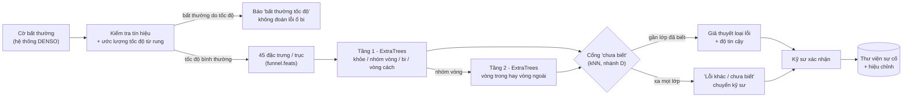
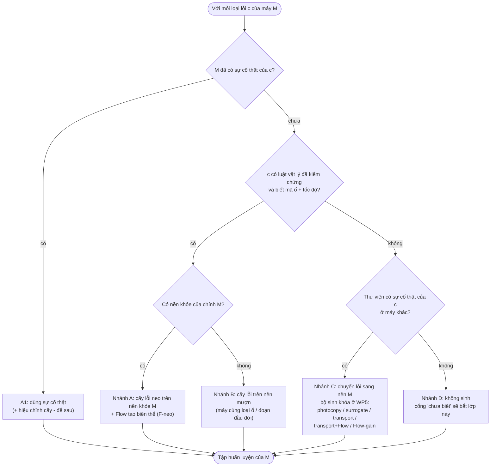
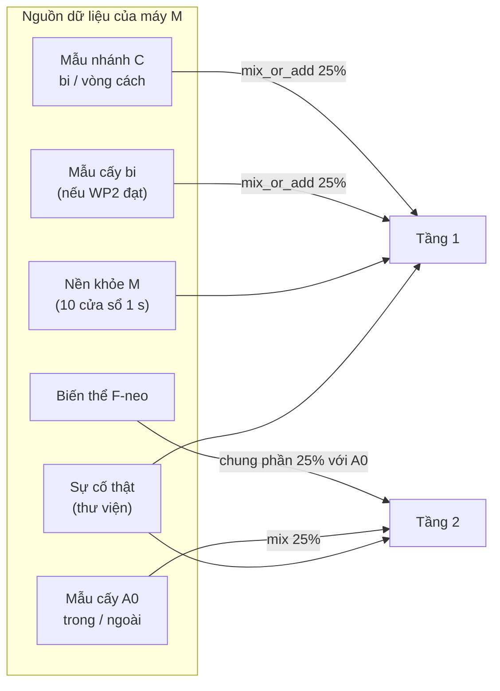
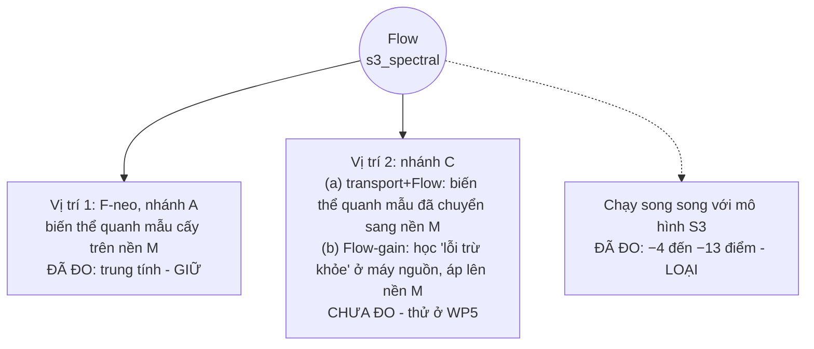
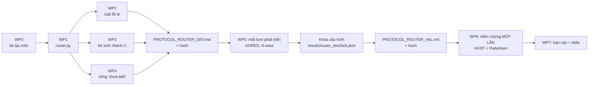

# PLAN: AnchorSpec pipeline v3, bộ định tuyến sinh dữ liệu lỗi (giữ Flow)

> **Dành cho agent code.** Đọc hết mục 0–3 trước khi viết dòng code nào. Mọi đường dẫn tính từ gốc repo. Ngày lập: 12/11/2026.
> Sơ đồ viết bằng Mermaid; xem trên GitHub hoặc VS Code (Markdown Preview) để hiện hình. Sơ đồ chính có kèm bản chữ.

---

## 0. Luật bắt buộc

| # | Luật | Vì sao |
|---|---|---|
| 1 | **Không bịa kết quả.** Mọi con số trong báo cáo phải đọc từ file kết quả do script sinh ra. | Dự án đã từng tin vào kết quả ảo |
| 2 | **Không sửa các file đã khóa:** `anchorspec/m_hier.py`, `m_dev.py`, `pb_common.py`, `injection.py`, `funnel.py`, `s3_spectral.py`, `measured_transport.py`, `fusion.py`. Chỉ import. Cần biến thể thì viết module mới. | Các lần chạy đã khóa phải tái tạo được |
| 3 | **Không chỉnh gì dựa trên HUST hoặc Paderborn.** Mọi lựa chọn (tham số, ngưỡng, chọn bộ sinh) làm trên **UORED**. HUST và Paderborn chỉ chạy **một lần**, sau khi đã khóa. | Hai bộ này đã được nhìn nhiều lần |
| 4 | **Giao thức trước, chạy sau.** Mỗi thí nghiệm có `anchorspec/PROTOCOL_*.md` ghi tiêu chí đạt. Script ghi `results/<tên>/prerun.sha256` chứa hash của giao thức và code trước khi chạy; nếu hash đổi giữa chừng thì dừng (xem mẫu ở `pb_hier.py`, hàm `main`). | Chống chỉnh sau khi thấy kết quả |
| 5 | **Mọi bộ sinh đều có đối chứng photocopy:** cùng số dòng, cùng trọng số, nhưng là bản chép y nguyên cửa sổ thật. | Tách hiệu ứng trọng số khỏi giá trị thật của mẫu sinh |
| 6 | **Báo đủ mọi nhánh**, kể cả nhánh thua. | |
| 7 | **Không commit dữ liệu.** `data/` bị Git bỏ qua. **Không viết thông tin dữ liệu DENSO** (tên file, chế độ chạy, định dạng cảm biến) vào bất kỳ file `.py` hay `.md` nào ngoài `data/denso/`: repo đang công khai và `.gitignore` cho phép mọi file `.md`. | Bảo mật |
| 8 | Commit hoặc push chỉ khi người dùng yêu cầu. | |

**Môi trường:**
```bash
cd anchorspec
PY=/home/host/miniconda3/envs/anchorspec/bin/python
export OMP_NUM_THREADS=1 OPENBLAS_NUM_THREADS=1 MKL_NUM_THREADS=1   # bắt buộc khi chạy song song
```
Máy có 16 nhân: dùng `ProcessPoolExecutor(14)`, **chạy một thí nghiệm mỗi lúc** (chạy hai cái cùng lúc không nhanh hơn).

---

## 1. Trạng thái hiện tại (mốc phải tái tạo được)

**Kiến trúc đã chốt: hai tầng + cấy lỗi neo** (`m_hier.two_stage`, `m_hier.scores_for`):
- **Tầng 1:** ExtraTrees 500 cây (`m_dev.Model('et500', seed)`), chỉ học từ sự cố thật. Các lớp: khỏe (0), nhóm vòng (1, gộp trong + ngoài, trọng số × 0,5), bi (3), vòng cách (4).
- **Tầng 2:** ExtraTrees 500 cây, chỉ phân biệt vòng trong (1) và vòng ngoài (2). Học từ sự cố thật cộng 150 mẫu cấy A0 mỗi lớp, trộn 25% trọng số (`m_dev.mix(base, inj, .25)`).
- **Gộp:** P(trong) = P1(nhóm vòng) × P2(trong); P(ngoài) = P1(nhóm vòng) × P2(ngoài). Sau đó `event_experts.causal_average`, rồi `diagnostic_experts.fault_labels` (chỉ chọn loại lỗi).

**Số phải tái tạo** (8 seed: 11, 29, 47, 101, 202, 303, 404, 505; macro theo lớp, mỗi ổ lấy trung bình trên các seed):

| Bộ | Mức sự cố | `real` (RF 500) | `hier` |
|---|---|---|---|
| Paderborn (`results/pb_hier`) | 1 / 2 / 4 | 44,8 / 45,7 / 61,0 | 65,8 / 61,4 / 76,3 |
| HUST (`results/hier_hust` + `hier_hust_seeds`) | 1 / 2 / 3 | 55,9 / 57,5 / 56,0 | 62,2 / 64,6 / 65,9 |

**Đã biết về Flow** (`results/fusion`, `results/compare4`):
- F-neo (Flow sinh biến thể quanh mẫu cấy, ở tầng 2): không làm hại (±0,7 điểm), đóng góp ≈ 0.
- Chạy song song với mô hình S3: kém đi 4–13 điểm, **đã loại**.
- Thật + Flow theo công thức cũ: không tiết kiệm được sự cố nào.

**Lỗ hổng hiện tại:** khi không có sự cố thật của một lớp (ví dụ bi), lớp đó được 0%, vì không có luật vật lý cho bi.

---

## 2. Thiết kế pipeline v3

### 2.1. Luồng chạy khi có cảnh báo



### 2.2. Lúc khởi tạo một máy: bộ định tuyến chọn cách tạo dữ liệu cho từng loại lỗi



**Bản chữ (nếu không xem được Mermaid):**
```text
loại lỗi c, máy M:
  M có sự cố thật của c          -> A1  dùng thật
  c có luật + mã ổ + tốc độ:
      có nền khỏe của M          -> A   cấy neo thuần (+ F-neo)
      không có nền khỏe của M    -> B   cấy trên nền mượn
  c không có luật:
      thư viện có sự cố c        -> C   chuyển lỗi sang nền M (bộ sinh khóa ở WP5)
      không có gì                -> D   không sinh, cổng "chưa biết"
```

**Luật vật lý:**

| Loại lỗi | Luật | Trạng thái |
|---|---|---|
| Vòng trong | Xung theo nhịp BPFI, điều biến theo vòng quay (`injection.component('inner')`) | Đã kiểm chứng |
| Vòng ngoài | Xung theo nhịp BPFO (`'outer'`) | Đã kiểm chứng |
| Bi | Xung theo nhịp 2 × BSF, điều biến FTF, chạm chập chờn | **Viết mới ở WP2** |
| Vòng cách | `'cage'` có trong code | Chưa kiểm chứng; coi là "không luật" trong v3 |
| Thiếu dầu, dị vật | Có trong code | Không có dữ liệu kiểm chứng; không dùng |

### 2.3. Dữ liệu sinh đi vào tầng nào



### 2.4. Vị trí của Flow



---

## 3. Quy trình thí nghiệm



**Bảng tách dữ liệu (không được vi phạm):**

| Bộ | Vai trò | Lớp lỗi | Số ổ | Được chỉnh tham số? |
|---|---|---|---|---|
| UORED | Phát triển | trong 1–5, ngoài 6–10, bi 11–15, vòng cách 16–20 | 20 | **Có** |
| HUST | Kiểm chứng (một lần) | trong, ngoài, bi (6204 không có bi) | 14 | **Không** |
| Paderborn | Kiểm chứng không làm hại (một lần) | trong, ngoài | 11 | **Không** |
| XJTU | Không dùng ở v3 | — | — | — |

---

## 4. Gói việc chi tiết

### WP0. Tái tạo mốc (khoảng 15 phút)
- Chạy `$PY fusion.py --smoke`. Phải in `hier matches ... True` cho cả PB và HUST.
- Viết `router_common.py` gồm:
  - Hàm nạp UORED cho cả 4 lớp:
    - `uored_item(i) = s3_uored.item(i)` (có `base`, `severe`, `developing`, `donor`, `donor_w`, `fr`, `label`).
    - Nền khỏe dạng sóng lấy từ `m_dev.healthy_waves('uored', i)`.
    - Bọc bằng `functools.lru_cache`.
  - Hàm chọn thư viện: với mỗi lớp c ∈ {1, 2, 3, 4}, lấy m ổ khác ổ đích theo `np.random.default_rng([seed, c, 20261112]).permutation(sorted(pool))[:m]`.
  - `mix_or_add(base, rows, beta)`: giống `m_dev.mix`, **nhưng nếu lớp c chưa có mẫu thật** thì thêm mẫu sinh với tổng khối lượng bằng `scale = len(x)/(1+C)`, tức một phần lớp. **Không dùng `m_dev.mix` cho lớp chưa có mẫu thật**, vì nó bỏ qua lớp đó.
- **Kiểm tra:** `two_stage` trong `fusion.py` với `base1 = base2 = base` phải ra đúng `hier` đã lưu ở `results/pb_hier/tasks/KI04_11_m1.json`.

### WP1. `router.py` (khoảng 1 giờ)
```python
@dataclass
class MachineInfo:
    orders: dict            # bpfo, bpfi, ftf, bsf (bậc so với tốc độ trục)
    fr: float               # Hz, đo hoặc ước lượng
    healthy_w: np.ndarray | None   # (n, 4000) nền khỏe của chính máy; None nếu không có
    borrowed_w: np.ndarray | None  # nền mượn (nhánh B)

RULES_VALIDATED = {1: 'inner', 2: 'outer'}   # thêm 3: 'ball' nếu WP2 đạt

def route(c, machine, library_events_of_c, own_events_of_c) -> str:
    """Trả 'A1', 'A', 'B', 'C' hoặc 'D' theo sơ đồ 2.2. Thuần logic, không chạm dữ liệu."""

def build_training(machine, library, config, seed) -> tuple[base1, base2, inj_tier2, log]:
    """Dựng dữ liệu cho tầng 1 và tầng 2 theo route() từng lớp; log ghi nhánh và số dòng mỗi lớp."""
```
- **BSF:** `bsf = D/(2*d) * (1 - (d/D*cos(phi))**2)`, bậc so với trục. Thêm hàm `orders_full(bearing)` trả về `bearing.orders() | {'bsf': ...}`. Không sửa `bearing.py`.
- **Kiểm thử đơn vị** (`test_router.py`):
  - Bảng chân trị đủ 5 nhánh.
  - Khi chỉ bật nhánh A cho trong/ngoài, `build_training` phải cho đúng `base` và `inj` như `fusion.pb_job`.

### WP2. Luật vật lý cho lỗi bi (khoảng 1,5 giờ), file `ball_rule.py`

```python
def ball_component(n, fs, fr, orders, prior, rng):
    h, meta = injection._pulse(rng, prior, fs)            # cùng mô hình cộng hưởng
    slip = injection._draw(rng, prior.slip)
    rate = 2 * orders['bsf'] * fr * (1 - slip)            # mỗi vòng tự xoay, vết nứt chạm hai vòng lăn
    ftf = orders['ftf'] * fr * (1 - slip)
    count = int(n / fs * rate) + 2
    pos = (np.arange(count) + rng.uniform() + rng.normal(0, jitter, count)) / rate
    p_contact = rng.uniform(.3, .9)                       # chạm chập chờn do trục xoay của bi đổi
    hit = rng.random(count) < p_contact
    amps = rng.lognormal(0, scatter, count) * hit * (1 + depth * np.cos(2*np.pi*ftf*pos + rng.uniform(0, 2*np.pi)))
    return injection._train(pos * fs, np.maximum(amps, 0), h, n), meta
```
- `jitter`, `scatter` lấy theo `prior` như `injection.component`. `depth` rút trong (0,3; 1).
- `inject_ball(background, ...)`: chép logic `injection.inject`, gồm mô phỏng ở `FS_SIM`, `fault_path`, chuẩn hóa `amp_rel`, `output_stage`; chỉ thay `component` bằng `ball_component`.
- `injected_ball(base, n, fr, orders, sensor, fs, rng)`: chép vòng lặp của `funnel.injected`, có `quality_gate`.
- **Hình học:**
  - UORED: `e8_uored.BEARING` (8 bi; 6,77; 28,50).
  - HUST: `x_core.GEO[size] = (d, D, ball, nb)` cho ra `Bearing(nb, ball, (d+D)/2, 0)`.
  - Paderborn: không có lớp bi.
- **Chỉ được chỉnh trên UORED:** khoảng `p_contact` và `depth`. Tối đa 4 cấu hình, chọn bằng tiêu chí ở WP5.

### WP3. Bộ sinh cho nhánh C (khoảng 2 giờ), file `branch_c.py`

Mỗi bộ sinh nhận `(events_c, target_healthy_w, machine_t, src_info, seed)` và trả về `(rows_feats, n_rows)`. Mỗi sự cố nguồn cho **20 dòng**. Mọi bộ sinh dùng cùng số dòng và cùng phần trọng số 25% (`mix_or_add`).

| Mã | Cách làm | Đặc trưng tính theo |
|---|---|---|
| `c_none` | Không sinh (= `hier`) | — |
| `c_copy` | Photocopy: 20 dòng = cửa sổ thật của sự cố nguồn, lặp vòng | máy nguồn |
| `c_surr` | `generator_benchmark/generators.py: constrained_surrogate(x, rng)` trên cửa sổ lỗi nguồn (nạp bằng importlib như `u_natural.prepare_surrogate`) | máy nguồn |
| `c_trans` | `measured_transport.generate(fault, src_healthy, tgt_healthy, f_src, f_tgt, rng, count=20)['transport']`, với **f = tần số đặc trưng của lớp** (bi: 2·BSF·fr; vòng cách: FTF·fr) thay cho fr, để co giãn đúng nhịp lỗi giữa các cỡ ổ | máy đích |
| `c_trans_flow` | 10 dòng `c_trans` + 10 biến thể Flow quanh chính 10 dòng đó (xem bên dưới) | máy đích |
| `c_flowgain` | Flow học "lỗi trừ khỏe" của máy nguồn, áp lên nền khỏe máy đích (xem bên dưới) | máy đích |

**`c_trans_flow`** (giống F-neo):
- Huấn luyện `SpectralResidual` + `ResidualGenerator('flow', seed)` trên cửa sổ lỗi thật của **toàn thư viện**, giống `fusion.run_arms`.
- Điều kiện cho mẫu neo: `codec.condition_scaler.transform([describe(anchor), onehot(c), fr_t, log_rms_t])`.
- Sinh phần dư rồi `codec.apply(anchor, residual*scale, .5, |anchor|.max)`.

**`c_flowgain`:**
- Mỗi sự cố nguồn e: `r_e = describe(fault_w_e) − mean(describe(src_healthy_w_e))` (24 dải log biên độ), cho ra 10 vector.
- **Dịch tần số:** nội suy `r_e` từ tâm dải `centers` sang `centers / k`, với `k = f_c,tgt / f_c,src`.
- Huấn luyện `ResidualGenerator('flow', seed)` trên `z = r/scale`, điều kiện = `[onehot(c), fr_src]` đã chuẩn hóa.
- Sinh 20 vector cho máy đích, rồi áp lên cửa sổ khỏe của máy đích: dùng hàm áp gain giống `SpectralResidual.apply` với độ mạnh 1,0, kẹp `±ln 2`.
- Viết hàm áp gain riêng trong `branch_c.py`; không sửa `s3_spectral.py`.

### WP4. Cổng "chưa biết" (khoảng 1 giờ), file `openset.py`
- **Không gian:** đầu ra `StandardScaler` của tầng 1 (fit trên tập huấn luyện tầng 1), sau `canonicalize`.
- **Điểm lạ:** `s(x)` = khoảng cách trung bình tới k = 5 hàng gần nhất trong tập huấn luyện tầng 1 (gồm cả mẫu sinh).
- **Ngưỡng:** `τ = κ · q95` của khoảng cách "bỏ một sự cố ra" của các sự cố thật trong thư viện tới phần còn lại.
- **Quy tắc:** cửa sổ có `s(x) > τ` thì gán −1 ("chưa biết"), áp dụng sau `causal_average` trên chuỗi điểm lạ (trung bình nhân quả của `s`).
- **Chỉ chỉnh κ trên UORED**, lưới {1,0; 1,25; 1,5; 2,0; 3,0}. Chọn κ nhỏ nhất sao cho tỉ lệ lớp đã biết bị báo "chưa biết" ≤ 10%.

### WP5. Một lượt phát triển trên UORED (máy chạy khoảng 15–20 phút)

**Giao thức** `PROTOCOL_ROUTER_DEV.md`, viết và băm **trước khi chạy**. Script `router_dev.py`.

**Lượt chạy:** 20 ổ đích × 8 seed × kịch bản. Ổ đích kiểm tra trên `severe` (báo thêm `developing`).

| Kịch bản | Thư viện | Nhánh so sánh |
|---|---|---|
| **S1:** có m sự cố mỗi lớp ở máy khác, m ∈ {1, 2}; bi và vòng cách coi là "không luật" | 4 lớp | `hier` (= `c_none`), `c_copy`, `c_surr`, `c_trans`, `c_trans_flow`, `c_flowgain`, `real` (RF 500) |
| **S2:** không có sự cố bi nào; có m = 2 sự cố cho trong / ngoài / vòng cách | 3 lớp | `hier_noball`, `+ball_rule` (WP2, tối đa 4 cấu hình), `+openset` (WP4, các κ) |

**Đầu ra:** `results/router_dev/tasks/*.json` (dự đoán từng cửa sổ của mọi nhánh) và `summary.md`.

**Quy tắc khóa** (ghi sẵn trong giao thức):

| Quyết định | Quy tắc |
|---|---|
| **Luật bi** | Đạt nếu recall bi ≥ 30% với cận dưới CI 95% > 0, và macro trong / ngoài giảm ≤ 3 điểm. Nếu nhiều cấu hình đạt, chọn cấu hình có recall bi cao nhất |
| **Bộ sinh nhánh C** | Ứng viên phải hơn `c_copy` về recall lớp không luật, trung bình hai mức m. Chọn ứng viên có recall lớp không luật cao nhất, với điều kiện macro ≥ `hier` − 1. **Nếu một bộ có Flow kém bộ tốt nhất không quá 1 điểm, chọn bộ có Flow.** Nếu không ứng viên nào hơn `c_copy`, nhánh C = `c_none` |
| **κ cổng lạ** | κ nhỏ nhất có tỉ lệ báo nhầm "chưa biết" trên lớp đã biết ≤ 10% |

Ghi quyết định vào `results/router_dev/lock.json`, gồm `ball_rule` (cấu hình hoặc null), `branch_c`, `kappa`, `fneo: true`.

### WP6. Kiểm chứng một lần (máy chạy khoảng 15 phút)

**Giao thức** `PROTOCOL_ROUTER_VAL.md`, viết sau khi khóa và trước khi chạy. Đọc cấu hình từ `lock.json`; **không chọn lại gì**.

| Bộ | Kịch bản | Nhánh |
|---|---|---|
| HUST, 8 seed, m = 1, 2, 3 | S1 (đủ lớp) | `hier`, `router`, `router_noflow` |
| HUST, 8 seed | S2 (bỏ hết sự cố bi) | `hier_noball`, `router` (luật bi hoặc cổng lạ) |
| Paderborn, 8 seed, m = 1, 2, 4 | S1 | `hier`, `router`, `router_noflow` |

`router_noflow` là router đã khóa nhưng tắt F-neo, và thay bộ sinh nhánh C có Flow (nếu được khóa) bằng bộ không có Flow tốt nhất ở WP5. Đây là phép đo đóng góp riêng của Flow.

**Tiêu chí đạt:**
1. **Không làm hại:** ở mọi mức của cả hai bộ, macro trong / ngoài của `router − hier` ≥ −1 điểm, và cận dưới CI 95% > −3.
2. **S1, lớp bi (HUST):** recall bi của `router − hier` ≥ +5 với CI > 0, **hoặc** macro 3 lớp ≥ +2 với CI > 0.
3. **S2:** recall bi ≥ 30% với CI > 0 (nếu khóa luật bi); **hoặc** ≥ 50% cửa sổ bi được báo "chưa biết" và ≤ 10% báo nhầm (nếu chỉ có cổng lạ).
4. **Flow:** chỉ được nói "Flow có đóng góp" nếu `router − router_noflow` ≥ +2 với CI > 0 ở ít nhất một mức, và không mức nào < −1.

### WP7. Báo cáo và slide (khoảng 1 giờ)
- `anchorspec/KET_QUA_ROUTER_<ngày>.md`: bảng đủ mọi nhánh, đạt / không đạt theo từng tiêu chí, giới hạn.
- Cập nhật `final_slides_20261112.py`: slide 3 (sơ đồ v3), slide 6 (thêm cột HUST lớp bi), slide 8 (thêm dòng về Flow). Phần DENSO ở `data/denso/denso_speed_slide.py`; chạy lại sau.

### WP8. Móc cho DENSO (chỉ chuẩn bị, chưa chạy)
- `router.MachineInfo` nhận `fr` từ bộ ước lượng tốc độ (code trong `data/denso/`, không commit).
- Cần mã ổ bi và tần số lấy mẫu từ DENSO trước khi cấu hình nhánh A cho máy thật.

---

## 5. Lịch và ngân sách thời gian chạy

```mermaid
gantt
    dateFormat  HH:mm
    axisFormat  %H:%M
    title Ngân sách thời gian (giờ tương đối)
    section Code
    WP0 tái tạo mốc            :w0, 00:00, 15m
    WP1 router.py              :w1, after w0, 60m
    WP2 luật bi                :w2, after w1, 90m
    WP3 nhánh C                :w3, after w1, 120m
    WP4 cổng lạ                :w4, after w3, 60m
    section Máy chạy
    WP5 phát triển UORED       :w5, after w4, 20m
    Khóa + giao thức val       :w5b, after w5, 20m
    WP6 kiểm chứng             :w6, after w5b, 15m
    section Báo cáo
    WP7 báo cáo + slide        :w7, after w6, 60m
```



Khoảng 6–8 giờ, phần lớn là viết code. Máy chạy tổng cộng khoảng 35 phút.

**Mẹo tăng tốc:**
- Dùng `pool.imap_unordered` và ghi từng task ngay khi xong (`pool.map` ghi theo thứ tự nên chậm hiện kết quả).
- `lru_cache` cho mọi hàm nạp ổ.
- Một Flow mỗi task, dùng chung cho `c_trans_flow` và F-neo.
- **Tạo thư mục kết quả trước khi chuyển hướng log** vào đó: nếu thư mục chưa có thì lệnh chuyển hướng hỏng, và tiến trình Python chết vì gãy đường ống khi in.

---

## 6. Những lỗi đã gặp, đừng lặp lại

| Lỗi | Cách tránh |
|---|---|
| Tin "thêm mẫu sinh tăng điểm" mà không có photocopy | Luôn có `c_copy`; mẫu sinh phải hơn photocopy |
| RF 50 cây dao động 15 điểm theo seed | Dùng ExtraTrees hoặc RF 500 cây; luôn 8 seed |
| Cách chấm có lớp "khỏe" khuếch đại hiệu ứng trọng số | Chấm "chỉ chọn loại lỗi" (`fault_labels`) |
| Macro 3 lớp tụt vì một lớp không có mẫu, rồi tưởng phương pháp hỏng | Luôn báo **recall từng lớp** bên cạnh macro |
| Chỉnh trên tập kiểm chứng | Mọi lựa chọn chỉ trên UORED; HUST và Paderborn chạy một lần |
| `json.dumps` lỗi với `numpy.bool_` | Bọc `bool()` / `float()` trước khi ghi |
| `m_dev.mix` bỏ qua lớp chưa có mẫu thật | Dùng `mix_or_add` |
| Ước lượng tần số bắt nhầm nửa tần số (lỗi quãng tám) | Khi tìm nhịp, dùng họ hài 1–2–3 |

---

## 7. Bảng quyết định cuối

| Kết quả WP6 | Pipeline v3 công bố | Câu được nói về Flow |
|---|---|---|
| Tiêu chí 1 không đạt | Giữ kiến trúc chốt (`hier`); router chỉ là thăm dò | "Flow ở F-neo, trung tính" |
| 1 đạt, 2 hoặc 3 đạt, Flow-C được khóa và tiêu chí 4 đạt | Router đầy đủ | "Flow chuyển lỗi sang máy mới, đóng góp +X điểm (CI ...)" |
| 1 đạt, 2 hoặc 3 đạt, tiêu chí 4 không đạt | Router đầy đủ | "Flow được tích hợp ở F-neo và nhánh C; đóng góp riêng chưa đo được" |
| 1 đạt, 2 và 3 không đạt | Router chỉ dùng A (+ F-neo) | "Flow trung tính" |

**Không bao giờ được nói:** "Flow giúp tiết kiệm dữ liệu lỗi", trừ khi tiêu chí 4 đạt. Toàn bộ phần tiết kiệm hiện có đến từ cấy lỗi vật lý.

---

## 8. Sản phẩm phải nộp

```text
anchorspec/
  router_common.py  router.py  ball_rule.py  branch_c.py  openset.py
  router_dev.py  router_val.py  test_router.py
  PROTOCOL_ROUTER_DEV.md  PROTOCOL_ROUTER_VAL.md
  KET_QUA_ROUTER_<ngày>.md
  results/router_dev/{prerun.sha256, tasks/, summary.md, lock.json}
  results/router_val/{prerun.sha256, tasks/, summary.md}
```

**Kiểm tra cuối:**
- `$PY -m pytest test_router.py -q` qua.
- `fusion.py --smoke` vẫn in `True`.
- Không file nào trong `git status` chứa thông tin DENSO.
