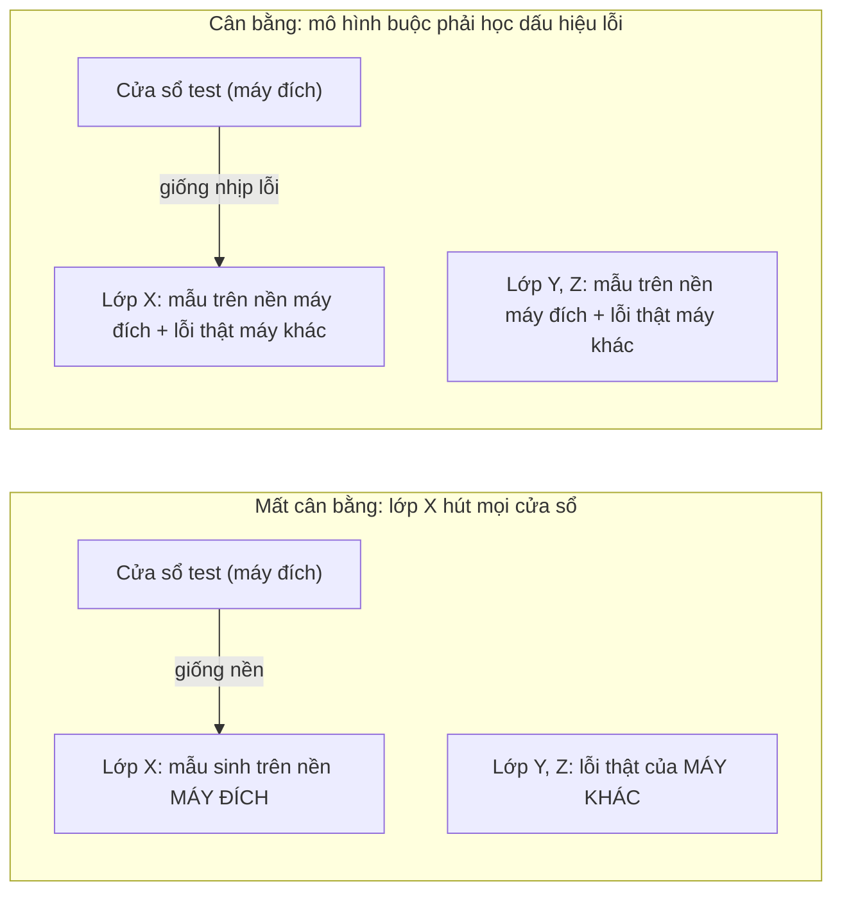
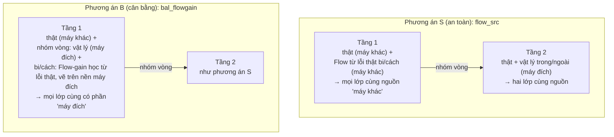
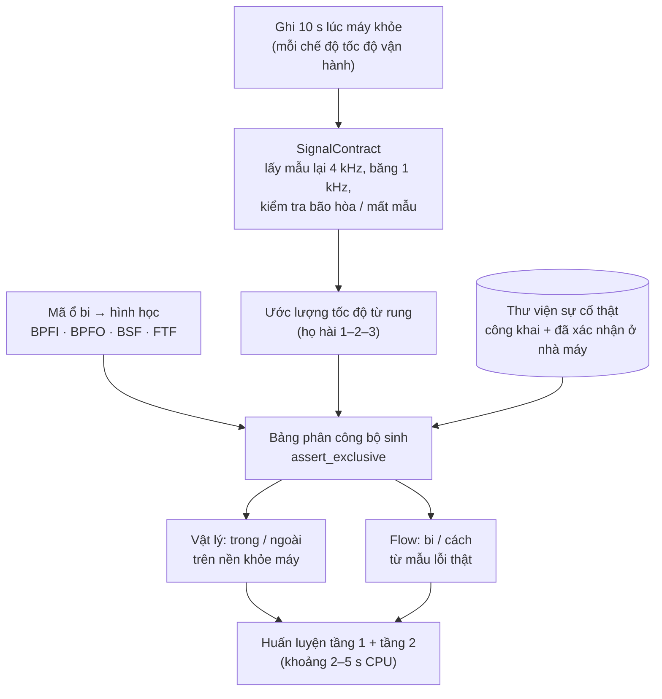
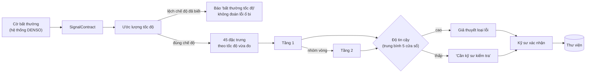
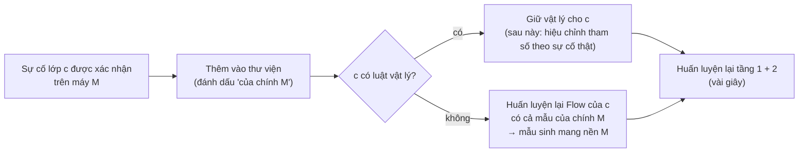
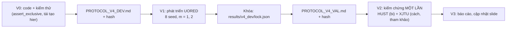

# PLAN v4: phối hợp sinh vật lý và sinh bằng Flow, mỗi lỗi một bộ sinh

> Dành cho agent code. Ngày lập: 12/11/2026. Kế thừa luật bắt buộc ở `PLAN.md` mục 0 (không bịa số, không sửa file đã khóa, chỉ chỉnh trên UORED, giao thức + hash trước khi chạy, có photocopy đối chứng, không ghi thông tin DENSO vào file có thể commit).
> PLAN v3 (`PLAN.md`) đã chạy xong, không qua kiểm chứng. Kết quả ở `anchorspec/KET_QUA_ROUTER_20261112.md`. Code v3 (`router_common.py`, `branch_c.py`, `router.py`…) được tái dùng.

---

## 1. Ý tưởng và chỗ điều chỉnh

### 1.1. Ý tưởng gốc (người dùng)
- Lỗi có quy tắc vật lý thì **chỉ** sinh bằng vật lý.
- Lỗi không tái tạo được bằng vật lý (bi, vòng cách) thì **chỉ** sinh bằng **Flow**, học **từ mẫu lỗi thật**.
- **Không lỗi nào được sinh bởi hai phương pháp cùng lúc**, và mẫu sinh của lỗi này không được làm hỏng kết quả của lỗi khác.

### 1.2. Phát hiện từ v1–v3: "hiệu ứng nguồn gốc"

| Lần thử | Mẫu sinh mang nền | Lớp cạnh tranh mang nền | Kết quả |
|---|---|---|---|
| Cấy phẳng trong / ngoài (M-Dev) | máy đích | vòng cách: máy khác | vòng cách 16–50% → 0–14% |
| Luật bi ở tầng 1 (v3) | máy đích | trong / ngoài / cách: máy khác | trong + ngoài −47 điểm |
| Flow-gain bi / cách ở tầng 1 (v3) | máy đích | trong / ngoài: máy khác | trong −15, ngoài −23 điểm |
| **Tầng 2: cấy trong và ngoài** | **máy đích** | **máy đích** (lớp kia cũng cấy) | **+6 đến +21 điểm** |

**Giả thuyết:** cửa sổ cần chẩn đoán luôn đến từ máy đích. Nếu chỉ một lớp có mẫu mang nền máy đích, mô hình học mẹo "giống máy này" thay vì học dấu hiệu lỗi, và lớp đó hút mọi cửa sổ.

**Nguyên tắc cân bằng nguồn gốc:** trong **mỗi** quyết định (mỗi mô hình), mọi lớp cạnh tranh phải có cùng tỉ lệ "mẫu mang nền máy đích" và "mẫu từ máy khác".



### 1.3. Điều chỉnh đề xuất cho ý tưởng gốc

| Ý gốc | Điều chỉnh | Lý do |
|---|---|---|
| Flow sinh từ mẫu lỗi thật, không đụng dữ liệu sạch | **Giữ làm phương án chính (`flow_src`)**, nhưng Flow học biến thiên **giữa các máy cùng loại lỗi**, không chỉ giữa các đoạn của cùng một sự cố | Flow gốc chỉ học "đoạn này khác đoạn kia của cùng ổ": mẫu sinh cách gốc 1,42, gần như photocopy. Học giữa các máy mới có thông tin hữu ích cho máy mới |
| (thêm) | **Phương án thứ hai (`bal_flowgain`):** Flow vẫn học từ mẫu lỗi thật (phần lỗi so với khỏe), nhưng "vẽ" lên nền máy đích, **và** lớp vòng ở tầng 1 cũng nhận mẫu vật lý trên nền máy đích, để cân bằng nguồn gốc | Đây là cách duy nhất mẫu bi / cách mang được đặc điểm của máy mới mà không hút lớp khác. Dữ liệu sạch chỉ là "tấm nền", nội dung lỗi vẫn học từ lỗi thật |
| Mỗi lỗi một phương pháp | **Bỏ F-neo** (Flow quanh mẫu cấy trong / ngoài) | F-neo cho trong / ngoài hai nguồn sinh. Đo được ≈ 0 điểm, nên bỏ không mất gì |
| Vòng cách: luật vật lý có trong code | **Xếp vòng cách vào nhóm Flow** | Luật vòng cách chưa kiểm chứng. Chỉ luật đã kiểm chứng mới được dùng |
| Lớp không có mẫu lỗi nào | **Không sinh** (Flow cần mẫu gốc); chuyển kỹ sư khi độ tin cậy thấp | Cổng kNN v3 thất bại (bắt được 0,7% bi) |

### 1.4. Bảng phân công: mỗi lỗi đúng một bộ sinh

| Loại lỗi | Bộ sinh | Học từ | Vào quyết định nào |
|---|---|---|---|
| Vòng trong | **Vật lý** (BPFI) | Hình học ổ + tốc độ, trên nền khỏe máy đích | Tầng 2 (trong / ngoài); ở phương án cân bằng, thêm vào lớp "nhóm vòng" ở tầng 1 |
| Vòng ngoài | **Vật lý** (BPFO) | như trên | như trên |
| Bi | **Flow** | Mẫu lỗi bi thật (thư viện; sau này cả sự cố của chính máy) | Tầng 1 |
| Vòng cách | **Flow** | Mẫu lỗi vòng cách thật | Tầng 1 |
| Thiếu dầu, dị vật, lỗi chưa biết | **Không sinh** | — | Độ tin cậy thấp thì chuyển kỹ sư |

**Kiểm tra bắt buộc trong code:** hàm `assert_exclusive(assignment)` báo lỗi nếu một lớp có hơn một bộ sinh.

---

## 2. Kiến trúc huấn luyện

### 2.1. Hai phương án sẽ so sánh



Bản chữ:
```text
Phương án S  tầng 1: [khỏe thật] [vòng: thật] [bi: thật + Flow(lỗi bi thật)] [cách: thật + Flow(lỗi cách thật)]
             tầng 2: [trong: thật + vật lý] [ngoài: thật + vật lý]
Phương án B  tầng 1: [khỏe thật] [vòng: thật + vật lý trên nền máy đích]
                     [bi: thật + Flow-gain trên nền máy đích] [cách: thật + Flow-gain trên nền máy đích]
             tầng 2: như S
Mẫu sinh của mỗi lớp chiếm đúng 25% khối lượng lớp đó; các lớp trong cùng một quyết định có cùng tỉ lệ.
```

### 2.2. Flow cho lớp không có luật

**`flow_src`** (ý gốc, phương án chính):
- Mỗi lớp c (bi, cách) có **một Flow riêng**, chỉ huấn luyện trên mẫu lỗi thật của lớp c. Không trộn lớp, để mẫu sinh không mang dấu hiệu của lớp khác.
- **Cặp học:**
  - `within`: hai đoạn của cùng một sự cố (như S3 cũ).
  - `class`: hai đoạn bất kỳ của **cùng loại lỗi**, kể cả khác máy. Cần ít nhất 2 sự cố; nếu chỉ có 1 thì tự quay về `within`.
- **Sinh:** neo vào chính đoạn lỗi thật, độ mạnh s ∈ {0,5; 1,0}. Đặc trưng tính theo tốc độ và hình học của **máy nguồn** (như dòng thật).
- **Dò trên UORED đúng 4 cấu hình:** {within, class} × {0,5; 1,0}.

**`bal_flowgain`** (phương án cân bằng):
- Flow riêng cho mỗi lớp c, học phần **"lỗi trừ khỏe"** (24 dải log biên độ) từ các sự cố thật của c, co giãn theo tần số đặc trưng (bi: 2·BSF·fr; cách: FTF·fr), rồi áp lên cửa sổ khỏe của máy đích (code: `branch_c._flowgain`).
- Tầng 1 thêm mẫu vật lý trong và ngoài (cùng bể với tầng 2), gắn nhãn "nhóm vòng", 25%.
- **Đối chứng `bal_phys`:** chỉ thêm vật lý cho nhóm vòng ở tầng 1, không có Flow. Dùng để kiểm tra trực tiếp giả thuyết nguồn gốc.

---

## 3. Pipeline tích hợp DENSO (v4)

### 3.1. Lắp đặt một máy (ngày 0)



### 3.2. Khi có cảnh báo



### 3.3. Vòng học sau mỗi sự cố được xác nhận



**Lưu ý:** khi Flow của bi / cách học từ sự cố **của chính M**, mẫu sinh mang nền M. Theo nguyên tắc cân bằng, lúc đó tầng 1 phải dùng phương án B, tức nhóm vòng cũng nhận mẫu vật lý trên nền M. Đây là lý do phải kiểm chứng phương án B ngay bây giờ, dù phương án S an toàn hơn.

**Dữ liệu nội bộ hiện có** (chưa có nhãn lỗi; chi tiết trong `data/denso/`, không commit) dùng được cho:
- kiểm tra SignalContract và cổng tốc độ;
- đo báo nhầm khi máy vẫn khỏe.

Còn thiếu: mã ổ bi và tần số lấy mẫu của cảm biến.

---

## 4. Thí nghiệm

### 4.1. Quy trình



### 4.2. V1: phát triển trên UORED

20 ổ đích × 8 seed × m ∈ {1, 2} = 320 lượt. Thư viện gồm đủ 4 lớp, mỗi lớp m sự cố ở ổ khác. Tầng 2 luôn là vật lý cho trong / ngoài, **không có F-neo**.

| Nhánh | Tầng 1: nhóm vòng | Tầng 1: bi, cách | Mục đích |
|---|---|---|---|
| `hier` | thật | thật | mốc |
| `copy` | thật | thật + photocopy 20 dòng / sự cố | đối chứng trọng số |
| `flow_src_{within,class}_{05,10}` | thật | thật + Flow từ lỗi thật, 20 dòng / sự cố | ý gốc, 4 cấu hình |
| `bal_phys` | thật + vật lý (máy đích) | thật | kiểm tra giả thuyết nguồn gốc (dự đoán: bi / cách giảm) |
| `bal_flowgain` | thật + vật lý (máy đích) | thật + Flow-gain (máy đích) | phương án cân bằng |

**Chỉ số:**
- Recall từng lớp.
- **Không-luật** = trung bình recall bi và vòng cách.
- **Bảo vệ** = recall vòng trong và vòng ngoài, xét **riêng từng lớp**.
- Macro 4 lớp.

**Quy tắc khóa** (ghi sẵn trong `PROTOCOL_V4_DEV.md`; mọi giá trị lấy trung bình hai mức m):
1. **Điều kiện bảo vệ (bắt buộc):** recall vòng trong ≥ `hier` − 2 điểm **và** recall vòng ngoài ≥ `hier` − 2 điểm, xét riêng từng lớp. Thêm macro ≥ `hier` − 1.
2. **Ứng viên có ích:** đạt điều kiện 1, không-luật > `copy`, và không-luật ≥ `hier` + 2.
3. Nếu có ứng viên có ích, chọn ứng viên có không-luật cao nhất. Nếu một cấu hình `flow_src` kém ứng viên đó không quá 1 điểm, chọn `flow_src` (ưu tiên ý gốc, an toàn hơn).
4. Nếu không có ứng viên có ích, chọn cấu hình `flow_src` có không-luật cao nhất trong số các cấu hình đạt điều kiện 1, ghi là **"giữ Flow, trung tính"**. Nếu không cấu hình nào đạt điều kiện 1, Flow không vào pipeline.
5. Ghi kèm `copy_equivalent` (cùng kiến trúc, photocopy thay cho Flow) để đo đóng góp riêng của Flow ở bước kiểm chứng.

### 4.3. V2: kiểm chứng một lần

| Bộ | Kịch bản | Nhánh |
|---|---|---|
| HUST: 14 ổ, m = 1, 2, 3, 8 seed | đủ lớp trong / ngoài / bi | `hier`, `locked`, `copy_equivalent` |
| XJTU: 13 ổ, thư viện tự nhiên, 8 seed (tham khảo, chỉ 2 ổ vòng cách) | trong / ngoài / cách | `hier`, `locked`, `copy_equivalent` |

Paderborn không có bi hay vòng cách. Với chỉ chọn loại lỗi, kết quả trùng `hier`, nên chỉ chạy kiểm tra trùng khớp (không tính tiêu chí).

**Tiêu chí** (`PROTOCOL_V4_VAL.md`):
1. **Không làm hại:** ở mọi mức trên HUST, recall vòng trong và vòng ngoài của `locked − hier` đều ≥ −2 điểm, xét riêng từng lớp; macro ≥ −1.
2. **Có ích cho lớp không luật:** recall bi trên HUST của `locked − hier` ≥ +5 với CI > 0 ở ít nhất một mức.
3. **Flow có đóng góp riêng:** `locked − copy_equivalent` ≥ +2 với CI > 0 ở ít nhất một mức, và không mức nào < −1.

### 4.4. Ngân sách thời gian

| Việc | Viết code | Máy chạy |
|---|---|---|
| V0: `flow_src` theo lớp + `assert_exclusive` + nhánh `bal_*` (tái dùng `branch_c._flowgain`) | khoảng 1,5 giờ | — |
| V1: phát triển UORED, 320 lượt | — | khoảng 15–20 phút |
| V2: kiểm chứng HUST + XJTU, khoảng 440 lượt | khoảng 0,5 giờ | khoảng 15 phút |
| V3: báo cáo + slide | khoảng 0,5 giờ | — |

---

## 5. Dự đoán trước (để đọc kết quả cho đúng)

| Nhánh | Dự đoán | Cơ sở |
|---|---|---|
| `flow_src_within` | Gần `copy` | Mẫu sinh cách gốc 1,42; FUSION f_t1 so với photocopy từ −1,0 đến +0,6 |
| `flow_src_class` | Có thể nhỉnh hơn `copy` khi m = 2 | Học biến thiên giữa các máy; khi m = 1 thì trùng `within` |
| `bal_phys` | Bi / cách giảm | Nếu không giảm thì giả thuyết nguồn gốc sai |
| `bal_flowgain` | Bi / cách tăng (như Flow-gain v3: +8 đến +11), trong / ngoài **không** tụt | Nếu trong / ngoài vẫn tụt thì cân bằng nguồn gốc chưa đủ, cần thêm bước kiểm tra tần số đặc trưng (để vòng sau) |

---

## 6. Bảng quyết định cuối

| Kết quả V2 | Pipeline công bố | Câu được nói về Flow |
|---|---|---|
| Tiêu chí 1 không đạt | Giữ `hier` (kiến trúc chốt) | "Flow chưa vào pipeline; đã thử có đối chứng" |
| 1 đạt, 2 đạt, 3 đạt | v4 với cấu hình khóa | "Vật lý cho trong / ngoài, Flow cho bi / cách; Flow đóng góp +X điểm cho bi (CI …)" |
| 1 đạt, 2 đạt, 3 không đạt | v4 | "Mỗi lỗi một bộ sinh; phần tăng đến từ việc bổ sung dữ liệu, đóng góp riêng của Flow chưa tách được" |
| 1 đạt, 2 không đạt | v4 với Flow trung tính | "Flow được giữ cho lớp không có luật vật lý; chưa đo được lợi ích" |

**Không bao giờ được nói "Flow tiết kiệm dữ liệu lỗi"** nếu tiêu chí 3 không đạt.

---

## 7. Sản phẩm

```text
anchorspec/
  v4_flow.py            # flow_src theo lớp (within/class), assert_exclusive, bộ dựng tầng 1 cho S/B
  v4_dev.py  v4_val.py  test_v4.py
  PROTOCOL_V4_DEV.md  PROTOCOL_V4_VAL.md
  KET_QUA_V4_<ngày>.md
  results/v4_dev/{prerun.sha256, tasks/, summary.md, lock.json}
  results/v4_val/{prerun.sha256, tasks/, summary.md}
```

**Kiểm tra cuối:**
- `pytest test_v4.py test_router.py -q` qua.
- `hier` tái tạo đúng PB-HIER.
- `git status` không có file chứa thông tin DENSO.
