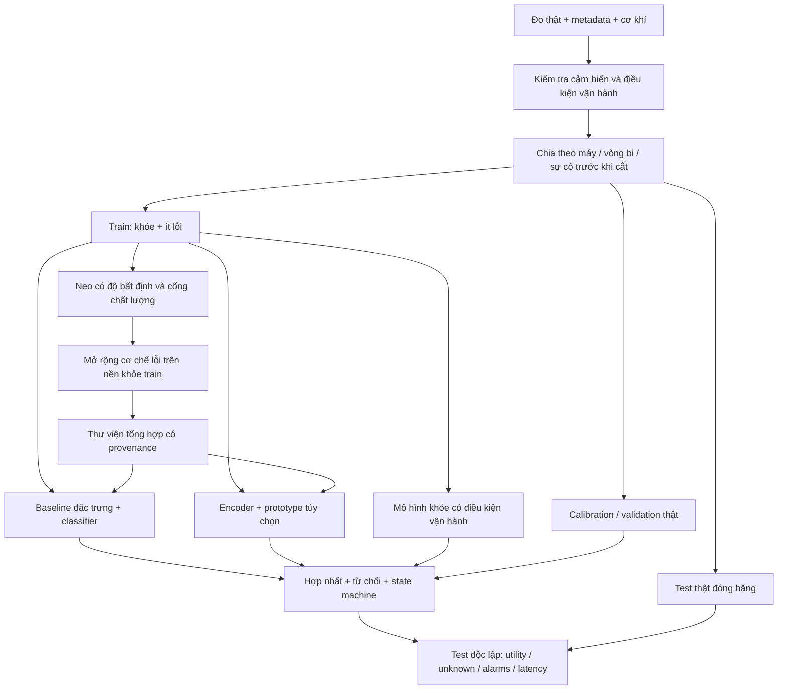
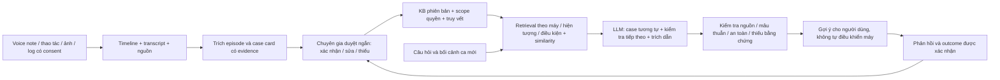

# Kế hoạch nghiên cứu DENSO: xác minh đề bài và thiết kế giải pháp có thể kiểm chứng

**Ngày đối chiếu nguồn:** 06/10/2026.  
**Tài liệu đầu vào:** `C:\Users\Ad\Downloads\DENSO\inputs\a2\A2.pdf`, 10 trang, hồ sơ “Neo và Mở rộng”, ghi ngày 01/10/2026.  
**Trạng thái cập nhật 07/10/2026:** chưa có dữ liệu DENSO. Bản generation-only và quyết định duy nhất ở mục 15 là lịch sử, không còn là quyết định toàn bộ MVP. Giao thức thực thi mới có downstream real-only/simple/surrogate/physics/DDPM, calibration riêng và final tải mới; xem mục 13 của `C:\Users\Ad\Downloads\DENSO\docs\plans\KE_HOACH_NGHIEN_CUU_DENSO_A2_12_TUAN.md` và hướng dẫn `C:\Users\Ad\Downloads\DENSO\generator_benchmark\MVP_README.md`. Chỉ dùng báo cáo artifact của run mới để kết luận utility; không suy W1/số lượng waveform thành hiệu quả detector.

**Kết quả đã kiểm chứng khi bàn giao:** release có 3.000 mẫu, 18 generator tests + 14 MVP tests và 8 CLI acceptance cases đạt; manifest 484 files khớp hash. Real-only được chọn trước final: accuracy 99,72%, recall alarm 100%, FPR trung bình 4,52%, **seed xấu nhất 6,78% > 5%**. Surrogate FPR 20,90%, DDPM FPR 6,78% dù classification accuracy DDPM 100%. **UTILITY_NOT_ESTABLISHED**, không nghiệm thu vận hành/DENSO, không retune final. Các mốc “tuần” là work packages rút gọn, không 12 tuần lịch đã qua. Kết quả gốc: `C:\Users\Ad\Downloads\DENSO\generator_benchmark\mvp_release_20261007\REPORT.md`.

**Cách đọc bản rà soát:** mỗi mục có phần **tự phản biện và quyết định**: lập luận ủng hộ, phản chứng/điểm thất bại và điều kiện nghiệm thu. Đây là kiểm tra lập luận của thiết kế, **không phải review của chuyên gia độc lập**. Mục 13 cụ thể hóa benchmark, không cho phép bỏ các ràng buộc dữ liệu/calibration ở mục 4–7. Biên bản kiểm tra mới: `C:\Users\Ad\Downloads\DENSO\docs\reviews\BIEN_BAN_RASOAT_METHOD_DENSO.md`.

> **Cảnh báo quan trọng về mã đề:** nội dung trong PDF tương ứng về chủ đề với **A1 — Predictive-Maintenance AI Despite Scarce Fault Data** trên website cuộc thi hiện tại. **A2 công bố trên website là Accumulate Master Know-How for AI to Learn**, một bài toán thu nhận tri thức chuyên gia và trợ lý LLM. Không đổi mã đăng ký chỉ dựa vào tên PDF; cần xác nhận với ban tổ chức/cố vấn. Tài liệu này có hai nhánh độc lập, không đề xuất làm cả hai cùng lúc.

## Mục lục

1. Kết luận điều hành và kiểm toán yêu cầu
2. Phản biện hồ sơ PDF
3. Nhánh P — sinh dữ liệu lỗi và phát hiện bất thường
4. Thiết kế bộ sinh vật lý có neo và độ bất định
5. Mô hình phát hiện, chẩn đoán và ra quyết định
6. Dữ liệu và chiến lược lấy mẫu
7. Giao thức đánh giá và ma trận thí nghiệm
8. Lộ trình triển khai nhánh P
9. Triển khai nhà máy, rủi ro và giá trị kinh doanh
10. Nhánh K — giải pháp cho A2 đang công bố trên website
11. Hồ sơ nộp, trình bày và danh sách xác nhận
12. Tài liệu tham khảo và mức kiểm chứng
13. Đối chiếu trực tiếp PDF, phản biện khả thi và benchmark MVP chốt lại
14. Kết luận sau rà soát hoàn chỉnh và truy tìm công bố DENSO
15. Quyết định generation-first sau thử nghiệm CWRU

---

## 1. Kết luận điều hành và kiểm toán yêu cầu

### 1.1. Đã xác minh được gì?

PDF **không phải đề bài gốc**: trang đầu tự giới thiệu là hồ sơ dự án và nội dung slide. Trang 2 diễn giải bài toán “theo slide A2 của DENSO”; trang 10 thừa nhận phần lớn nguồn chỉ được đọc qua đoạn trích. Vì vậy, đọc PDF là cần thiết nhưng không đủ để xác nhận yêu cầu chính thức.

Website là ứng dụng JavaScript: phần HTML trả về chỉ có tiêu đề cuộc thi. Đã đọc bundle công khai do chính website tải để kiểm tra thông tin chủ đề và thể lệ [S1]. Trích đoạn được lưu tại:

- `C:\Users\Ad\Downloads\DENSO\research_evidence\official_snapshots\DENSO_website_evidence.txt`: A1, A2 và một số nội dung lịch/thể lệ; có SHA-256 của bundle được đọc.
- `C:\Users\Ad\Downloads\DENSO\research_evidence\official_snapshots\DENSO_scoring_evidence.txt`: các phần tiêu chí tiếng Anh trích được.
- `C:\Users\Ad\Downloads\DENSO\inputs\a2\A2_extracted.txt`: nội dung văn bản PDF; các hình kiến trúc trang 3 và cây quyết định/lịch trang 6 cũng đã được xem trực tiếp.

**Giới hạn nguồn website:** đây là nội dung giao diện công khai, không phải bản giao nhiệm vụ riêng cho đội, không phải xác nhận từ mentor, và có thể thay đổi. Bundle có tên theo hash; nên lưu hoặc xuất trang đang hiển thị khi chốt đăng ký.

| Hạng mục | PDF nói gì? | Đối chiếu hiện tại | Cách sử dụng trong hồ sơ |
|---|---|---|---|
| Mã A2 | Sinh lỗi cho bảo trì dự đoán | Website gắn chủ đề đó với **A1** | Nêu mâu thuẫn; xin xác nhận mã |
| A1 trên website | Không phải trọng tâm PDF | Thiếu dữ liệu chế độ lỗi; cần bộ sinh bất thường, dữ liệu tăng cường, báo cáo trước/sau tăng cường | Nhánh P bám các đầu ra này |
| A2 trên website | Không tương ứng nội dung PDF | Thu nhận quy trình và lý do quyết định của chuyên gia vào KB, kết hợp LLM để tái sử dụng | Nhánh K ở mục 10 |
| Dừng máy/phế phẩm khi cố tạo lỗi | Trang 2 diễn giải slide gốc | Chưa có slide gốc để kiểm tra nguyên văn | Bối cảnh theo PDF, không giả làm trích dẫn chính thức |
| OEE 90,8% → 94%; dừng dài 2,2% → 1,1% | Trang 2 và slide trang 8 | PDF cũng ghi cần bản gốc; chưa xác minh độc lập | Không dùng như KPI cam kết của đội |
| Bốn loại lỗi thật | Hình trang 3; trang 5 ghi “nếu có” | Chưa có manifest dữ liệu DENSO | Giả định phạm vi, không phải dữ liệu đã được cấp |
| Vòng bi + đai + LM guide | Phương án của tác giả | Chưa thấy website yêu cầu bắt buộc ba bộ phận này | Chọn một bộ phận làm MVP, các phần khác có cổng quyết định |
| 12/10, 16/11, 02/12/2026 | Lịch trong PDF | Có nội dung tương ứng trong bundle website | Dùng cho kế hoạch, kiểm tra lại trước nộp |
| Tiêu chí chấm | PDF ghi chưa tìm thấy | Website có tiêu chí theo từng vòng | Bám mục 11, không chỉ tối ưu accuracy |

### 1.2. Bài toán thực chất nếu chọn chủ đề trong PDF

> Với dữ liệu khỏe tương đối sẵn và rất ít sự cố đã ghi nhận, tạo được dữ liệu bất thường **hữu ích cho mô hình**, để phát hiện bất thường trên tín hiệu thật chưa thấy; chứng minh lợi ích so với không tăng cường dữ liệu, đồng thời kiểm soát báo động giả và không ép lỗi chưa biết vào lớp lỗi đã biết.

Đầu vào tối thiểu: tín hiệu đo và thông tin cảm biến; thời gian, máy, phiên vận hành; tốc độ/tải nếu có; trạng thái khỏe xác nhận; vài bản ghi lỗi thật và thông tin cơ khí. Đầu ra:

1. Bộ sinh dữ liệu có cấu hình, tham số, seed, provenance và kiểm tra chất lượng.
2. Tập tăng cường chỉ tạo từ phần huấn luyện, phân biệt rõ thật/tổng hợp.
3. Bộ phát hiện bình thường/bất thường; nhãn lỗi là đầu ra phụ khi đủ bằng chứng.
4. Báo cáo so sánh trước/sau trên **dữ liệu thật giữ lại**, không chỉ trên dữ liệu tổng hợp.
5. Demo giải thích được cảnh báo và trường hợp hệ thống không đủ tự tin.

**Không đồng nhất ba tác vụ:** phát hiện bất thường ≠ chẩn đoán loại lỗi ≠ dự đoán thời gian còn lại đến hỏng (RUL). CWRU và HUST chủ yếu kiểm tra chẩn đoán trạng thái, không chứng minh cảnh báo sớm. Muốn dùng từ “dự báo hỏng hóc” theo nghĩa dự báo tương lai phải có chuỗi suy giảm và mốc sự cố thật; XJTU-SY là lựa chọn bổ sung cho đánh giá đó [D6].

### 1.3. Quyết định phạm vi

- **Nhánh P:** nếu đội được giao bài toán thiếu dữ liệu lỗi, bất kể tên file/mã cũ, ưu tiên vòng bi và bộ sinh nhẹ có neo; triển khai mục 3–9.
- **Nhánh K:** nếu đăng ký thực sự là A2 theo website hiện tại, triển khai thu nhận tri thức + case-based RAG ở mục 10, không nộp bộ sinh rung thay cho đầu ra KB.
- Chỉ liên kết hai nhánh về sau: cảnh báo từ P trở thành sự cố để K hỗ trợ tra cứu và lưu kinh nghiệm; đây không phải MVP chung.

### 1.4. Tự phản biện và quyết định: yêu cầu phải kiểm chứng trước phương pháp

- **Ủng hộ:** ba đầu ra generator, augmented dataset và before/after report khớp nội dung A1 công khai [S1]; dữ liệu công khai cho phép kiểm tra phương pháp trước khi có dữ liệu nhà máy.
- **Phản chứng:** tên PDF không xác định mã giao cho đội; seeded fault detection không chứng minh cảnh báo sớm hay giảm downtime. Một phương pháp chạy trên benchmark có thể thất bại vì cảm biến hoặc lỗi nhà máy khác hoàn toàn.
- **Chốt sửa:** requirement sheet phải ghi tên đề, nguồn/ngày/phiên bản, người xác nhận, deliverables, hạn nộp và permission. Khi chưa xác nhận, chỉ nghiên cứu P có điều kiện; không trình bày như đã được giao chính thức. Phạm vi claim ban đầu là **phát hiện trạng thái lỗi quan sát được**, không RUL, không mọi unknown, không ROI thực đo.
- **Nghiệm thu phần này:** mỗi yêu cầu phải có nguồn hoặc nhãn `ASSUMPTION`/`PENDING_CONFIRMATION`; không có giấy phép/quyền truy cập thì không thu hoặc tải dữ liệu bị hạn chế để cứu tiến độ.

## 2. Phản biện hồ sơ PDF

### 2.1. Những điểm nên giữ

1. Dùng dữ liệu khỏe thật làm nền thay vì chỉ nhiễu trắng. Có prior art trực tiếp: Kahr và cộng sự dùng mô phỏng nhiều vật thể, cộng nền đo khỏe, chuyển wavelet rồi huấn luyện CNN [R1].
2. Không bắt đầu bằng GAN/diffusion khi dữ liệu quá ít.
3. Có baseline phổ bao/FFT, nhánh một lớp, kiểm thử giấu loại lỗi và quan tâm báo động giả.
4. “Tách trước, sinh sau” là nguyên tắc đúng.
5. Đặt thí nghiệm so sánh neo với tham số lý thuyết làm trọng tâm thay vì mặc định giải pháp đã có hiệu quả.

### 2.2. Những điểm phải sửa

| Vấn đề | Tại sao ảnh hưởng kết luận? | Sửa thế nào? |
|---|---|---|
| Gọi “neo” là phần mới chưa được kiểm chứng | Few-shot physics-based generation đã có công trình rất gần [R2]; chưa đọc toàn văn thì không thể kết luận tính mới | Định vị là giả thuyết/khác biệt thiết kế; đọc prior art trước khi tuyên bố novelty |
| Khớp một bộ tham số từ vài mẫu | Nhiều tổ hợp biên độ, tắt dần, đường truyền cảm biến tạo phổ tương tự | Ước lượng miền tham số/ensemble; báo cáo khả năng không định danh |
| Kurtogram chọn dải có tính xung cao nhất | Một va đập ngoại lai cũng có kurtosis cao | Kết hợp tính tuần hoàn, tần số/order lỗi và độ bền qua các đoạn |
| Cắt đầu–cuối một bản ghi để test | Cùng vòng bi, cùng cảm biến và sự cố; cửa sổ không chồng vẫn phụ thuộc | Chỉ gọi là PoC trong bản ghi; bằng chứng chính phải giữ lại sự cố/vòng bi/phiên độc lập |
| OR giữa nhánh lỗi biết và nhánh một lớp | Hai nguồn báo sai có thể làm FPR tăng | Hiệu chỉnh **đầu ra hợp nhất**, thêm state machine và bộ kiểm tra dữ liệu |
| Mẫu âm khó được tự gán khỏe | Đổi độ lợi lớn có thể là cảm biến lỏng; xung ngoài có thể là dấu hiệu lỗi | Chỉ gán khỏe khi chuyên gia xác nhận biến thiên lành tính; mẫu không rõ để trạng thái quality/unknown |
| Đai chỉ mô hình hóa bằng dịch phổ | Đai có trượt, điều biến, ma sát phi tuyến và quan hệ tốc độ motor–fan | Thử baseline RPM/slip và đa cảm biến trước; mô hình dịch phổ chỉ là giả thuyết |
| Dataset có puli/đai được coi như dữ liệu lỗi đai | Có bộ phận trong test rig không có nghĩa có nhãn đai chùng | Marshall–Jensen xác nhận lỗi vòng bi và trục cong; không dùng làm bằng chứng trực tiếp lỏng đai [D5] |
| “LM guide chưa có dữ liệu công khai” | Có MIMII/MIMII DUE slide rail nhưng khác modality [D7] | Nói chưa xác nhận bộ rung + vị trí tương đương DENSO; có proxy âm thanh |
| Dùng số F1 0,08/0,42 để loại diffusion nói chung | Kết quả phụ thuộc dataset, classifier và cách chia | Dùng làm động lực thử nghiệm; không coi là định luật cho mọi diffusion [R3] |
| Mốc AUROC ≥ 0,95 trên mọi lỗi trong cây quyết định | AUROC cao không đảm bảo FPR thấp khi lỗi hiếm | Quyết định theo recall tại ngân sách cảnh báo và chi phí vận hành |
| Phổ thật/tổng hợp khớp là đủ | Có thể đẹp về phổ nhưng tạo shortcut hoặc không giúp phát hiện thật | Đánh giá thêm tính đa dạng, cơ chế lỗi, và utility downstream |

**Về độ mới:** không tuyên bố “đầu tiên tiêm lỗi vào nền khỏe” hoặc “đầu tiên dùng vật lý cho few-shot”. Đóng góp có thể kiểm chứng là quy trình neo có độ bất định, mở rộng có điều kiện vận hành, kiểm toán nguồn sinh và phát hiện open-set tại ngân sách cảnh báo xác định. Nếu E1 không thắng, báo cáo trung thực; không đổi mục tiêu sau khi xem test để giữ câu chuyện thắng.

### 2.3. Tự phản biện và quyết định: prior art không thay bằng chứng của đội

- **Ủng hộ:** [R1] hỗ trợ tính hợp lý của mô phỏng + nền đo thật; công thức xung tạo MVP rẻ hơn mô phỏng cơ học đầy đủ.
- **Phản chứng:** [R1] dùng cấu hình mô phỏng/đo cụ thể, không chứng minh bước neo ít sự cố của đội. [R2] mới có metadata ở hồ sơ này; chưa đủ để xác nhận mức mới của toàn bộ phương pháp.
- **Chốt sửa:** giữ “neo giúp utility” là giả thuyết cần bác bỏ được. Trước claim novelty, đọc toàn văn R2 và đối chiếu: tham số nào được fit, từ dữ liệu nào, cách split, comparator và endpoint. Không viện dẫn literature để đặt accuracy kỳ vọng. Nếu E1 âm, vẫn giao generator/dataset/report và giải thích giới hạn, không tuyên bố đã có công nghệ augmentation hiệu quả.

---

## 3. Nhánh P — câu hỏi nghiên cứu và kiến trúc

### 3.1. Giả thuyết

- **H1 — Utility:** thêm mẫu vật lý có neo vào tập ít lỗi thật giúp recall trên lỗi thật độc lập tốt hơn real-only và tăng cường thông thường tại cùng FPR.
- **H2 — Uncertainty:** lấy mẫu trong miền tham số có độ bất định tổng quát hóa tốt hơn dùng duy nhất tham số khớp tối ưu.
- **H3 — Context:** điều kiện hóa tốc độ/tải và mẫu âm có xác nhận làm giảm cảnh báo giả khi trạng thái vận hành đổi.
- **H4 — Open-set:** kết hợp mô hình khỏe và chẩn đoán có khả năng từ chối phát hiện được một phần lỗi bị giấu, tốt hơn chỉ phân loại tập đóng.
- **H5 — Transfer:** nền khỏe của máy đích giúp chuyển miền tốt hơn chỉ dùng nền/nhiễu của dataset nguồn.

H4 **không** hứa phát hiện mọi lỗi chưa biết: chỉ phát hiện được những thay đổi còn quan sát được bằng cảm biến và nằm ngoài phân bố khỏe đã học.

### 3.2. Kiến trúc đề xuất



MVP chỉ cần **A + C**. Nhánh B, self-supervised learning, domain adaptation và diffusion đều có cổng bổ sung, không làm đồng thời ngay từ đầu.

### 3.3. Vai trò phương pháp và thứ tự đọc

| Nhóm | Phương pháp/công trình | Vai trò cụ thể | Quyết định |
|---|---|---|---|
| Tín hiệu cơ học | Tutorial Randall–Antoni; spectral kurtosis; kurtogram [R4–R6] | Tần số đặc trưng, chọn dải và giải điều chế | Đọc trước khi viết simulator |
| Mô phỏng + nền thật | Kahr 2022 [R1]; Ma 2025 [R2] | Prior art sát nhất, phân biệt simulator và calibration | Bắt buộc đối chiếu |
| Generative augmentation | Thompson 2024 [R3]; DDPM [R14] | Comparator/tùy chọn tinh chỉnh residual | Không làm lõi MVP |
| Tổng quan vật lý | Braun và cộng sự [R7] | Phân loại cách tích hợp vật lý, nhận diện giới hạn | Không suy ra bảo đảm sim-to-real |
| Few-shot | Prototypical Networks [R8] | Khoảng cách đến lớp từ support ít mẫu | Thử sau baseline |
| Biểu diễn không nhãn | TS2Vec [R9] | Tận dụng khỏe train để học embedding | Cần ablation; augmentation không được xóa dấu hiệu lỗi |
| Một lớp | Deep SVDD [R10]; kNN/Mahalanobis/Isolation Forest | Học phân bố khỏe, phát hiện unknown | Baseline nhẹ trước mạng sâu |
| Căn chỉnh miền | DANN [R11] | Comparator sim-to-real | Chỉ align các miền/lớp tương thích |
| Đánh giá | Kim [R12]; báo cáo RotorVitals [R15] | Tránh point adjustment và rò rỉ | R15 là báo cáo, không phải bằng chứng tổng quát |
| Hiệu chỉnh | Conformal prediction tutorial [R13] | Rank score, ngưỡng có kiểm toán | Giới hạn exchangeability phải ghi rõ |

### 3.4. Tự phản biện và quyết định: một câu hỏi chính, các nhánh có điều kiện

- **Ủng hộ:** A+C tách khả năng nhận diện cơ chế đã biết khỏi bất thường so với khỏe; H1 có comparator trực tiếp nên khả thi nhất.
- **Phản chứng:** thêm C/fusion đồng thời với generator có thể che việc generator vô ích. H3–H5 cần dữ liệu condition/unknown/target khác, chưa chắc sẵn. H5 dùng khỏe đích là một thay đổi data-access, không chỉ thay thuật toán.
- **Chốt sửa:** H1 là câu hỏi xác nhận chính; H2 là mở rộng có thứ tự sau H1; H3–H5 exploratory khi đủ dữ liệu. E1 trước hết so **score A** của P0–P3/P4; C-only và A+C là báo cáo bổ sung. Trong so sánh fusion, giữ C và quy tắc fusion cố định giữa các biến thể, hiệu chỉnh ngưỡng riêng cùng quy trình. Đánh giá H5 phải cho comparator quyền dùng cùng khỏe target-train, hoặc báo rõ lợi ích gộp của dữ liệu và phương pháp.
- **Nghiệm thu:** config nêu task, split, real-data access, score chính, baseline, endpoint và điều kiện dừng; bỏ B/DANN/diffusion khỏi đường chạy mặc định.

## 4. Bộ sinh vật lý có neo và độ bất định

### 4.1. Vòng bi: mô hình tối thiểu

Với `n` viên bi, đường kính bi `d`, đường kính vòng chia `D`, góc tiếp xúc `φ`, tần số quay trục `f_r`:

```text
BPFO = (n f_r / 2) [1 − (d/D) cos φ]
BPFI = (n f_r / 2) [1 + (d/D) cos φ]
BSF  = (D f_r / 2d) [1 − ((d/D) cos φ)^2]
FTF  = (f_r / 2) [1 − (d/D) cos φ]
```

Đây là tần số động học lý tưởng [R4], không phải vị trí đỉnh luôn chính xác. Trượt, tải, tốc độ biến đổi và tiếp xúc có thể làm lệch; lỗi viên bi có thể tạo thành phần `2×BSF` và điều biến FTF. Không dùng một công thức xung giống hệt cho mọi loại lỗi.

Mô hình ban đầu:

```text
x_syn(t) = x_healthy(t; z) + Σ_k A_k q(t_k; z) h(t − t_k; θ)
h(u; θ) = 1[u ≥ 0] Σ_j b_j exp(−β_j u) sin(2π f_cj u + ψ_j)
```

- `z`: tốc độ, tải, chế độ vận hành, cảm biến.
- `q`: điều biến vùng tải/chu kỳ quay; lỗi vòng trong và lỗi bi cần xem xét điều biến khác lỗi vòng ngoài.
- `f_cj`, `β_j`: cộng hưởng và tắt dần của đường truyền máy–cảm biến; không đồng nhất với tần số lặp lỗi.
- `A_k`: biên độ thay đổi theo lần va đập; mức biên độ tổng hợp chưa có nghĩa là kích thước vết lỗi vật lý.
- Một cộng hưởng là MVP; đa cộng hưởng chỉ thêm khi phổ thật cho thấy cần thiết.

**Tốc độ biến đổi:** không dùng `t_k = kT` cố định. Tạo sự kiện theo pha tích lũy:

```text
ϕ_fault(t) = 2π ∫_0^t f_fault(s) ds
Sự kiện k xảy ra khi ϕ_fault(t_k) đi qua 2πk, cộng jitter trong miền pha.
```

Chỉ co chu kỳ xung theo RPM chưa mô phỏng được đầy đủ thay đổi cộng hưởng/tải. Nền khỏe phải thuộc chế độ tương thích, hoặc trường hợp không tương thích phải được gắn nhãn stress test.

**Điều kiện công thức:** các quan hệ BPFO/BPFI/BSF/FTF trên dùng cấu hình vòng ngoài đứng yên, vòng trong quay, hình học và tiếp xúc phù hợp; không áp dụng nguyên xi khi cả hai vòng quay hoặc cơ cấu khác. `f_r = RPM/60` theo Hz. Ghi sai số RPM/geometry và khoảng slip; đối chiếu tần số ứng viên với nhiều harmonic, không chọn một đỉnh gần công thức rồi xem đó là nhãn lỗi xác nhận.

### 4.2. Quy trình neo

1. **Kiểm tra đầu vào:** đơn vị, gain, clipping, tần số lấy mẫu, RPM, độ dài. Giữ bản raw, không tự z-score từng cửa sổ rồi xóa thông tin mức rung.
2. **Chọn dải ứng viên:** spectral kurtosis/kurtogram trên anchor train; đối chiếu tính tuần hoàn qua nhiều đoạn, phổ bao và order cơ học. Nếu RPM thay đổi, dùng tachometer/order tracking khi có.
3. **Ước lượng chu kỳ:** đỉnh envelope và harmonics, autocorrelation/cyclostationarity làm kiểm tra phụ. Nếu không có geometry, báo khoảng order ứng viên, không tự bịa BPFO.
4. **Ước lượng đáp ứng xung:** căn chỉnh các đoạn xung của train; khớp tắt dần/cộng hưởng robust. Nếu xung chồng nhau hoặc SNR quá thấp, không tuyên bố tham số đã được nhận dạng.
5. **Phân phối biên độ/jitter:** thống kê robust trên các đoạn của anchor; xem đó là độ biến thiên trong bản ghi, không phải số sự cố độc lập.
6. **Khớp theo đặc trưng, không ép waveform giống hệt:** envelope spectrum, harmonic ratios, sideband ratios, band energy, RMS/kurtosis, autocorrelation. So với khỏe cùng điều kiện nếu có để giảm nhầm nền với lỗi.
7. **Ước lượng độ bất định:** bootstrap theo block của anchor và/hoặc giữ nhiều bộ tham số gần tối ưu. Khi chỉ có một sự cố, phải ghi đây là uncertainty có điều kiện trong sự cố, chưa bao phủ giữa máy/sự cố.

Một objective thực dụng:

```text
L_anchor(θ) = Σ_m w_m distance(feature_m(x_syn(θ)), feature_m(x_fault_train))
              + λ_prior penalty_physical(θ)
```

Trọng số và bounds chốt bằng train/validation; **không** tối ưu theo feature của test. Không gọi ensemble bootstrap là posterior Bayes nếu chưa thực sự xây likelihood và prior. Khi có đủ dữ liệu và nhu cầu, có thể nâng lên inference Bayes; đó không phải điều kiện để làm MVP.

### 4.3. Cổng chất lượng và mở rộng

**G0 — đủ dữ liệu/metadata:** không clipping, có dải đo chứa cộng hưởng cần thiết, có nền khỏe tương thích. Nếu thiếu, dùng detector khỏe hoặc đổi bộ phận.

**G1 — phù hợp cơ chế:** tín hiệu tổng hợp có periodicity/order phù hợp, không chỉ khớp RMS; khoảng tham số không phi vật lý. Dải cộng hưởng phải thấp hơn Nyquist với biên cho bộ lọc, damping dương, biên độ không làm clipping ngoài ý muốn.

**G2 — không tạo shortcut:** classifier không chỉ dựa vào một artifact do generator (cạnh nối, biên cửa sổ, spectral notch, gain khác lớp). Thử real-vs-synthetic classifier trong từng lớp/chế độ; phân biệt tốt là dấu hiệu khoảng cách miền, không tự động chứng minh dữ liệu vô dụng.

**G3 — utility thật:** train real + synthetic phải cải thiện trên validation thật ở FPR cố định. Test chỉ mở khi pipeline đã chốt.

Mở rộng theo các yếu tố tách biệt:

| Nhóm tham số | Cách lấy mẫu | Điều kiện an toàn |
|---|---|---|
| Cộng hưởng/damping | Trong ensemble neo và bounds kỹ thuật | Không dịch vài phần trăm cố định cho mọi máy |
| Tốc độ/tải | Miền vận hành từ metadata | Nền và xung cùng chế độ; giữ lại chế độ để test |
| Cường độ xung | Lưới/log-scale từ yếu đến mạnh | Không coi mọi mẫu cực yếu là nhãn lỗi chắc chắn; có thể giảm weight/loại |
| Jitter/slip | Phân phối thực nghiệm + stress range riêng | Ghi rõ observed range và extrapolation |
| Đường truyền/cảm biến | Gain/filter trong miền đã xác nhận | Sensor fault không gán khỏe mặc định |
| Nền khỏe | Đổi phiên/đoạn khỏe **train** | Không sao chép nền calibration/test |
| Noise/ngoại lực | Nền thật hoặc perturbation có kiểm soát | Mẫu âm phải có xác nhận hoặc nhãn quality riêng |

Tỷ lệ mẫu tổng hợp/thật nên thử `0, 1, 5, 10` theo số batch/cửa sổ huấn luyện phù hợp, không mặc định càng nhiều càng tốt. Sampling cân bằng theo **parent record**, tránh bản ghi dài hoặc một anchor tạo hàng nghìn mẫu lấn át phần còn lại. Dùng provenance để truy được mọi mẫu tổng hợp về nền, anchor, seed và cấu hình.

### 4.4. Đai: ưu tiên quan hệ đa cảm biến trước mô phỏng

Bộ HVAC thật có rung, dòng và RPM của motor/fan dưới các mức căng đai [D4]. Nếu hai RPM và đường kính puli đủ tin cậy, baseline trượt:

```text
r_ideal = diameter_motor_pulley / diameter_fan_pulley
slip_proxy(t) = 1 − rpm_fan(t) / [r_ideal × rpm_motor(t)]
```

Kiểm tra định nghĩa đường kính hữu hiệu, đồng bộ thời gian và điều kiện tải; không biến tỷ số sai vì metadata thành “lỗi đai”. Khi không có đường kính, ước lượng tỷ số khỏe theo chế độ và gọi là deviation proxy, không phải slip vật lý tuyệt đối.

Lộ trình:

1. Đo xem feature trượt/RPM, harmonics, sidebands, envelope và current thật thay đổi thế nào theo mức căng.
2. Train detector khỏe và classifier đặc trưng; giữ lại mức căng/phiên độc lập.
3. Chỉ sinh spectral perturbation cục bộ hoặc residual có điều kiện nếu cơ chế quan sát hỗ trợ. Không warp toàn bộ phổ vì sẽ dịch cả cộng hưởng máy.
4. Neo một mức, test mức khác là **khác severity**, không phải tự động “lỗi chưa biết”. Nếu chỉ có một lần đo ở mỗi mức, không suy ra độ bền giữa sự cố.

### 4.5. LM guide / slide rail

- Nếu có rung + encoder: cắt từng hành trình, phân biệt chiều đi/về, vùng tăng tốc/giảm tốc; resample theo vị trí đơn điệu từng chiều. Không nội suy qua điểm đảo chiều khi vận tốc gần 0.
- So sánh energy/envelope theo vị trí và pha chu kỳ; tổn thương rail cục bộ có thể tái xuất hiện tại cùng vị trí, còn lỗi rolling elements có cơ chế khác.
- Paper Jírová dùng **bộ phận chẩn đoán và kết nối cơ khí cảm biến đặc thù**, không chỉ thuật toán position-domain [R16]. Không bê tỷ lệ 98% vào cấu hình gia tốc kế thông thường.
- Khi chỉ có âm thanh: MIMII DUE slide rail là proxy để thử normal-only/domain-shift [D7]. Không gọi đây là dữ liệu rung LM guide DENSO và không dùng công thức BPFO một cách máy móc.

### 4.6. Diffusion: nhánh tùy chọn có điều kiện dừng

Chỉ thử sau khi A+C và simulator có utility. Ý tưởng là học residual/transfer correction có điều kiện `cơ chế lỗi, RPM, tải, embedding nền`, không bắt generator tự tưởng tượng một lỗi không có tri thức.

```text
L = L_denoising + λ_env L_envelope + λ_order L_order_consistency
```

Đây là thiết kế đề xuất, chưa phải phương pháp đã chứng minh. Cần nhiều dữ liệu nguồn hợp lệ, kiểm tra nearest-neighbor memorization với anchor, thời gian/GPU, fidelity và downstream utility. Nếu không thắng physics-only ở cùng ngân sách dữ liệu và test, loại khỏi sản phẩm. Khoảng 9 giờ RTX 4090 trong Thompson là chi phí **cấu hình của bài đó**, không phải dự toán cho dự án này [R3].

### 4.7. Tự phản biện và quyết định: neo có thể khớp nhưng không định danh

**Ủng hộ:** một cộng hưởng + xung tuần hoàn trên nền thật đủ đơn giản để kiểm thử. **Phản chứng:** `A_k`, `q` và `b_j` có thể bù hệ số; damping/cộng hưởng cũng có thể bù nhau trong cửa sổ ngắn. Phổ khớp không chứng minh tham số cơ học đúng; bootstrap một record không tạo bất định giữa máy.

**Chốt sửa cho 4.1–4.3:**

1. MVP cố định một cộng hưởng, đặt `b_1=1`, chuẩn hóa `q` có trung bình bằng 1 trên đoạn sinh khi có nghĩa; amplitude giữ thang đơn vị vật lý. Bounds của `f_c`, `β`, amplitude và jitter có nguồn/giả định riêng. Không fit mọi tham số cùng lúc: khóa geometry/RPM, chọn dải, rồi fit phần còn quan sát được. Nếu không tách được tác động amplitude và transfer gain, báo **effective amplitude**, không suy ra kích thước vết hỏng.
2. Chuẩn hóa các distance trong `L_anchor` theo scale được fit từ train, để RMS không áp đảo các feature khác chỉ vì đơn vị. Dùng nhiều seed/pha/nền train trong objective; kiểm tra độ nhạy, multi-start và các bộ θ gần tối ưu. P3 chọn một θ theo quy tắc khóa trước; P4 lấy mẫu **các bộ θ kết hợp** còn phù hợp, không lấy độc lập từng tọa độ gây tổ hợp phi vật lý.
3. Chia anchor-train thành block fit/check có guard gap đủ cho hỗ trợ bộ lọc/đáp ứng. Check block chỉ kiểm tra khả năng tái tạo trong anchor, **không là test độc lập**. Trước fit real, kiểm thử simulator với θ biết trước, SNR thấp và xung chồng; kiểm tra feature recovery, không bắt buộc mọi θ phục hồi duy nhất khi mô hình vốn không định danh.
4. Sinh đoạn dài rồi cắt: có pre-roll ít nhất theo độ dài suy giảm/bộ lọc đã chọn, random phase, sự kiện cả trước đầu cửa sổ; tránh mọi mẫu bắt đầu bằng xung tại `t=0` hoặc reset trạng thái tại biên. Mọi lớp thật/tổng hợp dùng cùng preprocessing và cùng quy tắc bỏ biên. Không trừ hai waveform khỏe/lỗi không đồng bộ rồi gọi residual là tín hiệu lỗi.
5. Định nghĩa signal-level SNR bằng năng lượng phần xung sinh so nền sau cùng preprocessing; đây không phải defect-size hay SNR lỗi thật đã biết. Mẫu xung dưới độ quan sát hoặc không đạt cơ chế bị loại/giảm weight theo quy tắc train-only; vẫn báo tỷ lệ bị loại để không giấu sự bất ổn của generator.
6. Mô hình cộng tuyến tính chỉ là xấp xỉ trong miền hẹp; lỗi thay đổi stiffness/transfer/load quá mạnh thì hạ claim hoặc bỏ generator. Không dùng held-out faults để chọn dải/bounds/quality thresholds rồi báo chúng là test.

**Chốt sửa cho 4.4–4.6:** đai chỉ nghiên cứu khi có RPM đồng bộ và metadata puli/phiên; LM guide cần vị trí, chiều và timestamp, proxy âm thanh chỉ là task khác. Diffusion loại khỏi core; utility không tăng trên development trong ngân sách chốt thì dừng. **Nghiệm thu:** provenance θ, bounds, fit/check blocks, tỷ lệ reject và sensitivity plots phải đi cùng synthetic library; không chỉ một đồ thị phổ đẹp.

## 5. Mô hình phát hiện, chẩn đoán và ra quyết định

### 5.1. Nhánh A — baseline mạnh, dễ giải thích

Feature gồm RMS, peak/crest factor, kurtosis robust, band energies; log-PSD/FFT; envelope spectrum, energy quanh harmonic orders và sidebands. Khi có RPM, lưu cả feature Hz và order; khi không có RPM, ghi rõ hạn chế thay đổi tốc độ.

Các baseline cần cùng split và preprocessing:

- Ngưỡng RMS/kurtosis hoặc envelope energy theo chế độ khỏe.
- Nearest-centroid/kNN trên FFT/envelope features; logistic regression hoặc SVM nếu môi trường có.
- Random Forest trên feature vật lý và FFT đã giảm chiều.
- Real-only với augmentation thông thường hợp lệ: crop, gain nhỏ, noise thực tế; time-stretch chỉ khi cơ chế và tốc độ tương thích.
- Real + synthetic, giữ nguyên classifier để cô lập hiệu quả tăng cường.

Không mặc định XGBoost hoặc một baseline FFT phải đạt 99%. Các số trong benchmark chỉ so sánh được khi cùng task, split, preprocessing và budget. Dùng scaler fit train; lưu feature mức tuyệt đối, tránh chuẩn hóa mỗi cửa sổ làm mất dấu hiệu tăng năng lượng.

### 5.2. Nhánh B — prototype khi ít nhãn

Một encoder nhỏ hai đầu vào waveform + log-envelope/order spectrum, embedding khởi điểm 64 hoặc 128 chiều là cấu hình thử, không phải yêu cầu của DENSO. Bắt đầu freeze encoder hoặc chỉ tinh chỉnh head khi số anchor độc lập rất ít.

```text
μ_c = mean_i encoder(x_i), với x_i là support train lớp c
p(c | x) ∝ exp(−distance(encoder(x), μ_c) / temperature)
```

Huấn luyện episodic phải tách support/query theo **parent record/vòng bi**, không dùng hai cửa sổ gần nhau cùng anchor rồi gọi là few-shot tổng quát hóa. Định nghĩa `k-shot` là số sự cố/bản ghi độc lập thực sự; báo cả số cửa sổ sử dụng trong mỗi record.

Không ép gán loại lỗi từ softmax: một mẫu quá xa mọi prototype phải được từ chối dù softmax cao. Dùng khoảng cách tuyệt đối, margin và bằng chứng phổ, hiệu chỉnh trên validation. Nếu không đủ real anchors để hiệu chỉnh độ tin cậy, chỉ hiển thị “nghi vấn tương tự lỗi X”, không hiển thị xác suất chính xác như đã calibrated.

### 5.3. Nhánh C — mô hình khỏe có điều kiện

MVP chọn kNN hoặc Mahalanobis covariance có regularization trên feature khỏe; Isolation Forest làm comparator. Nếu khỏe đa mode, một Gaussian duy nhất không đủ: tách chế độ theo RPM/tải hoặc dùng mô hình local; không để thay đổi tải bình thường thành unknown fault.

Deep SVDD [R10] chỉ thêm khi đặc trưng/embedding nhẹ không đủ. Autoencoder reconstruction cũng cần kiểm tra vì có thể tái tạo cả lỗi và báo sai khi condition thay đổi.

Nếu pretrain bằng TS2Vec [R9], **không** dùng khỏe của test máy đích trong thiết lập inductive. Nếu muốn dùng dữ liệu không nhãn đích, mở một thí nghiệm transductive riêng và khai báo. Không trộn kết quả của hai thiết lập.

### 5.4. Căn chỉnh miền

Ưu tiên nền thật và normalization theo metadata trước DANN. Việc align source có nhiều lớp lỗi với target chỉ khỏe có thể kéo feature lỗi vào cụm khỏe. Vì vậy:

1. Thử no-adaptation làm baseline.
2. Align healthy-to-healthy theo chế độ; class-conditional alignment chỉ dùng anchor **train** đủ tin cậy.
3. Không dùng test fault labels hoặc toàn bộ test distribution để tune alignment.
4. Báo recall unknown và FPR trước/sau adaptation để phát hiện negative transfer.

DANN [R11] là cơ sở phương pháp, không bảo đảm open-set sim-to-real.

### 5.5. Hợp nhất và kiểm soát cảnh báo

Thiết kế hai tầng; quality/OOD là trạng thái **không có quyết định lỗi đáng tin**, không được xem là `NORMAL`:

**Tầng 1 — chất lượng/điều kiện:** cảm biến clipping, mất mẫu, flatline, RPM ngoài miền học, sensor relocation. Xuất `DATA_QUALITY` hoặc `OPERATING_CONDITION_OOD`, không tự gán “máy lỗi”.

**Tầng 2 — điểm bất thường và chẩn đoán:** từ `s_A`, `s_C`, và `s_B` nếu có, chuyển score theo empirical rank khỏe của từng chế độ trên **development/rank-reference set** rồi hợp nhất bằng hàm đã chốt (max là baseline; logistic fusion chỉ khi có development lỗi đủ). **Sau đó hiệu chỉnh score hợp nhất trên final-calibration khỏe riêng**. Không dùng ngưỡng riêng lẻ rồi OR và cho rằng vẫn giữ nguyên FPR. Rank transform, fusion weights và chọn mode đều là phần fit của score; không học lại chúng trên final-calibration rồi áp dụng công thức conformal như score cố định.

Data flow bắt buộc: `train → development (chọn model, rank-reference, fusion và alarm rule) → final-calibration (đặt ngưỡng của pipeline đã khóa) → test`. Nếu thiếu nhóm để tách đủ bốn vai trò, dùng cấu hình định trước hoặc nested group folds; báo rõ exploratory calibration, không hứa bảo đảm conformal. Không tối ưu persistence/cooldown trên final-calibration rồi vẫn gọi đó là kiểm định cuối độc lập.

Một rank-tail p-value để tham khảo [R13]:

```text
p_normal(x) = [1 + Σ_i 1(s_cal,i ≥ s(x))] / (n_cal + 1)
```

Ở đây score cao là bất thường. Công thức có cách diễn giải conformal khi score được fit độc lập và các đơn vị calibration/test exchangeable. Cửa sổ liên tiếp và domain drift thường phá điều kiện này; dùng calibration theo block/record/chế độ và báo kết quả thực nghiệm, **không hứa bảo đảm distribution-free ngoài điều kiện giả thiết**. Độ phân giải p-value thấp nhất là `1/(n_cal+1)`: muốn ngưỡng rất nhỏ cần đủ đơn vị calibration độc lập, không phải chỉ hàng triệu cửa sổ phụ thuộc.

**State machine** với tham số chốt trên validation:

```text
NORMAL → WATCH → ALARM → RECOVERY
```

- `WATCH`: score cao một vài lần, lưu evidence, chưa mở ticket bảo trì.
- `ALARM`: vượt ngưỡng trong `m` trên `n` cửa sổ hoặc condition-specific persistence; gộp thành một event.
- `RECOVERY`: dùng ngưỡng hạ khác để tránh nhấp nháy; có cooldown và xác nhận người vận hành.
- Lỗi biết: chỉ nêu nhãn nếu gần prototype/lớp có confidence đạt chuẩn.
- Lỗi chưa biết: score bất thường đủ bền nhưng không đủ bằng chứng nhãn.

Ngưỡng `m/n`, cooldown và fusion đều là phần của pipeline phải đóng băng trước test. Đo cả event recall, latency và số alarm giả, tránh “giảm FPR” bằng cách trì hoãn đến lúc máy đã hỏng.

### 5.6. Giải thích và cập nhật

Dashboard nên có raw waveform, envelope/order peaks, đối chiếu khỏe cùng chế độ, score lịch sử và provenance mô hình; không chỉ một đèn đỏ. Nếu update khi gặp sự cố mới: xác nhận nhãn, thêm anchor vào **phiên bản tiếp theo**, kiểm tra regression trên tập chuẩn, giữ model trước để rollback. Không đưa dữ liệu test đang chấm vào train rồi vẫn báo test như trước.

**Tự phản biện và quyết định — mục 5:** A+C có thể bổ sung nhau nhưng fusion cũng có thể che việc generator vô ích hoặc làm tăng báo giả. E1 chấm A trước; C-only/A+C là endpoint phụ, giữ C và quy tắc fusion giữa các biến thể. Rank transform không biến score thành xác suất hỏng; công thức conformal chỉ có bảo đảm trong giả thiết exchangeability của đơn vị đã định nghĩa. Rejection phải có coverage và đường chuyển kỹ sư. **Nghiệm thu:** score direction, dữ liệu fit/rank/final-calibration, threshold, persistence và mapping trạng thái có version; không sửa sau khi xem test.

## 6. Dữ liệu và chiến lược lấy mẫu

### 6.1. Dataset phù hợp và giới hạn

| Dataset | Nội dung xác minh/đặc điểm | Vai trò | Hạn chế và giấy phép |
|---|---|---|---|
| **CWRU** [D1] | Motor 2 hp; lỗi EDM vòng trong/ngoài/bi; tải 0–3 hp, khoảng 1797–1720 rpm; các nhóm đo 12/48 kHz cần kiểm tra file cụ thể | Smoke test simulator/feature; so sánh giữ lại load/record | Lỗi nhân tạo, điều kiện hẹp, không run-to-failure. Trang công khai không đủ để kết luận quyền dùng thương mại |
| **Paderborn/PU** [D2] | Nguồn chính thức cung cấp rung và dòng điện, damage datasets gồm các trạng thái cần đọc metadata artificial/real | Test chuyển miền và giữ lại bearing ID | Website ghi **CC BY-NC 4.0**, dùng thương mại phải liên hệ tác giả. Không suy ra mỗi file là một vòng bi độc lập |
| **HUST bearing** [D3] | 99 tín hiệu raw; 6 loại defect đơn/kép; 5 loại 6204–6208; tải 0/200/400 W; bài báo mô tả 51,2 kHz, 10 s | Đánh giá khác geometry/type và tải; nguồn nghiên cứu Việt Nam | 99 signals ≠ 99 physical bearings/sự cố. Cần đọc map file, số healthy, số lần đo độc lập. Kiểm tra license bản Mendeley dùng thực tế |
| **HVAC belt looseness** [D4] | Bộ riêng lỏng đai trong bài Jung 2025; rung x/y, dòng 3 pha, RPM motor/fan; bài mô tả rung 25,6 kHz, dòng/RPM 100 kHz; kiểm tra riêng nhóm HVAC | Kiểm chứng phần đai trên lỗi được tạo ngoài dây chuyền, đa cảm biến | Testbed HVAC, không đại diện mọi bộ truyền DENSO; số phiên/repeats cần manifest. Bài báo CC BY không tự động là license mọi file |
| **AC motor companion** [D4] | Motor công nghiệp, speed/load changes và nhiều loại lỗi; bộ raw trên 60 GB tính chung hai môi trường | Stress test chế độ vận hành | Tải dữ liệu có chọn lọc; archive nhiều phần phải ghép đủ, không coi mỗi phần là dataset độc lập |
| **Rotary single/double faults** [D5] | 38 kịch bản lỗi + một nominal; 3 tốc độ; ~10 s, 6400 Hz; lỗi vòng bi và trục cong | Multi-fault/open-set, phụ trợ cho drivetrain | Rig có belt/pulley nhưng không dùng để chứng minh nhãn lỏng đai. File ngắn, khó đo alarm/day |
| **XJTU-SY** [D6] | 15 bearings run-to-failure, 3 chế độ × 5 bearings; 25,6 kHz; mỗi phút đo 1,28 s, 32768 điểm, 2 trục | Cảnh báo theo thời gian và lead time; tách theo bearing trajectory | Tuổi thọ tăng tốc, không đo liên tục cả phút; không cộng khoảng trống vào giờ khỏe được giám sát |
| **MIMII DUE** [D7] | Âm thanh fan/gearbox/pump/slide rail/valve; 6 sections/type; source–target đổi tốc độ/nhiễu | Proxy slide rail và normal-only domain-shift | Âm thanh không phải rung+encoder; **CC BY-NC-SA 4.0**, cần quyền riêng cho dùng thương mại |
| **DENSO thực tế** | Chưa được cấp/kiểm tra | Nền train, anchors và test site-specific | Cần permission, bảo mật, metadata, nhãn sự cố và thời gian khỏe đủ dài |

**Lựa chọn thực dụng:** trước 12/10 chỉ CWRU subset + một loại lỗi. Sau đó HUST/PU cho kiểm chứng độc lập; HVAC cho đai nếu còn thời gian. XJTU-SY chỉ cần một thí nghiệm cảnh báo thời gian nếu hồ sơ giữ tuyên bố prognostics. Không tải tất cả dataset rồi trì hoãn baseline.

### 6.2. Link tải chính xác

- CWRU: <https://engineering.case.edu/bearingdatacenter>.
- PU: <https://mb.uni-paderborn.de/en/kat/research/bearing-datacenter> — URL này truy cập được; một số URL cũ trong kết quả tìm kiếm trả 404.
- HUST: <https://data.mendeley.com/datasets/cbv7jyx4p9/3>; mô tả toàn văn [D3].
- HVAC lỏng đai: <https://data.mendeley.com/datasets/5tt3zb2pns/1>, DOI `10.17632/5tt3zb2pns.1`.
- AC motor companion: bắt đầu từ `9r82jppsn7/1`; các phần `wg6h28cfbs`, `mvdg4t6cz7`, `697w94bhw2`, `j2r275rmdf`, `gr8c9ckhxh`, `j8c6mf2gn8` đều được liệt kê trong [D4]. Kiểm tra filename và hướng dẫn giải nén thay vì tải một phần tùy ý.
- Rotary: <https://figshare.com/articles/dataset/Single_and_Double_Fault_Scenarios_for_a_Rotary_Machine/22693120>, DOI `10.6084/m9.figshare.22693120.v1`.
- XJTU-SY: <https://biaowang.tech/xjtu-sy-bearing-datasets/>.
- MIMII DUE: <https://zenodo.org/records/4740355> — chỉ tải `slider` khi thử proxy rail.

Chưa tải dataset hay xác minh hash raw trong lượt này. Các thông số trên dựa vào trang chủ/bài mô tả, phải đối chiếu manifest raw trước viết loader.

### 6.3. Data contract và provenance

Mỗi raw record phải có tối thiểu:

```text
record_id, machine_id, physical_component_id, incident_id, session_id
source_uri, source_version, sha256, license, permission_scope
timestamp_start, duration, fs, channels, units, sensor_id, mounting_position
rpm_source, load_source, operating_mode, label, label_evidence, label_confidence
```

Với cửa sổ: `parent_record_id`, `start_sample`, `end_sample`, split, preprocessing version. Với synthetic: `healthy_parent_id`, `anchor_parent_ids`, fault mechanism, θ, seed, generator version, quality flags, synthetic weight.

Không tạo ID giả để thay thế physical bearing ID chưa biết. Nếu thiếu, lưu `unknown` và dùng nhóm bảo thủ theo rig/phiên/condition; giới hạn kết luận phải đi cùng kết quả.

**Window length theo cơ chế:** cần đủ chu kỳ lỗi và độ phân giải phổ. Ví dụ muốn quan sát tối thiểu 10 chu kỳ tại `f_fault`, chọn thời gian ≥ `10/f_fault` rồi kiểm tra stationarity. 4096 mẫu ở 51,2 kHz chỉ dài 0,08 s; không đủ cho mọi tốc độ/cơ chế. So sánh 0,25/0,5/1 s là grid khởi đầu nếu record và condition cho phép, không cấu hình cố định bất kể dataset.

Anti-alias filter trước resample; giữ đơn vị vật lý; synchronise nhiều kênh; loại leakage do tên file, label, padding, duration hoặc sensor channel thay đổi theo lớp.

**Cập nhật kiểm chứng PU ngày 06/10/2026:** trang con chính thức `data-sets-and-download` nêu **6 khỏe, 12 hỏng nhân tạo, 14 hỏng từ accelerated lifetime tests**, vòng bi 6203; 4 settings, mỗi setting 20 lần đo × 4 s. Settings: `(1500 rpm, 0,7 Nm, 1000 N)`, `(900, 0,7, 1000)`, `(1500, 0,1, 1000)`, `(1500, 0,7, 400)`; nhiệt độ khoảng 45–50 °C. 20 repeats không phải 20 sự cố độc lập. 14 nhóm hỏng lifetime không đồng nghĩa 14 nhóm của một lớp lỗi thuần; cần fact sheets để map location/combined damage. Sáu nhóm khỏe là hạn chế thực sự khi chia train/dev/cal/test; số cửa sổ lớn không khắc phục cỡ mẫu nhóm nhỏ. Nguồn được quản lý tại mục 14 và báo cáo nghiên cứu bổ sung.

**Tự phản biện và quyết định — mục 6:** dữ liệu công khai giúp kiểm tra cơ chế nhưng không đại diện đường truyền, cảm biến và maintenance policy DENSO. License paper, code và raw data là ba quyền khác nhau; license NC không mặc định cho phép thương mại hay mọi demo cuộc thi. **Nghiệm thu:** map physical IDs/fault labels/settings từ fact sheets trước chốt k; nguồn thiếu ID hoặc license chỉ dùng đúng phạm vi được phép, không nâng thành benchmark độc lập.

## 7. Giao thức đánh giá và ma trận thí nghiệm

### 7.1. Hierarchy chống rò rỉ

Ưu tiên tách theo **máy → bộ phận vật lý/sự cố → phiên → bản ghi**, rồi mới cắt cửa sổ. Các bản ghi khác file nhưng cùng sự cố không tự động độc lập.

1. Lập nhóm, đóng băng test groups trước xem/khớp tín hiệu test.
2. Train chứa khỏe, anchors và healthy nền sinh; development chọn cấu hình/rank/fusion; final-calibration khỏe đặt ngưỡng; test chấm cuối. Tách theo nhóm độc lập khi metadata cho phép, không chỉ đổi tên các cửa sổ cùng record.
3. Fit mọi scaler, band selection toàn cục, encoder, generator và prototype trong train. Thuật toán chọn band từng mẫu có thể chạy test nếu đó là preprocessing cố định không dùng nhãn; phải khai báo rõ.
4. Tune cấu hình trên development, khóa score rồi đặt ngưỡng trên final-calibration; không dùng test làm “gate chất lượng”. Quality gate chỉ được chọn trong development và khóa trước test.
5. Chỉ train augmentation; tất cả đầu ra từ cùng parent giữ cùng split.
6. Report tập test thật nguyên trạng; synthetic test chỉ là kiểm tra simulator riêng.

**Một hoặc hai record/lỗi:** không đủ giữ lại độc lập train/cal/test cho lớp đó. Temporal split với guard gap chỉ là kiểm tra nội bộ; ghi “same-record PoC”. Không lấy nhiều seed/window rồi tạo CI như có nhiều sự cố. Có thể calibrate trên các phiên khỏe riêng và lấy bằng chứng tổng quát hóa từ dataset có nhóm vật lý phù hợp.

**K-shot:** `k = 1,2,5,10` chỉ thử nếu có đủ anchor groups độc lập. Nếu một lớp không có 10 sự cố thì không nhân cửa sổ thành 10-shot. Cùng k/budget thật và cùng search budget giữa các phương pháp.

### 7.2. Các thiết lập phải tách riêng

- **Closed-set:** test record/bearing độc lập của lỗi đã có anchor train.
- **Leave-one-fault-family-out:** loại một họ lỗi khỏi anchors, synthetic generator dùng để train, source pretraining, validation lỗi và tuning. Nếu vẫn dùng mẫu mô phỏng của họ bị giấu, đó là zero-real-shot known-mechanism, **không** unknown mechanism.
- **Known mechanism, unseen severity:** train mức nhẹ, test mức khác; không gọi thành lỗi mới.
- **Condition generalization:** giữ lại tốc độ/tải; có thể cùng cơ chế lỗi nhưng chưa thấy condition.
- **Cross-dataset:** chỉ map các nhãn thực sự tương thích, ghi khác sensor/geometry/rate/labeling. Không đưa là “cross-machine DENSO” nếu chỉ CWRU→PU.
- **Temporal early warning:** trajectory độc lập; chỉ dùng dữ liệu quá khứ, preprocessing causal và không tune onset theo test.

### 7.3. Chỉ số và ý nghĩa vận hành

| Nhóm | Chỉ số cần báo cáo | Lưu ý |
|---|---|---|
| Binary ranking | AUROC, AUPRC và prevalence | AUPRC phụ thuộc tỷ lệ lỗi; báo cả tỷ lệ benchmark và kịch bản triển khai |
| Operating point | Recall/precision tại FPR cố định, PR curve | FPR grid 0,1%/1% chỉ dùng nếu calibration đủ để ước lượng |
| Chẩn đoán biết | Macro-F1, balanced accuracy, per-class recall/confusion | Chỉ trên known classes; thêm tỷ lệ từ chối |
| Open-set | Unknown detection recall tại ngân sách FPR khỏe; unknown bị ép nhãn biết; known rejection | Unknown fault và operating OOD báo riêng |
| Events | Event recall, detection delay/lead time, số alarm giả/giờ khỏe | Không point-adjust score; định nghĩa interval/persistence trước test |
| Synthetic | Envelope/order distance, diversity, artifact tests, downstream delta | Fidelity không thay thế utility |
| Compute | Train time, generation throughput, RAM, CPU/GPU, p50/p95 latency | Đo trên thiết bị thật với cấu hình cố định |
| Uncertainty | Khoảng biến thiên theo fold/seed, CI theo nhóm độc lập | Bootstrap theo incident/bearing, không bootstrap window iid |

```text
false_alarms_per_hour = false_alarm_events / observed_healthy_hours
projected_false_alarms_per_day = false_alarms_per_hour × monitored_hours_per_day
```

Phân biệt alarm event với window vượt ngưỡng. Bản ghi khỏe 10 s không đủ khẳng định alarm/day. Không có alarm trong thời gian T giờ vẫn có bất định: dưới giả thiết Poisson stationarity, cận trên 95% gần `3/T` alarm/giờ; điều kiện ca/shift và sensor drift có thể làm giả thiết sai. Với dữ liệu intermittent như XJTU-SY, không tính khoảng không đo là thời gian giám sát khỏe.

Ví dụ minh họa, **không phải kết quả**: nếu lỗi chiếm 0,1% cửa sổ, recall 90% và FPR 1%, precision chỉ khoảng 8,3%. Vì vậy AUROC đẹp chưa đủ làm nhà máy tin cảnh báo. KPI nên thống nhất bằng số ticket giả/ca và thời gian cần để người vận hành xử lý.

**Accounting mẫu bị từ chối — bắt buộc:** lưu mọi raw group/window vào ledger, kể cả clipping, mất mẫu và operating OOD. Báo `coverage = accepted / total`, rejection rate theo lý do và theo nhãn/condition; với chuỗi thời gian thêm thời lượng valid/invalid/OOD và missing exposure. Báo song song:

- `recall_accepted = TP_fault / N_fault_accepted` và `FPR_accepted = FP_fault / N_healthy_accepted` cho phần có score hợp lệ.
- `recall_end_to_end = TP_fault / N_fault_total`: mẫu lỗi bị reject không được tính là đã phát hiện lỗi; nếu chuyển kỹ sư thành công, báo **review-assisted recall riêng**, có outcome xác nhận.
- `fault_alarm_fraction_all_healthy = FP_fault / N_healthy_total`, luôn đi cùng coverage; không gọi đây là FPR improved nếu chỉ reject thêm mẫu khỏe. Đếm quality/OOD tickets, tổng workload và thời gian mất khả năng giám sát riêng.
- Incident bị thiếu/invalid trong detection horizon là `unresolved/missed` theo quy tắc chốt trước, không loại hậu nghiệm. Report known-class accuracy/F1 conditional-on-acceptance cùng known coverage và end-to-end classification success.

Khóa eligibility rule trước test; điểm số không hợp lệ không được gán 0 để vẽ AUROC đẹp. AUROC/AUPRC conditional trên accepted chỉ là chỉ số phụ, bảng raw denominator và rejection phải kèm theo. Trong replay, missing/OOD không reset WATCH/cooldown như thể đã quan sát khỏe; phải định nghĩa timeout và trạng thái mất giám sát.

### 7.4. Ma trận thí nghiệm

| TN | Câu hỏi | Thiết lập và comparator | Kết luận được phép |
|---|---|---|---|
| E0 | Mốc real-only mạnh đến đâu? | RMS/envelope threshold, FFT kNN/RF; same split, same budget | Baseline thật, không hạ baseline để giải pháp thắng |
| E1 | Augmentation giúp không? | Real-only; standard aug; unanchored physics; anchored physics; cùng classifier | Delta trên real test và CI nhóm |
| E2 | Neo point vs uncertainty? | Best-fit θ vs ensemble θ, cùng số synthetic và nền | Utility của độ bất định; kiểm tra worst fold |
| E3 | Nền khỏe target giúp? | White noise, source healthy, target **train healthy** | Tách hiệu quả nền khỏi hiệu quả neo |
| E4 | Cần bao nhiêu anchor? | k độc lập, learning curve và synthetic ratio 0/1/5/10 | Data efficiency, không inflation k-shot |
| E5 | Có bắt unknown? | Leave-one-family-out triệt để; closed classifier vs C vs fusion | Khả năng phát hiện họ bị giấu, không mọi unknown |
| E6 | Mẫu âm/context/fusion ích gì? | Bỏ từng thành phần; vận hành khỏe ở load/RPM giữ lại | Giảm FPR có đánh đổi latency/recall gì |
| E7 | Robust và transfer? | Condition holdout, cross-dataset; noise/gain stress riêng | Không dùng noise injection thay cross-machine evidence |
| E8 | Đai có cơ chế đủ mô phỏng? | RPM/slip, rung/current features; detector khỏe; spectral perturbation | Có/không cần generator đai; severity vs unknown |
| E9 | Cảnh báo thực tế? | Khỏe dài + incident timeline; frozen state machine | Alarm rate, lead time và pilot feasibility |
| E10 | Deep/generative có đáng làm? | A+C vs B/self-supervised; physics vs residual diffusion | Accuracy–compute–data trade-off |

Thực hiện E0→E1→E5/E6 trước; không đợi hoàn thành mạng sâu mới test real utility. Dùng ít nhất vài seed (ví dụ 5 khi budget cho phép), paired folds và paired deltas giữa phương pháp. Seed không tạo thêm sự cố độc lập. Chọn **một endpoint chính** trước test, chẳng hạn recall tại ngân sách cảnh báo đã thống nhất. Endpoint phụ nhiều cần nói rõ exploratory; không chỉ báo seed tốt nhất.

### 7.5. Quy tắc go/no-go

- **G1:** metadata/nhãn/split hợp lệ, baseline chạy được → mới sinh dữ liệu.
- **G2:** anchored synthetic qua kiểm tra cơ chế và validation utility → mới mở rộng sang lỗi thứ hai.
- **G3:** cải thiện nhất quán, không chỉ một condition dễ; không phá FPR/latency → mới thêm encoder/diffusion.
- **G4:** khỏe dài/pilot không vượt ngân sách báo giả và không bỏ lỗi nghiêm trọng → mới thử shadow deployment.

Nếu E1 không thắng: kiểm tra leakage/artifact, nền không tương thích, parameter uncertainty quá hẹp/rộng, nhãn/cơ chế sai và tỷ lệ synthetic quá cao. Sau chẩn đoán, giữ real-only + C nếu tốt hơn; giá trị báo cáo không phụ thuộc việc phải chứng minh generator thắng.

## 8. Lộ trình triển khai nhánh P

### 8.1. Mốc theo lịch công khai

Tại ngày nghiên cứu 06/10 chỉ còn khoảng sáu ngày đến hạn ý tưởng. Không có cơ sở hứa hoàn thành toàn bộ E0–E10 trước 12/10.

| Thời gian | Công việc | Artifact/cổng nghiệm thu |
|---|---|---|
| 06–07/10 | Xác nhận mã đề; kiểm kê data; chốt dataset subset và split; đọc R1/R2/R4 | Requirement sheet, manifest, split version 1, danh sách assumption |
| 08–09/10 | Loader, QA, feature, E0; giữ lại record/condition | Baseline reproducible và plot đúng đơn vị; không rò parent |
| 10–11/10 | PoC một cơ chế lỗi, neo ensemble đơn giản, E1 validation | Generator CLI/spec, quality plot, delta sơ bộ kèm giới hạn |
| 12/10 | Hồ sơ ý tưởng trước hạn website ghi 23:59:59 GMT+7 | Bài toán/mã đúng, kiến trúc, deliverables, kế hoạch; số nào chưa đo không đưa thành kết quả |
| 13–23/10 | Đối chiếu raw HUST/PU; E1–E4, chuẩn hóa provenance; làm việc với mentor/factory tour | Real test folds độc lập; report augmentation utility |
| 24/10–08/11 | E5–E7, alarm state machine; đai E8 nếu core ổn; B chỉ khi cần | Unknown demo, context robustness, dashboard + logs |
| 09–15/11 | Chốt kết quả vòng thuyết trình, regression, luyện pitch | Slides, demo dự phòng; script tái tạo số và câu trả lời giới hạn |
| 16/11 | Vòng trình bày Top 10 để chọn Top 5 theo website | Nhấn evidence thực nghiệm và tính khả thi |
| 17–27/11 | E9/pilot nếu được cấp data; XJTU-SY nếu cần early warning; tối ưu latency | Frozen pipeline, alarm audit, field failure modes |
| 28/11–01/12 | Freeze, security check, rehearsal, video backup | Demo chạy offline/replay khi cần; model card và data card |
| 02/12 | Chung kết | Product demonstration + evidence + rollback story |

Website còn nêu factory tour 2 ngày 23/10 và mentoring đến chung kết; chỉ tham gia theo thông báo chính thức/điều kiện đội được chọn. Lịch có thể cập nhật, kiểm tra lại.

### 8.2. Cấu trúc module dự kiến

Chưa có codebase/package manifest trong thư mục ban đầu, chỉ có PDF. Các module dưới đây là **thiết kế cần triển khai**, không phải tuyên bố đã tồn tại:

| Module | Trách nhiệm | Test bắt buộc |
|---|---|---|
| `data_manifest` | Loader metadata, hashes, parent/group IDs, permission | Thiếu ID/units/fs; label map; file corruption |
| `split_audit` | Split group và raw-index overlap, khóa test | Same incident qua split; synthetic parent từ test |
| `signal_processing` | Filtering, PSD/envelope, order/position transform | Sine/impulse known frequencies; anti-alias; RPM ramp; edge handling |
| `anchor_estimation` | Fit constraints, ensemble và identifiability flags | Synthetic ground-truth recovery; low SNR; overlapping impacts |
| `fault_generator` | Bearing mechanisms, context matching, provenance | Event frequency, bounds, clipping, seed reproducibility |
| `detectors` | Baseline A, healthy C, optional prototype B | Scale fit train-only, score orientation, labels/rejection |
| `calibration_alarm` | Fusion, threshold, persistence, quality states | FPR validation; cooldown; no future data; known/unknown routing |
| `evaluation` | Group CI, event metrics, utility deltas | No point adjustment; healthy hours accounting; all folds included |
| `report_demo` | Replay, plots, metadata, explanation, export | Invalid sensor, condition OOD, unknown event, offline backup |

### 8.3. Công nghệ và môi trường

Website A1 gợi ý Python, mô phỏng vật lý, GAN/diffusion, scikit-learn/PyTorch [S1]; đó là **gợi ý**, không bắt buộc dùng hết. Kiểm tra trực tiếp bổ sung ngày 06/10/2026: Python **3.12.10**, NumPy **2.4.4**, SciPy **1.17.1**, scikit-learn **1.8.0**, PyTorch **2.7.1+cu118** import được; `torch.cuda.is_available()` trả `True`, CUDA build **11.8**. Đây chưa phải benchmark runtime hoặc bảo đảm các repo cũ tương thích; không cài dependency cũ đè môi trường này.

Smoke test môi trường trên tín hiệu/mảng **toy** đã chạy: Hilbert envelope tìm đúng modulation 40 Hz, RF probability và regularized covariance distance hữu hạn, tensor PyTorch chạy trên `cuda:0`. Kết quả lưu tại `C:\Users\Ad\Downloads\DENSO\research_evidence\environment_smoke.json`; không phải benchmark vòng bi, code generator, live factory validation hay tái lập paper.

MVP nên dùng Python + công cụ số/tín hiệu + classifier nhẹ sau khi tạo môi trường và khóa versions được đội xác nhận. PyTorch chỉ khi B/self-supervised/diffusion cần và máy có hỗ trợ. Không yêu cầu XGBoost, framework UI hay cloud chưa được chốt. Trước coding cần kiểm kê `python --version`, môi trường, RAM/disk và GPU; lập dependency lock, dataset checksums và config experiment.

Một máy CPU có thể chạy baseline/simulator nhỏ; runtime thật phải benchmark. Chỉ xin GPU sau khi chứng minh bước sâu cần thiết. Không đưa con số milliseconds/GPU-hours chưa đo vào hồ sơ.

### 8.4. Definition of Done

1. Tái tạo baseline và augmentation report từ raw manifest + split + config + seed.
2. Không có parent/incident leak; mọi synthetic truy được anchor/nền train.
3. Báo cáo known, unknown, condition shift và khỏe dài riêng.
4. Chỉ số có đơn vị, class prevalence, folds, giới hạn dữ liệu và bất định.
5. Có mẫu failure được giải thích, không chỉ demo mẫu thắng.
6. Demo kiểm tra quality/OOD và từ chối nhãn; có rollback/update policy.
7. License và quyền dùng DENSO/public datasets được ghi rõ.

## 9. Triển khai nhà máy, rủi ro và giá trị kinh doanh

### 9.1. Pilot an toàn

1. Cùng maintenance engineer chọn một bộ phận và failure mode quan sát được; không cố gây lỗi trên line.
2. Thu khỏe qua đủ tốc độ/tải/shift và tình trạng cảm biến; xác nhận “khỏe” bằng lịch sử bảo trì, không chỉ do chưa có alarm.
3. Dùng các sự cố đã ghi nhận làm anchors; không lấy test incidents để calibrate hiện tại.
4. Chạy **shadow mode read-only**, cảnh báo chỉ hiển thị cho kỹ sư, không nối lệnh dừng/PLC tự động.
5. Ghi từng alarm: đúng/sai/chưa xác nhận, thời gian xử lý, nguyên nhân, điều kiện, sensor quality.
6. Sau đủ thời gian khỏe/sự cố, chốt ngưỡng và trách nhiệm phê duyệt; mở rộng từng máy, không hứa plug-and-play.

Lưu raw buffer quanh sự kiện, feature/score theo thời gian và version model; giữ chính sách retention. Feature có thể thu tại edge khi quyền bảo mật yêu cầu, huấn luyện offline trong hạ tầng được duyệt. Đây là phương án tích hợp cần DENSO phê duyệt. **Cập nhật nguồn:** corporate trực tiếp vẫn trả 403 nhưng bản văn bản công khai qua Jina Reader đã đọc được bài F-IoT của Ishibashi (2022), D-tote (2022) và DENSO WAVE IoT/ORiN; xem mục 14. Không suy từ những bài này rằng đội được truy cập nền tảng nội bộ, interface có sẵn, hay FAIN là thành phần đã xác minh của bài toán này.

### 9.2. Chuyển metric thành giá trị kinh doanh

```text
Giá trị ròng ước tính = downtime tránh được × chi phí downtime/giờ
                       − chi phí xử lý alarm giả
                       − chi phí sensor, tích hợp, compute và bảo trì hệ thống
```

Phải có maintenance lead cung cấp chi phí/tỷ lệ sự cố và một pilot hoặc mô hình giả định rõ ràng. Phát hiện lỗi tốt không tự động tăng OEE: còn scheduling, spare parts, staffing và thời gian lead. Số OEE trong PDF không được dùng để suy ra ROI của mô hình.

### 9.3. Risk register

| Rủi ro | Dấu hiệu sớm | Hành động |
|---|---|---|
| Sai mã đề | A2 PDF không khớp A2 website | Requirement confirmation trước nộp |
| Thiếu tín hiệu lỗi quan sát được | Envelope/order không ổn, sensor sai vị trí | Đổi cảm biến/bộ phận hoặc hạ claim, không tạo tín hiệu đẹp giả |
| Neo không định danh | Nhiều θ khớp, utility không bền | Ensemble/bounds; báo ambiguity; không tune quá sâu vào một anchor |
| Synthetic shortcuts | Synthetic score tốt, real holdout tụt | Artifact audit, đổi nền, giảm synthetic weight |
| Normal contaminated | Máy “khỏe” có lịch sử sửa chữa bất thường | Expert review, robust model, exclude uncertain periods |
| Sensor/condition drift | Alarm tăng theo gain/shift/load | Quality gate, mode-specific calibration, controlled update |
| Unknown bị ép nhãn | Softmax cao nhưng xa prototype | Abstention + evidence + kỹ sư xác nhận |
| Thiếu giờ khỏe | Không alarm trên vài giây bị diễn giải thành alarm/day | Báo alarms/hour với exposure và CI; xin thêm data |
| Noncommercial license | PU/MIMII NC | Demo nghiên cứu có attribution; xin quyền trước commercial deployment |
| Hết thời gian | Nhiều model, chưa có E0 | MVP A+C một cơ chế; cắt diffusion/LM guide trước |

---

## 10. Nhánh K — giải pháp cho A2 đang công bố trên website

### 10.1. Bài toán và đầu ra bắt buộc

Theo nội dung công khai [S1], **Accumulate Master Know-How for AI to Learn** yêu cầu ghi lại quá trình làm việc và lý do quyết định của chuyên gia vào cơ sở tri thức, kết hợp LLM để tái sử dụng cho bài toán tương tự, giảm nhu cầu tự soạn tài liệu.

Đầu ra website liệt kê:

1. Mẫu chuẩn ghi tri thức.
2. Cơ sở tri thức.
3. Trợ lý LLM gợi ý lời giải.
4. Báo cáo mức độ hữu ích.

**Phân biệt quan trọng:** đây không chỉ là chatbot hỏi đáp SOP/PDF. Know-how nằm ở quan sát, điều kiện, kiểm tra phân biệt, lý do chọn/loại phương án, kết quả và ngoại lệ. LLM không đọc được suy nghĩ chuyên gia; hệ thống phải ghi **lý do được chuyên gia phát biểu/xác nhận**, không suy diễn rồi ghi thành sự thật.

### 10.2. Giải pháp: “Dấu vết Chuyên gia” — capture-first, evidence-grounded case-based RAG



**MVP:** một nghiệp vụ bảo trì hoặc một quy trình setup máy, voice note/text + log/ảnh được cấp phép, case cards và hybrid retrieval. Không bắt đầu bằng fine-tune LLM, full video understanding, GraphRAG toàn nhà máy hay autonomous agent.

### 10.3. Schema thu nhận tri thức

| Trường | Nội dung |
|---|---|
| Bối cảnh | Máy/bộ phận/phiên bản; sản phẩm; mode; speed/load; điều kiện môi trường |
| Hiện tượng | Triệu chứng, ảnh/log/đo, thời điểm, nguồn evidence |
| Mục tiêu và ràng buộc | Muốn xác nhận điều gì; điều kiện an toàn; quyền thao tác |
| Giả thuyết | Nguyên nhân ứng viên; mức chắc chắn; chưa loại trừ điều gì |
| Kiểm tra phân biệt | Test được làm; kết quả; đơn vị và giới hạn đo |
| Quyết định | Hành động được chọn; alternative bị loại; lý do chuyên gia xác nhận |
| Kết quả | Thành công/thất bại/chưa rõ; xác nhận sau sửa; side effects |
| Điều kiện áp dụng | Case tương tự nào dùng được; contraindications; yêu cầu escalations |
| Nguồn và duyệt | Source URI + timestamp/line range; người tạo; người duyệt; version; ACL |

Trạng thái mỗi assertion: `OBSERVED`, `EXPERT_CONFIRMED`, `HYPOTHESIS`, `UNVERIFIED`. Chỉ case được duyệt mới vào vùng tri thức dùng để gợi ý thao tác; bản draft vẫn có thể tìm nhưng phải hiển thị nhãn. Bất đồng chuyên gia giữ thành các nhận định có nguồn, không âm thầm chọn một bản là đúng.

Schema provenance lấy cảm hứng W3C PROV: entity là evidence/case, activity là extraction/review/repair, agent là chuyên gia/phần mềm [K6]. Không bắt buộc dựng RDF hoặc graph database ngay; bảng/JSON có quan hệ và source IDs đủ cho MVP.

### 10.4. Capture không làm tăng gánh nặng tài liệu

1. Cho phép chuyên gia đánh dấu sự kiện bằng voice note ngắn hoặc nút “quan sát/kiểm tra/quyết định”. Không yêu cầu đọc suy nghĩ liên tục.
2. Transcript phải giữ mã máy, đơn vị, tên linh kiện; từ không chắc có flag và link về audio. Khi chưa chọn được ASR đáng tin tiếng Việt/kỹ thuật, text note có cấu trúc là fallback.
3. LLM trích draft case card và evidence spans; không tự điền nguyên nhân hoặc outcome thiếu.
4. Gợi ý tối đa một vài câu xác nhận có giá trị: “Vì sao loại phương án này?”, “Kết quả đã đo hay suy đoán?”, “Áp dụng trong điều kiện nào?”.
5. Review dạng xác nhận/sửa vài trường; đo tổng thời gian review. “Không cần soạn tài liệu” không có nghĩa “không cần duyệt kiến thức kỹ thuật”.
6. Kết quả bảo trì về sau cập nhật card mới có version, không ghi đè lịch sử suy đoán ban đầu.

### 10.5. Retrieval và gợi ý có kiểm soát

**Query enrichment:** hỏi máy/bộ phận, symptom, mode và constraint còn thiếu. Không có thông tin quan trọng thì không đưa repair action cụ thể.

**Retrieval:** filter quyền truy cập trước retrieval/generation; lọc machine family/part/version, dùng lexical để giữ exact code và dense similarity để khớp mô tả. Rerank bằng similarity + compatibility context + review status + evidence quality, không chỉ embedding distance. Chốt các trọng số trên validation cases.

**Output template:**

1. Các sự kiện đã biết trong ca mới, dữ kiện thiếu.
2. 2–3 ca tương tự với điểm giống/khác và nguồn.
3. Các giả thuyết cần phân biệt, không gọi là nguyên nhân chắc chắn.
4. Kiểm tra tiếp theo theo thứ tự hợp lý, prerequisites và evidence hỗ trợ.
5. Điều kiện phải dừng/escalate và giới hạn áp dụng.

**Citation gate:** mỗi claim kỹ thuật/action phải dẫn case/evidence cụ thể; source ID hợp lệ chưa đủ, nội dung phải hỗ trợ claim. Thiếu hỗ trợ → bỏ claim hoặc chuyển thành “cần chuyên gia xác nhận”. Tài liệu/log được coi là dữ liệu, không phải chỉ thị để LLM bỏ guardrails: kiểm tra prompt injection, tài liệu độc và leakage ACL.

GraphRAG [K5] chỉ thử khi câu hỏi global “nhóm nguyên nhân lặp lại ở nhiều phân xưởng” cần tổng hợp liên ca và corpus đủ lớn; kết quả paper về global QFS không bảo đảm tốt hơn hybrid case retrieval cho xử lý một sự cố.

### 10.6. Research và dữ liệu cho nhánh K

| Nguồn/phương pháp | Vai trò | Giới hạn |
|---|---|---|
| RAG Lewis [K1], survey Gao [K2] | Retrieval memory ngoài model; cập nhật/grounding | RAG không tự đảm bảo đúng hoặc hiểu nguyên nhân |
| ALCE [K3] | Citation correctness/completeness, đánh giá hỗ trợ nguồn | Benchmark QA không thay thế kiểm tra an toàn nhà máy |
| Ragas [K4] | Theo dõi faithfulness/retrieval bằng metric tự động | LLM-as-judge chỉ hỗ trợ, không thay người duyệt/utility study |
| W3C PROV [K6] | Version, evidence và trách nhiệm | Không phải mô hình chẩn đoán |
| WikiHow [K7] | Smoke test extraction các bước procedural | Không chứa tacit industrial know-how DENSO; license nội dung cần kiểm tra |
| ALCE public benchmark/code [K3] | Test hạ tầng citation và retrieval độc lập | Không chứng minh hữu ích với bảo trì cụ thể |
| Log/SOP/maintenance cases được DENSO cấp | Corpus chính, expert review và test usefulness | Chưa được cấp; phải có consent, ACL và quyền dùng model/API |
| Case mô phỏng bởi đội | Test schema, UI, failure modes | Gắn nhãn synthetic; không làm bằng chứng external validity |

Không tìm thấy trong lượt này bộ công khai đã xác minh đủ tương đương “quá trình làm việc + lý do chuyên gia DENSO + outcome”. Vì vậy **dataset chính cần thu có chủ đích**, thay vì đổi bài toán thành QA trên PDF rồi gọi là tích lũy know-how.

**PoC collection mục tiêu, không phải dữ liệu đang có:** chọn một nhóm nghiệp vụ; ghi 10–20 episodes ban đầu nếu được consent; xây 30–50 cases đã duyệt và khoảng 60–100 queries/test scenarios nếu đủ thời gian. Quy mô tùy permission và expert capacity, không bịa số ca đã thu. Cần case thất bại, ngoại lệ, trường hợp thiếu evidence và mâu thuẫn, không chỉ các ca sửa thành công.

### 10.7. Đánh giá nhánh K

Tách theo **case/incident**, không chia các đoạn cùng transcript vào train/test; giữ lại expert/machine family để thử transfer khi có đủ dữ liệu. Với retrieval-memory evaluation, query mới về case đã trong KB khác với “chẩn đoán ca mới”; báo hai tasks riêng. Với ca mới giữ lại, không đưa lời giải/outcome ca đó vào KB trước hỏi.

**Baselines:**

1. Tìm SOP/KB theo keyword không LLM.
2. LLM không retrieval.
3. Naive RAG trên transcript không schema.
4. Case schema + hybrid retrieval + citations.
5. Full pipeline thêm context compatibility, expert review và abstention.

| TN | Endpoint |
|---|---|
| K-E1 Capture | Precision/recall extraction observation/action/reason; entity/unit accuracy; % assertion có evidence; thời gian review |
| K-E2 Retrieval | Recall@k/MRR theo relevant cases do chuyên gia đánh giá; subgroup máy/condition |
| K-E3 Grounding | Claim correctness, citation support/completeness; factual errors; case contradictory handling |
| K-E4 Usefulness | Task success, thời gian đến quyết định/kiểm tra đúng, helpfulness có rubric; không chỉ BLEU/ROUGE |
| K-E5 Abstention/safety | Từ chối đúng khi thiếu nguồn/ngoài scope; unsafe recommendation rate; ACL và injection tests |
| K-E6 Transfer | Held-out expert/machine/task family, với compatibility limits được nêu |

Utility study: người ít kinh nghiệm làm các ca giả lập/an toàn; so keyword baseline với trợ lý trên các bộ ca tương đương, randomize/counterbalance để giảm learning effect. Chuyên gia chấm mù hệ thống nếu khả thi; hai người đánh giá các assertion quan trọng, ghi bất đồng. Không cho người dùng thử thao tác nguy hiểm thật để đo accuracy.

**Ablations:** bỏ schema, bỏ lý do expert-confirmed, bỏ compatibility filter, bỏ human review, bỏ evidence gate. Giữ model/retrieval budget tương đương. Metric Ragas [K4] và automated citation checks chỉ là proxy; expert usefulness/safety là endpoint chính.

### 10.8. Lộ trình nhánh K thay thế nhánh P

- **06–12/10:** xác nhận A2; schema + consent/data plan; một flow capture→review→retrieve→cited suggestion chạy bằng ca mô phỏng hoặc ca được cấp. Hồ sơ phải nói rõ nguồn ca.
- **13–23/10:** thu episodes đầu, label gold, xây KB nhỏ; chốt permissions và máy/nghiệp vụ cụ thể.
- **24/10–08/11:** K-E1–E3; context retrieval và refusal; UI review đo thời gian, không fine-tune vội.
- **09–16/11:** utility pilot nhỏ K-E4/K-E5, báo confidence/giới hạn; demo một case mới thiếu thông tin và một case có nguồn.
- **17/11–02/12:** bổ sung ca/expert khi được phép, K-E6, security/regression, freeze + demo backup.

Website A2 gợi ý LLM+RAG, KB, workflow capture, LangChain/LlamaIndex [S1]. Đây không phải xác nhận các thư viện đang cài. Trước implementation chốt môi trường, model/API được phép, vị trí dữ liệu, ngôn ngữ/latency/license; dùng một orchestration cách đơn giản trước, không bắt buộc thêm framework nếu chưa cần.

**Cổng thành công A2:** case card được chuyên gia duyệt nhanh, claim có evidence, người dùng giải được ca mới hữu ích hơn tìm keyword/SOP, biết từ chối và không vượt quyền. “Chatbot trả lời trôi chảy” không đủ.

## 11. Hồ sơ nộp, trình bày và checklist xác nhận

### 11.1. Bám tiêu chí công khai

Bundle website nêu thang 0–5 cho từng tiêu chí. Vòng ý tưởng xem hồ sơ đội và giải pháp: tính mới, khả thi/hiệu quả, thực tiễn/khả năng mở rộng; ý tưởng phải liên quan chủ đề và chưa triển khai thương mại. Vòng presentation có innovation/originality, technical communication, solution maturity, problem understanding và practical applicability; nội dung công khai ghi điểm là trung bình các tiêu chí. Vòng chung kết chú trọng presentation, product demonstration và Q&A/engagement [S1].

Thời gian vòng presentation trong nội dung website là **15 phút trình bày + 15 phút Q&A**, phạt 1 điểm mỗi phút quá thời gian. PDF gợi ý 8–10 phút/13 slide là lựa chọn của tác giả, không phải giới hạn chính thức đã đối chiếu. Chuẩn bị bài gọn trong hạn và xác nhận lại hướng dẫn gửi cho đội.

| Tiêu chí | Evidence nhánh P | Evidence nhánh K |
|---|---|---|
| Problem understanding | Không tạo lỗi line, mẫu độc lập ít, alarm cost | Tacit knowledge ≠ SOP QA; capture/review burden |
| Originality | Neo uncertainty + kiểm toán + open-set tại alarm budget, không claim đầu tiên | Capture-first, lý do được duyệt và context-compatible reuse |
| Feasibility | MVP simulator nhẹ + A/C, metadata và compute thật | Corpus nhỏ + review workflow + model/ACL được phép |
| Effectiveness | Before/after augmentation trên real holdout | Usefulness vs keyword/naive RAG, grounded claims |
| Scalability | Mode-specific calibration, provenance/update | Case schema/version/permissions, expert disagreement |
| Maturity | Replay, metrics, failure demos, model/data cards | Capture→KB→cited suggestion→feedback với refusal/security |

### 11.2. Nội dung slide khuyến nghị

1. Đúng mã đề và một câu giá trị.
2. Bối cảnh người dùng/nhà máy; tách dữ kiện khỏi giả định.
3. Vì sao baseline hiện tại chưa đủ; nguồn nghiên cứu có relevance.
4. Kiến trúc MVP và đầu ra đúng yêu cầu.
5. Cơ chế trọng tâm: neo uncertainty **hoặc** capture expert-confirmed case.
6. Data contract, privacy/license và giao thức chống rò rỉ.
7. Baseline + kết quả chính thật; không có thì nói kế hoạch và PoC.
8. Unknown/OOD/failure cases **hoặc** insufficient evidence/refusal.
9. Demo và giải thích nguồn.
10. Chi phí/triển khai/pilot và KPI vận hành.
11. Giới hạn, go/no-go và roadmap.
12. Team roles, điều cần DENSO hỗ trợ.

Số slide tùy thời gian; không biến phần literature thành danh sách paper dài. Phụ lục chứa split/ablation/per-class results và nguồn để trả lời Q&A.

### 11.3. Những câu cần xác nhận trước coding/nộp

**Chung:**

- Mã đội đăng ký và tên đề trong tài liệu mentor/BTC hiện hành: A1 hay A2? Có lịch sử đổi mã không?
- Đề/slides gốc, acceptance criteria, deadline và quy định nộp phiên bản mới nhất?
- Quyền dùng public NC datasets, dữ liệu nội bộ, API/cloud/model và ảnh/log trong demo?
- Thiết bị triển khai, latency/compute, network, offline yêu cầu và người phê duyệt an toàn?

**Nếu nhánh P:**

- Bao nhiêu machines/bearings/incidents độc lập, mỗi loại lỗi có bao nhiêu? Tên file không đủ.
- Sensor/position/fs/units/calibration/clipping, timestamp, RPM/load/encoder và geometry?
- Có khỏe dài cùng máy, qua đủ shift/mode? Khỏe do ai xác nhận?
- Loại lỗi/mức nặng/onset/failure time do maintenance xác nhận hay chỉ heuristic?
- Ngân sách alarm/ca, chi phí ticket giả, lead time cần thiết? Có timeline để gọi là dự báo tương lai không?

**Nếu nhánh K:**

- Nghiệp vụ/expert nào, có consent recording không, những thông tin nào bị cấm thu?
- Những thao tác/lý do nào có thể quan sát/phát biểu; review time tối đa?
- Case gold và outcome do ai duyệt, xử lý chuyên gia bất đồng ra sao?
- Trợ lý chỉ gợi ý hay được làm gì thêm? Action safety/ACL/scope là gì?

### 11.4. Kết luận lựa chọn

**Không chọn phương pháp trước khi chọn đúng đề.** Nếu làm chủ đề PDF, đề xuất tốt nhất ở quy mô hackathon là **bộ sinh vật lý có neo và ensemble bất định + baseline mạnh + mô hình khỏe có điều kiện + đánh giá thật chống rò rỉ**, không phải diffusion-first. Nếu mã A2 website là nhiệm vụ chính thức, đề xuất tốt nhất là **capture-first, expert-confirmed case knowledge + retrieval có ngữ cảnh + LLM có trích dẫn và từ chối**, không phải chỉ chatbot PDF.

---

## 12. Tài liệu tham khảo và mức kiểm chứng

**Quy ước:** `Toàn văn` = đã đọc nội dung trả về có phương pháp/kết luận liên quan, không có nghĩa đã tái lập code; `Trang/tóm tắt` = xác minh mô tả chính; `Metadata` = xác minh thư mục, chưa dùng như bằng chứng kỹ thuật đầy đủ. Không coi việc một URL trả HTTP 403 là bài không tồn tại.

### 12.1. Nguồn đề và cuộc thi

- **[S1] DENSO Factory Hacks 2026**, <https://densohackathon.vn>, các route `<https://densohackathon.vn/challenges>` và `<https://densohackathon.vn/rules>`; bundle đọc ngày 06/10/2026: <https://densohackathon.vn/main.f1dc06c851292d95.js>. **Nội dung giao diện công khai đã kiểm tra trực tiếp**: A1/A2, deliverables, suggested stack, timeline và criteria. Vì HTML không render nội dung, lưu excerpt local như mục 1.1. Cần đối chiếu nhiệm vụ được giao riêng cho đội.
- **[S2] A2.pdf**, hồ sơ “Neo và Mở rộng”, 01/10/2026, 10 trang. **Đã đọc văn bản toàn bộ và hình trọng tâm**, nhưng đây là nguồn thứ cấp của yêu cầu DENSO và của nhiều paper trong bibliography, không thay thế đề gốc/paper gốc.

### 12.2. Phương pháp nhánh P

- **[R1] Kahr, M.; Kovács, G.; Loinig, M.; Brückl, H. (2022).** *Condition Monitoring of Ball Bearings Based on Machine Learning with Synthetically Generated Data*. Sensors 22(7):2490. DOI: <https://doi.org/10.3390/s22072490>; **toàn văn** <https://pmc.ncbi.nlm.nih.gov/articles/PMC9002605/>. Mô phỏng 3D multi-body + nền khỏe đo + wavelet/CNN; prior art trực tiếp, data bài nghiên cứu theo yêu cầu tác giả, không mặc định open raw.
- **[R2] Ma, Z.; Fu, L.; Xu, F.; Zhang, L. (2025).** *A physics-based sample generation method for few-shot bearing condition monitoring*. Knowledge-Based Systems, article 112952. DOI: <https://doi.org/10.1016/j.knosys.2024.112952>. **Metadata đã xác minh** bằng <https://api.crossref.org/works/10.1016/j.knosys.2024.112952>; ScienceDirect trả 403, Crossref không cung cấp abstract trong lần đọc. Phải lấy toàn văn trước claim chi tiết/novelty; không giả làm đã đọc kỹ thuật đầy đủ.
- **[R3] Thompson, A. và cộng sự (2024).** *Multivariate Data Augmentation for Predictive Maintenance using Diffusion*. <https://arxiv.org/abs/2411.05848>; **toàn văn** <https://arxiv.org/html/2411.05848v1>. Nghiên cứu chuyển quan hệ healthy/faulty trên PRONOSTIA, hạn chế chuyển sang fault data chưa thấy; chi phí 9 giờ RTX 4090 được xác minh trong discussion. Các số F1 trong PDF không tái sử dụng như kết luận phổ quát; cần đối chiếu đúng table/task trước lên slide.
- **[R4] Randall, R. B.; Antoni, J. (2011).** *Rolling element bearing diagnostics: A tutorial*. MSSP 25(2):485–520. <https://doi.org/10.1016/j.ymssp.2010.07.017>. **Thư mục từ PDF/kiến thức cơ sở**, chưa đọc toàn văn trong lượt này; cần đọc để hiện thực signal processing và giải thích modulation.
- **[R5] Antoni, J.; Randall, R. B. (2006).** *The spectral kurtosis: application to the vibratory surveillance and diagnostics of rotating machines*. MSSP 20(2):308–331. **Thư mục từ PDF**, không trích số hiệu quả.
- **[R6] Antoni, J. (2007).** *Fast computation of the kurtogram for the detection of transient faults*. MSSP 21(1):108–124. **Thư mục từ PDF**, cần toàn văn/implementation xác minh trước tích hợp.
- **[R7] Braun, C.; Raible, J.; Huber, M. F. (2026).** *Physics-Informed Machine Learning in Prognostics and Health Management: A Systematic Literature Review*. <https://arxiv.org/abs/2608.10047>; <https://arxiv.org/html/2608.10047v1>; related journal DOI <https://doi.org/10.1007/s10845-026-02930-3>. **Tóm tắt và phần toàn văn truy cập được**: 212 studies, observational/inductive/learning bias và hybrid; nhiều giải pháp problem-specific, uncertainty/robustness/online deployment còn thiếu. Không chứng minh mọi tập trộn luôn hơn GAN/mô phỏng.
- **[R8] Snell, J.; Swersky, K.; Zemel, R. (2017).** *Prototypical Networks for Few-shot Learning*. <https://arxiv.org/abs/1703.05175>. **Trang/tóm tắt**; nguồn nguyên lý prototype, không tự chứng minh hiệu quả vòng bi DENSO.
- **[R9] Yue, Z. và cộng sự (AAAI 2022).** *TS2Vec: Towards Universal Representation of Time Series*. <https://arxiv.org/abs/2106.10466>. **Trang/tóm tắt**; hierarchical contrastive learning, tùy chọn pretrain.
- **[R10] Ruff, L. và cộng sự (ICML 2018).** *Deep One-Class Classification*. PMLR 80:4393–4402. <https://proceedings.mlr.press/v80/ruff18a.html>. **Trang xuất bản/tóm tắt**; Deep SVDD. Dùng nguồn này thay cho một arXiv ID dễ nhầm với OC-NN của nhóm tác giả khác.
- **[R11] Ganin, Y. và cộng sự (JMLR 2016).** *Domain-Adversarial Training of Neural Networks*. <https://arxiv.org/abs/1505.07818>. **Trang/tóm tắt**; gradient reversal và domain-invariant representations; không bảo đảm class mismatch/open-set.
- **[R12] Kim, S.; Choi, K.; Choi, H.-S.; Lee, B.; Yoon, S. (2021/2022).** *Towards a Rigorous Evaluation of Time-series Anomaly Detection*. <https://arxiv.org/abs/2109.05257>. **Trang/tóm tắt**; point adjustment có thể làm random scores thành apparent SOTA.
- **[R13] Angelopoulos, A. N.; Bates, S. (2021, revised 2022).** *A Gentle Introduction to Conformal Prediction and Distribution-Free Uncertainty Quantification*. <https://arxiv.org/abs/2107.07511>. **Trang/tóm tắt**; nguồn để đọc calibration theory, không hứa exchangeability cho raw windows công nghiệp.
- **[R14] Ho, J.; Jain, A.; Abbeel, P. (2020).** *Denoising Diffusion Probabilistic Models*. <https://arxiv.org/abs/2006.11239>. **Trang/tóm tắt**; paper nền tảng image generation, không phải bằng chứng few-shot time-series factory.
- **[R15] Santibáñez-Leal, F. (2026).** *Diagnostics is Largely Solved, Prognostics is Not: A Leakage-Immune Benchmark for Rolling-Element Bearings over CWRU, XJTU-SY, FEMTO and IMS*, report v1.2. <https://zenodo.org/records/22834808>. **Trang mô tả report**, không qua phản biện được xác nhận; title không phải kết luận cho mọi máy. Dùng như ví dụ pipeline/leakage, không nguồn quyết định duy nhất.
- **[R16] Jírová, R.; Pešík, L.; Žuľová, L.; Grega, R. (2023).** *Method of Failure Diagnostics to Linear Rolling Guides in Handling Machines*. Sensors 23(7):3770. <https://doi.org/10.3390/s23073770>; **toàn văn** <https://pmc.ncbi.nlm.nih.gov/articles/PMC10099071/>. Đánh giá theo vị trí + diagnostic part và kết nối cảm biến cơ khí; chi tiết liên quan patent không mở hoàn toàn.

**Nguồn trong PDF kiểm tra bổ sung qua metadata:** DOI `10.3390/machines14060602`, `10.3390/machines14080891`, `10.3390/app16031407` đã được truy vấn Crossref; truy cập MDPI trực tiếp trả 403. Không dựa vào các con số như FFT 99,09% hay hiệu quả GAN/MK-MMD để đặt KPI vì chưa đọc/tái lập giao thức đầy đủ. Những nguồn thiếu định danh chắc chắn và nguồn “phiên trước” trong PDF không được nâng thành evidence đã xác minh ở đây. Không đưa ISP-AD ảnh lỗi làm dataset rung chính, cũng không dùng thông cáo Bosch để suy ra hiệu quả trên DENSO.

### 12.3. Dataset nhánh P

- **[D1] CWRU Bearing Data Center**, **trang chính thức** <https://engineering.case.edu/bearingdatacenter>. Seeded faults EDM; cần đối chiếu subpage/file rates trước loader.
- **[D2] Paderborn University Bearing Data Center**, **trang chính thức** <https://mb.uni-paderborn.de/en/kat/research/bearing-datacenter>. License CC BY-NC 4.0, commercial use cần liên hệ. Publication: Lessmeier và cộng sự, European PHM 2016.
- **[D3] Thuan, N. D.; Hong, H. S. (2023).** *HUST bearing: a practical dataset for ball bearing fault diagnosis*. BMC Research Notes 16:138, <https://doi.org/10.1186/s13104-023-06400-4>; **toàn văn** <https://pmc.ncbi.nlm.nih.gov/articles/PMC10327369/>; raw version link tại mục 6.2. Bài báo CC BY 4.0; license dữ liệu cụ thể xem repository version.
- **[D4] Jung, W. và cộng sự (2025).** *Vibration, current, torque, RPM dataset for multiple fault conditions in industrial-scale electric motors under randomized speed and load variations*. Data in Brief 62:111954. <https://doi.org/10.1016/j.dib.2025.111954>; **toàn văn và data links** <https://pmc.ncbi.nlm.nih.gov/articles/PMC12361783/>. Dữ liệu HVAC đai là repository riêng `5tt3zb2pns`.
- **[D5] Marshall, L.; Jensen, D. (2023).** *Dataset of single and double faults scenarios using vibration signals from a rotary machine*. Data in Brief 49:109358. <https://doi.org/10.1016/j.dib.2023.109358>; **toàn văn** <https://pmc.ncbi.nlm.nih.gov/articles/PMC10344648/>; data DOI <https://doi.org/10.6084/m9.figshare.22693120.v1>.
- **[D6] XJTU-SY Bearing Datasets**, **trang nhóm cung cấp** <https://biaowang.tech/xjtu-sy-bearing-datasets/>. Cite Wang, Lei, Li và Li, *A Hybrid Prognostics Approach for Estimating Remaining Useful Life of Rolling Element Bearings*, IEEE Transactions on Reliability 69(1):401–412, 2020. Trang xác nhận 15 trajectories và intermittent sampling.
- **[D7] Tanabe, R. và cộng sự (2021).** *MIMII DUE: Sound Dataset for Malfunctioning Industrial Machine Investigation and Inspection with Domain Shifts due to Changes in Operational and Environmental Conditions*. **Repository metadata** <https://zenodo.org/records/4740355>, DOI `10.5281/zenodo.4740355`, CC BY-NC-SA 4.0. Paper link tại repository. Bổ sung MIMII gốc: Purohit và cộng sự (2019), <https://arxiv.org/abs/1909.09347>, mô tả cả slide rails/rail damage.

### 12.4. Nghiên cứu nhánh K

- **[K1] Lewis, P. và cộng sự (NeurIPS 2020).** *Retrieval-Augmented Generation for Knowledge-Intensive NLP Tasks*. **Trang/tóm tắt** <https://arxiv.org/abs/2005.11401>. Cơ sở kết hợp parametric/non-parametric memory.
- **[K2] Gao, Y. và cộng sự (2023, revised 2024).** *Retrieval-Augmented Generation for Large Language Models: A Survey*. **Trang/tóm tắt** <https://arxiv.org/abs/2312.10997>. Naive/Advanced/Modular RAG, challenges và evaluation.
- **[K3] Gao, T.; Yen, H.; Yu, J.; Chen, D. (EMNLP 2023).** *Enabling Large Language Models to Generate Text with Citations*. **Trang/tóm tắt** <https://arxiv.org/abs/2305.14627>. ALCE, correctness/fluency/citation quality, có link code/data; cần kiểm tra license riêng khi tải.
- **[K4] Es, S.; James, J.; Espinosa-Anke, L.; Schockaert, S. (2023, revised 2025).** *Ragas: Automated Evaluation of Retrieval Augmented Generation*. **Trang/tóm tắt** <https://arxiv.org/abs/2309.15217>. Reference-free evaluation, không thay expert review.
- **[K5] Edge, D. và cộng sự (2024, revised 2025).** *From Local to Global: A Graph RAG Approach to Query-Focused Summarization*. **Trang/tóm tắt** <https://arxiv.org/abs/2404.16130>. Global sensemaking trên corpus lớn, không mặc định cần cho MVP case retrieval.
- **[K6] W3C (2013).** *PROV-Overview: An Overview of the PROV Family of Documents*. **Nội dung chuẩn công khai** <https://www.w3.org/TR/prov-overview/>. Provenance entities/activities/agents; PROV-Overview là Working Group Note, các tài liệu thành phần có status riêng.
- **[K7] Koupaee, M.; Wang, W. Y. (2018).** *WikiHow: A Large Scale Text Summarization Dataset*. **Trang/tóm tắt** <https://arxiv.org/abs/1810.09305>. Procedural text extraction proxy, không factory expertise corpus.

### 12.5. Tuyên bố trung thực về kiểm chứng

Đã kiểm tra PDF, hình trọng tâm, các nguồn web/metadata được đánh dấu, và đối chiếu thiết kế với yêu cầu công khai. **Chưa thực hiện** benchmark ML, dataset download, code simulator, pilot DENSO, review chuyên gia hay utility study. Vì vậy các hyperparameter grids, quy mô thu ca, milestones và go/no-go ở trên là đề xuất có điều kiện; không phải kết quả thực nghiệm hoặc cam kết của DENSO. Bước tiếp theo có giá trị cao nhất là xác nhận mã đề và nhận data/permission contract, rồi chạy baseline tương ứng.

---

## 13. Đối chiếu trực tiếp PDF, phản biện khả thi và benchmark MVP chốt lại

**Phạm vi:** đánh giá lại ý tưởng “Neo và Mở rộng” trong chính PDF, tức **nhánh P**, không ghép với nhánh K. Mục này cụ thể hóa các mục 2–9 thành quyết định triển khai và benchmark tối thiểu. Mọi tiêu chí số bên dưới là **đề xuất để chốt trước thí nghiệm**, không phải kết quả đã đo hoặc yêu cầu DENSO đã xác nhận.

### 13.1. Biên bản đối chiếu lại nguồn gốc

Ngày 06/10/2026 đã mở trực tiếp `C:\Users\Ad\Downloads\DENSO\inputs\a2\A2.pdf` bằng thư viện đọc PDF và đọc văn bản các trang; xem hình kiến trúc trang 3 và cây quyết định/lịch trang 6. PDF có **10 trang, 775.125 byte**, SHA-256:

```text
03278ba8c684349a525cadb018efdff2439394b77a3ff487e39348faa754f430
```

Đây là fingerprint trong lượt đối chiếu này, không phải bằng chứng PDF chưa từng thay đổi trước đó. Văn bản trích lại bằng thư viện không trùng từng ký tự với `C:\Users\Ad\Downloads\DENSO\inputs\a2\A2_extracted.txt`; thứ tự text trong trang cũng khác. Vì vậy không dùng byte equality của hai bản trích xuất để kết luận nội dung đúng/sai; các nhận định dưới đây dựa vào PDF đọc trực tiếp và các hình đã xem.

| Vị trí trong PDF | Nhận định sau đối chiếu | Quyết định phát triển |
|---|---|---|
| Trang 1–2: neo là phần chưa kiểm chứng, E1 là trung tâm | Đúng về cách đặt giả thuyết; không được mô tả neo như công nghệ đã chứng minh | Làm E1 trước mạng sâu; kết quả âm vẫn có giá trị |
| Trang 3: bốn loại lỗi thật là đầu vào | Chưa có dữ liệu để xác nhận; trang 5 cũng ghi mẫu DENSO “nếu có” | MVP không phụ thuộc việc chắc chắn được cấp bốn loại lỗi |
| Trang 3: A/B/C song song, OR khi hợp nhất | Sơ đồ rộng hơn năng lực MVP; OR không giữ nguyên tỷ lệ báo giả | A+C; hiệu chỉnh score hợp nhất và state machine trên dữ liệu riêng |
| Trang 4: xung tắt dần cộng nền khỏe | Là xấp xỉ kỹ thuật hữu ích, không phải digital twin đầy đủ | Một cộng hưởng, một cơ chế, miền RPM/tải hẹp trước |
| Trang 4: tổng hợp khớp phổ thì đi tiếp | Điều kiện cần về tín hiệu, chưa đủ về utility trên lỗi thật | Cổng chất lượng + benchmark real holdout; không chấm generator bằng phổ đẹp |
| Trang 5: cắt đầu–cuối khi chỉ 1–2 record | Chỉ kiểm tra trong cùng bản ghi; cùng máy/sự cố vẫn phụ thuộc | Ghi rõ same-record PoC; không lấy làm kết quả tổng quát hóa chính |
| Trang 6: AUROC ≥ 0,95 thì ưu tiên unknown | Bỏ qua vùng FPR thấp, prevalence và thời gian khỏe | Thay bằng recall ở operating point cố định, alarm rate và độ bất định |
| Trang 7: chạy đai, thêm B+C, rồi mở rộng | Quá nhiều nhánh nếu chưa chứng minh E1 | Giữ vòng bi đến khi core qua gate; đai/LM guide/deep là backlog |
| Trang 8–10: slide, số nghiên cứu và nguồn | Slide là đề xuất của tác giả; phần lớn nguồn PDF chỉ đọc đoạn trích | Không lấy số literature làm kết quả đội hoặc bảo đảm cho DENSO |

Đã tải lại bundle công khai [S1] trong lượt này: **3.804.516 byte**, hash khớp evidence lưu trước đó `d6edf49e713750b0fc117fa8e12e590a24f6416a3f2a87eac0c29f9a8a4dafbe`. Nội dung A1/A2 vẫn thể hiện mâu thuẫn mã đề đã nêu đầu tài liệu. Các mốc lịch và scoring cần đọc theo đúng vòng; ví dụ hạn bài chung kết không phải hạn ý tưởng. Hash khớp chỉ xác nhận bundle này, không xác nhận mọi thông báo riêng hoặc website sẽ giữ nguyên. **Cần mentor/BTC xác nhận mã đã giao trước triển khai.**

### 13.2. Phản biện theo ba góc nhìn: điểm mạnh, phản chứng và quyết định

Đây là tổng hợp lập luận có thể kiểm tra, không phải tuyên bố đã có phản biện từ chuyên gia bên ngoài.

| Góc nhìn | Điểm ủng hộ | Phản biện quan trọng | Quyết định |
|---|---|---|---|
| Người thiết kế giải pháp | Vật lý cung cấp cấu trúc lỗi khi dữ liệu hiếm; nền khỏe thật giúp giữ đặc tính máy | Mô hình cộng tuyến tính bỏ qua thay đổi tải, độ cứng, ma sát, đường truyền khi hỏng | Chỉ dùng làm augmentation trong miền quan sát được; không gọi là mô phỏng mọi tình trạng máy |
| Người đánh giá phương pháp | Neo từ mẫu thật có thể giảm sai lệch simulator | Nếu chỉ phương pháp neo được xem lỗi thật, nó có lợi thế dữ liệu; nhiều tham số có thể khớp cùng phổ | Comparator đều có cùng anchors; báo ablation point-estimate/ensemble và phân phối kết quả |
| Kỹ sư triển khai | FFT/envelope + classifier nhẹ + healthy detector có thể chạy CPU | Khỏe đa mode, gain/sensor drift và mẫu ngắn dễ tạo cảnh báo không dùng được | Context/quality gate trước fault score; replay, đo compute; shadow mode có xác nhận kỹ sư |
| Người đánh giá open-set | Nhánh khỏe không bắt buộc biết trước nhãn lỗi | Một lớp chỉ phát hiện bất thường quan sát được; OOD tải không đồng nghĩa hỏng máy | Giấu họ lỗi triệt để; báo unknown fault riêng operating OOD, có từ chối |
| Người duyệt giá trị kinh doanh | Augmentation thành công có thể giảm phụ thuộc mẫu NG | Phân loại trạng thái đã hỏng chưa chứng minh báo sớm, giảm downtime hoặc tăng OEE | Claim MVP là detection/diagnosis; chỉ claim early warning khi có timeline/trajectory và lead time |

**Kết luận:** nên phát triển như một **pipeline tăng cường dữ liệu có kiểm toán và phát hiện bất thường ít mẫu**, không như một bộ sinh tổng quát “tưởng tượng được mọi lỗi”. Độ khó chính là dữ liệu độc lập, tín hiệu quan sát được và báo giả, không phải thiếu GAN hay encoder lớn.

### 13.3. MVP được chốt: vòng bi, một cơ chế trước, A+C

**Bài toán đầu tiên:** phát hiện lỗi vòng ngoài trong một miền tốc độ/tải xác định, nếu dataset có nhãn và metadata phù hợp. Đây là cơ chế mở đầu thuận tiện để kiểm tra tính tuần hoàn; không giả định mọi lỗi vòng ngoài đều dễ. Nếu cảm biến không quan sát được cơ chế này, đổi phạm vi sau kiểm kê và **trước khi mở test**.

Pipeline:

```text
Raw + metadata -> manifest -> split theo bộ phận/sự cố -> QA
Train healthy + k anchors -> FFT/envelope baseline + healthy detector
Train anchors -> miền tham số lỗi -> tiêm vào healthy train tương thích
Classifier giữ nguyên -> calibration thật riêng -> frozen real test
Replay -> score + alarm event + evidence phổ + quality/OOD + từ chối nhãn
```

**Phải có:** manifest/checksum, split group, feature baseline, simulator xung tối thiểu, provenance synthetic, đối chứng real-only, detector khỏe theo điều kiện, calibration và báo cáo lỗi thật giữ lại.

**Cắt khỏi MVP:** đai/LM guide, prototype encoder, DANN, diffusion, foundation model, online auto-retraining, tự động dừng máy. Kurtogram đầy đủ cũng không phải điều kiện chặn E0: có thể bắt đầu bằng một số dải cố định chọn trong train theo metadata và phổ; ghi rõ không phải implementation kurtogram đã tái lập.

**Tách hai đầu ra:** bộ sinh + augmented dataset + augmentation report phục vụ đầu ra nhánh P [S1]; detector/dashboard phục vụ kiểm tra khả năng dùng. Nếu generator không giúp thì báo kết quả âm, giữ detector tốt hơn nếu cần; không gọi detector-only là đã hoàn thành đủ deliverables về augmentation.

### 13.4. Chọn dữ liệu và cấp độ bằng chứng

| Tầng | Dữ liệu và cách chia | Kiểm chứng được gì? | Không được kết luận gì? |
|---|---|---|---|
| T0 — smoke test | CWRU subset [D1], một cơ chế; split bảo thủ theo nguồn lỗi/bộ phận khi metadata cho phép | Loader, FFT/envelope, formula và generator có chạy; loại artifact rõ | Không suy ra tổng quát hóa giữa sự cố chỉ vì khác load/file |
| T1 — benchmark chính | PU [D2] nếu đủ physical bearing IDs cho lớp đang xét; giữ lại toàn bộ đo của test bearing, ưu tiên damage thật khi đủ | Utility trên bộ phận giữ lại; khác condition đánh giá riêng | Không gọi few-shot theo incident nếu shots chỉ là các lần đo cùng bearing |
| T2 — kiểm tra ngoài dataset | HUST [D3] hoặc dataset phù hợp sau khi kiểm tra physical grouping/nhãn/cảm biến | Robustness/transfer trên miền khác có scope rõ | Không cam kết deploy trực tiếp tại DENSO |
| T3 — khả năng cảnh báo | Khỏe dài liên tục được phép dùng + sự cố có timeline; XJTU-SY [D6] chỉ cho thí nghiệm sampled trajectory thích hợp | Alarm rate/lead time trong đúng chế độ giám sát | Không tính khoảng không đo thành giờ exposure; không dùng lỗi gieo tĩnh làm dự báo tuổi thọ |

Trang PU được truy cập lại xác nhận dữ liệu rung/current và **CC BY-NC 4.0**; thông tin nhóm, repeats và damage chi tiết phải đọc trang con/metadata raw. Bản kiểm tra này chưa tải raw PU hoặc xác minh có đủ groups. **PU là ứng viên benchmark chính có điều kiện**, không phải cam kết lớp nào cũng đủ k-shot.

Cho closed-set: mỗi lớp cần `k` nhóm anchor train độc lập và nhóm test độc lập; nhóm validation lỗi riêng cần nếu tune bằng nhãn lỗi. Healthy train/calibration/test cũng tách nhóm tương ứng. Với `k=1`, một group train + một test có thể chạy PoC nhưng thiếu bằng chứng độ ổn định; nếu muốn train/val/test lỗi riêng thì ít nhất ba groups là điều kiện cấu trúc, **không phải cỡ mẫu đủ để chứng minh hiệu quả**. Không cố giữ grid `1,2,5,10` khi số bộ phận thực không đáp ứng. Có thể chọn ít hyperparameter trước hoặc tune trên source/development set được khai báo thay vì lấy lỗi test để cứu thiếu validation.

### 13.5. Benchmark E1 đối chứng công bằng: ma trận tối thiểu

Mục tiêu chính là đo **lợi ích augmentation**, sau đó tách **lợi ích riêng của neo**. Các mã `P0–P5` dưới đây là **biến thể trong E1**, không thay số E0–E10.

| Biến thể | Dữ liệu huấn luyện classifier | Điều muốn đo |
|---|---|---|
| P0 | Healthy train + cùng k anchors thật | Real-only, chưa tăng cường |
| P1 | P0 + crop/gain nhỏ/noise hợp lệ từ cùng train | Augmentation đơn giản có đủ chưa? |
| P2 | P0 + physics synthetic từ geometry/RPM và prior chốt trước, không fit θ vào fault anchors | Lợi ích vật lý chưa neo |
| P3 | P0 + physics synthetic có θ point-estimate từ anchors train | Lợi ích bước neo: P3 so P2 |
| P4 | P0 + physics synthetic lấy mẫu miền θ quanh neo theo độ bất định | Lợi ích uncertainty: P4 so P3 |
| P5 | P4 + mẫu âm lành tính có xác nhận | Lợi ích hard negatives; nghiên cứu sau khi core ổn |

**Quy tắc fairness:** P2–P5 đều cho classifier xem **cùng anchors thật của P0**, cùng nền train và cùng classifier/features. P2 không fit simulator vào lỗi thật nhưng classifier vẫn được dùng chúng. Nếu bỏ lỗi thật khỏi P2 classifier mà giữ chúng trong P3 thì so sánh không cô lập được bước neo. Một nhánh synthetic-only được phép làm kiểm tra phụ, không làm comparator duy nhất.

Giữ cùng split, k groups, parent sampling, số synthetic/cửa sổ augmentation và ngân sách tune; cân bằng số training updates hoặc báo learning curve khi training size khác. Scaler, chọn dải, anchor fitting và quality gate không xem test. P3/P4 không có search budget lớn hơn rồi quy lợi ích cho neo.

**Budget contract cụ thể — khóa trước E1:**

1. Cùng raw anchors/healthy groups, số real windows mỗi group, features/scaler và tổng trọng số real. Trọng số mỗi group thật được chia cho số cửa sổ của group, không để record dài chi phối. Tổng khối lượng trọng số synthetic là `λ` lần tổng khối lượng fault-real, với `λ` chọn trong development và chia đều/phân tầng cho số synthetic giữ lại. Class weights phải chốt từ real budget, không tự đổi theo số synthetic khiến real anchors bị hạ trọng số khác nhau.
2. P1–P4 có cùng mục tiêu số augmented windows **được nhận**, cùng condition quotas và nền khỏe train; lưu số unique healthy parents, số lần dùng lại, attempted/accepted/rejected và compute sinh. Healthy parent cùng ID không trở thành nhiều independent samples. Không xóa biến thể khó sinh khi không đủ quota: báo thất bại hoặc dùng budget thấp hơn cho toàn bộ comparator trước test.
3. P3/P4 cùng giới hạn số objective evaluations/multi-start và tối đa thời gian fit; mọi θ search tính vào chi phí generator. Search classifier/generator: cùng tối đa số cấu hình được chấm development và tiêu chí chọn. P0 không bị buộc có cùng volume nhưng giữ real weights; báo P1 size-matched để tách lợi ích volume khỏi cơ chế.
4. RF/SVM dùng cùng hyperparameter grid và quy tắc chọn; không có khái niệm training updates tương đương như mạng sâu. Báo fit/generation/search time và RAM. Nếu thử deep, giữ số optimizer updates cùng real/synthetic sampling mass, báo total compute và learning curve riêng.
5. Endpoint chính của H1: **paired delta recall A trên real holdout ở ngưỡng đặt theo cùng nominal healthy FPR từ final-calibration**, đồng thời báo actual test FPR/coverage. H1 so best augmentation đã chọn development với best P0/P1; lợi ích neo so P3–P2, uncertainty so P4–P3 là kiểm tra phụ đã đăng ký. Không chọn best method bằng test; không nội suy ngưỡng trên test để đạt đúng FPR rồi gọi là triển khai.

CI được ghép cặp theo bearing/incident giữ lại; seed không phải số đơn vị độc lập. Nếu nhiều folds dùng chung groups, báo dependence và không dùng t-test trên fold như các phép đo iid. Healthy C, mapping/rule fusion và alarm architecture cố định; mỗi score A/A+C được đặt ngưỡng trên cùng final-calibration protocol, không nhất thiết cùng giá trị số threshold.

**Cấu hình mở đầu có giới hạn, không tối ưu tràn lan:** một feature set FFT/envelope + một classifier RF hoặc SVM đã xác nhận môi trường; một healthy kNN/Mahalanobis theo mode. Chọn window length từ số chu kỳ/stationarity; thử tối đa hai lựa chọn trên development set. Khởi đầu tỷ lệ synthetic/thật `1` và `5`, point-estimate và ensemble nhỏ có seed; chỉ mở rộng grid khi validation có tín hiệu ích lợi. Dùng ít nhất vài seed khi budget cho phép; các seed cùng split và cùng train anchors được ghép cặp giữa phương pháp.

**Endpoint chính của E1 offline:** recall trên **lỗi thật giữ lại** tại ngưỡng chọn trên healthy calibration theo FPR mục tiêu đã chốt. Có thể bắt đầu 1% để khảo sát nếu exposure đủ, nhưng đây là operating point nghiên cứu, không phải ngân sách alarm nhà máy. Ngưỡng chọn riêng theo score mỗi hệ thống bằng **cùng quy trình calibration**; báo cả FPR thật đạt được trên test, không gọi hai mô hình “cùng FPR” khi test FPR khác đáng kể. Không dò ROC test để lấy threshold rồi gọi là hiệu năng deployment.

Đóng băng phương án được chọn trên development/validation; dùng test độc lập hoặc outer grouped folds để báo đánh giá cuối. Trong mỗi outer fold, mọi lựa chọn/tuning nằm ở train/inner-validation. Xem test nhiều lần để sửa generator biến test thành development; phải có holdout mới hoặc hạ mức claim.

Tổng hợp recall theo record và bearing/incident để một record dài không chi phối; báo metric window và group riêng. Báo paired deltas `P4−P0`, `P4−P1`, `P3−P2`, `P4−P3` theo outer groups/folds; CI/bootstrap theo nhóm vật lý khi đủ. Ít groups thì đưa bảng từng group và range, không bootstrap windows để tạo ý nghĩa thống kê giả.

**Cách kết luận:** P4 tốt hơn P0 nhưng không hơn P1 thì chưa chứng minh cần simulator; P3 không hơn P2 thì chưa chứng minh neo; P4 không hơn P3 thì bỏ uncertainty sampling phức tạp nếu không có lợi ích khác được chốt trước. P5 chỉ tốt hơn khi được thêm healthy data thật thì phải có comparator nhận cùng healthy data, tránh quy sai lợi ích cho thiết kế hard negatives.

### 13.6. Benchmark unknown, condition và cảnh báo: không trộn ba bài toán

Sau khi benchmark augmentation đã chạy được, thực hiện theo thứ tự:

1. **E5 — unknown fault:** cần ít nhất hai họ lỗi phù hợp và đủ nhóm. Mỗi lượt giấu một họ khỏi anchors, sinh dữ liệu, source pretraining có nhãn, validation lỗi và tuning. Threshold đặt bằng healthy calibration; fusion không được tune bằng họ bị giấu. So classifier tập đóng, healthy-only và fusion A+C ở cùng quy trình calibration. Báo unknown recall, FPR khỏe thực tế, tỷ lệ unknown bị ép thành nhãn biết, known recall/rejection. Có thể bắt đầu outer-ring/inner-ring nếu metadata đủ, nhưng unknown chỉ là **họ bị giấu trong benchmark này**, không bằng chứng phát hiện mọi lỗi mới.
2. **E6/E7 — condition shift:** giữ lại RPM/tải/phiên khỏe; so C không context với C có context. Healthy condition mới phải được ghi là operating OOD nếu hệ thống không hỗ trợ, không lén loại các false alarms này khỏi báo cáo. Noise/gain injection là stress test phụ, không thay dữ liệu khỏe condition thật. Báo recall/FPR cả trong miền và ngoài miền; OOD refusal cũng có coverage và chi phí, không mặc định là xử lý thành công.
3. **E9 — cảnh báo:** khóa threshold, persistence, hysteresis và cooldown trên development data, rồi replay khỏe test theo thứ tự thời gian. Đếm **alarm events**, không đếm tất cả window vượt ngưỡng. Báo false alarms/giờ exposure, incident recall và delay, cùng thời gian ở trạng thái alarm. Cooldown rất dài có thể làm alarm count đẹp nhưng bỏ lỗi sau đó; phải chấm việc gộp sự kiện và latency cùng nhau. Không tune state machine trên timeline test.

**Tính exposure cần thiết trước khi xin dữ liệu:** nếu chấp nhận giả thiết số alarm giả Poisson stationary, không thấy alarm trong `T` giờ chỉ cho cận trên một phía 95% xấp xỉ `−ln(0,05)/T ≈ 3/T` alarm/giờ. Ví dụ **mục tiêu minh họa** một alarm giả/24 giờ giám sát liên tục cần khoảng **72 giờ khỏe quan sát thực tế không alarm** mới có cận trên tương ứng, không phải vài file 10 giây. Nếu mục tiêu một alarm/ca 8 giờ thì khoảng 24 giờ là cận lý thuyết tương ứng khi không alarm. Đây không phải bảo đảm: dữ liệu phải bao phủ chế độ, ngày/shift, sensor drift; khi có alarm phải tính CI theo số events và exposure, và khi không stationary cần đánh giá theo block/shift dài hơn.

**Giới hạn early warning:** CWRU/PU/HUST lỗi tĩnh chủ yếu chứng minh detection/diagnosis. XJTU-SY có trajectory nhưng sampled, onset lỗi có thể không rõ; cần định nghĩa onset/ground truth và baseline dựa trên quá khứ trước test. Báo time-to-alarm trong đúng lịch sampling, không hứa lead time tại DENSO hay RUL chỉ từ AUROC phân loại.

### 13.7. Cổng khả thi: đủ quyết định, không đặt KPI đẹp trước dữ liệu

| Cổng | Bằng chứng cần có | Tiếp tục khi | Khi không đạt |
|---|---|---|---|
| F0 — phù hợp đề và data | Mã đề xác nhận; permission/license; groups/metadata; split audit | Có phạm vi P được giao và dữ liệu kiểm tra hợp lệ | Nếu giao K thì dùng mục 10; nếu thiếu độc lập thì chỉ PoC, không giả lập số shots |
| F1 — tín hiệu và baseline | E0, kiểm tra unit/RPM/alias/clipping; envelope/order của train | Có tín hiệu lỗi quan sát được và baseline đánh giá được | Đổi cảm biến/phạm vi trước test; không dùng generator để che tín hiệu thiếu |
| F2 — utility của augmentation | P0–P4 trên real holdout; artifact checks; paired deltas | Cải thiện có ý nghĩa thực dụng theo endpoint chốt trước, không phá FPR | Chọn phương án nhẹ tốt nhất; giữ kết quả âm, không thêm diffusion chỉ để cứu câu chuyện |
| F3 — unknown và context | E5/E6/E7; known/unknown/OOD tách riêng | Có lợi ích sau fusion và context ở ngưỡng khóa | Hạ claim unknown; baseline đơn có thể đủ |
| F4 — vận hành | E9; exposure đủ; compute/replay; kỹ sư xác nhận alarms | Alarm/latency/coverage đáp ứng budget của maintenance lead | Tiếp tục shadow data collection, không nối điều khiển máy |

Nếu cần tiêu chí ưu tiên engineering cho F2, có thể đăng ký trước **delta recall ≥ 5 điểm phần trăm** so baseline mạnh nhất P0/P1 tại operating point đã chọn, cải thiện ở đa số nhóm lỗi độc lập và không tăng FPR quá giới hạn đã thống nhất. Đây là mức thử để quyết định công sức, **không phải chuẩn khoa học phổ quát**. Khóa margin FPR và mục tiêu recall theo chi phí với mentor trước test; ít groups hoặc CI rộng thì kết luận “hứa hẹn/chưa đủ bằng chứng”, không “đã chứng minh”. Nếu baseline đã gần trần, thay endpoint chỉ trên development set và chốt lại trước test, hoặc kết luận bài toán hiện tại không cần thêm generator.

**Artifact audit tối thiểu:** kiểm tra DC/biên cửa sổ/clipping/scale/fs; nearest-neighbor với anchor để phát hiện nhớ mẫu; thử phân biệt real–synthetic trong từng lớp và condition có kiểm soát. Real–synthetic dễ phân biệt là cảnh báo domain gap, không tự động đủ kết luận generator vô ích; quyết định cuối theo real utility. Không kiểm tra fidelity bằng test fault rồi sửa generator để đẹp hơn.

### 13.8. Công việc khả thi trong 6–10 ngày làm việc

Thời lượng là ước lượng lập kế hoạch cho core, phụ thuộc download, metadata và nhân lực; không cam kết hoàn tất trước hạn 12/10. Nếu còn sáu ngày đến hạn, ưu tiên requirement, E0 và PoC có giới hạn hơn làm đủ mọi benchmark.

| Ngày công | Việc trọng tâm | Artifact phải ra |
|---|---|---|
| 1 | Xác nhận mã P/K; chọn subset, quyền dùng; kiểm kê physical groups | Requirement sheet + manifest + split/config version |
| 2–3 | Loader/QA, FFT/envelope, P0/P1 và healthy-only; kiểm tra leak | E0 report và failure plots, không chỉ accuracy tổng |
| 4–5 | Simulator lý thuyết P2; point-estimate P3; provenance/quality plots | Synthetic library train-only + comparison trên development set |
| 6 | P4 nếu point estimate hợp lý; chốt lựa chọn/ngưỡng trước test | Config frozen + E1 plan/report có giới hạn |
| 7–8 | Real outer holdout evaluation; unknown/condition khi đủ groups | Bảng paired deltas, FPR thực, per-group errors |
| 9–10 | Replay alarm/compute, demo read-only, slide | Model/data card; exposure chưa đủ ghi rõ; demo backup |

Môi trường đã được **import trực tiếp** và xác nhận versions/CUDA availability như mục 8.3 trong lượt nghiên cứu bổ sung; chưa chạy benchmark DENSO hay tái lập repository ngoài. Thư mục hiện tại không phải Git repository; trước implementation cần version control, dependency versions/lock và experiment tracking đơn giản. Không cần GPU để quyết định có đáng phát triển simulator không.

Artifact benchmark tối thiểu nên xuất vào một thư mục riêng có cấu hình và run ID; đường dẫn dự kiến trong workspace:

- `C:\Users\Ad\Downloads\DENSO\benchmark\manifest.csv`: raw ID, physical group, metadata, label evidence, hash, quyền dùng.
- `C:\Users\Ad\Downloads\DENSO\benchmark\splits.json`: group assignment, inner/outer folds, k anchors, phiên bản.
- `C:\Users\Ad\Downloads\DENSO\benchmark\runs.csv`: variant, config, seed, groups, metric/calibration, FPR thực, compute và trạng thái.
- `C:\Users\Ad\Downloads\DENSO\benchmark\synthetic_provenance.csv`: nền, anchors, θ, seed và generator version.
- `C:\Users\Ad\Downloads\DENSO\benchmark\report.md`: bảng từng group, deltas, quality plots, failure cases, alarm exposure, limitations.

Các đường dẫn trên là **đầu ra cần xây trong giai đoạn implementation, chưa được tạo ở lượt nghiên cứu này**. Ưu tiên manifest/split/P0 trước UI.

### 13.9. Kết luận dành cho quyết định của đội

**Nên theo ý tưởng**, với điều kiện đề giao đúng nhánh P và có tín hiệu cùng dữ liệu đánh giá hợp lệ. Định vị ngắn gọn:

> “Dùng ít bản ghi lỗi thật để hiệu chỉnh một bộ sinh cơ chế lỗi trên nền máy khỏe; đo lợi ích tăng cường bằng đối chứng cùng ngân sách dữ liệu trên bộ phận/sự cố thật giữ lại, rồi kiểm tra cảnh báo ở mức báo giả có thể vận hành.”

Không cam kết trước rằng neo thắng, không triển khai ba bộ phận đồng thời, không dùng hàng nghìn cửa sổ làm hàng nghìn sự cố, không gọi mọi bất thường là hỏng, và không quy AUROC cao thành OEE/RUL. **Bước tiếp theo có giá trị cao nhất là F0 → E0/P0/P1 → E1/P2/P3**, không phải thiết kế thêm mạng sâu. Khi có manifest và baseline thật mới quyết định cần P4, P5, unknown hay chuyển sang phạm vi khác.

---

## 14. Kết luận sau rà soát hoàn chỉnh và truy tìm công bố DENSO

**Báo cáo nguồn và phương án:** `C:\Users\Ad\Downloads\DENSO\docs\research\NGHIEN_CUU_CONG_BO_DENSO_VA_PHUONG_AN.md`. **Biên bản phản biện:** `C:\Users\Ad\Downloads\DENSO\docs\reviews\BIEN_BAN_RASOAT_METHOD_DENSO.md`. Các quy định mới về tách development/final-calibration ở mục 5, rejection ở mục 7 và fairness ở mục 13 có hiệu lực cho toàn bộ kế hoạch, kể cả bảng lộ trình cũ dùng từ validation/calibration rút gọn.

### 14.1. Điều thực sự thay đổi sau nghiên cứu

- DENSO International America có patent **US10767725B2**, *Amplitude-modulating vibrator for predictive maintenance modeling* (grant 2020, priority 2018), mô tả thiết bị tạo vibration signatures để xây dữ liệu mô hình thay vì chờ lỗi thật. Đây là prior art liên quan trực tiếp; không đồng nhất thiết bị kích rung với software few-anchor simulator, và không suy patent là open-source hoặc chứng minh downstream accuracy.
- Ishibashi, *Factory Work Style Reform by Building an F-IoT Platform*, **DENSO Technical Review Vol.27 (2022)**, cho bằng chứng về data platform, ORiN, OSS liên kết, app development, security và hoạt động cải tiến do con người thực hiện. Bài tự nhấn mạnh F-IoT không phải “magic wand”; OEE tăng không thể quy đơn độc cho classifier.
- Yoshida, Yamamoto, Kanke, *Data-Driven Anomaly Detection of Battery Capacity using Monitoring Data*, **Vol.25 (2020)**, dùng **Graphical Lasso** và thay đổi quan hệ giữa biến. Có thể gợi ý nhánh nhẹ cho telemetry đa biến; battery domain không chứng minh rung vòng bi. Bài vẫn nêu khó khăn threshold, tuning và transfer, không phải deployment đã giải quyết hoàn toàn.
- Với dữ liệu hiện chưa có, phương án **feature vật lý + healthy-only có điều kiện + baseline ít nhãn**, sau đó thêm generator nếu có utility thật, **khả dụng hơn việc xây trọn kiến trúc PDF ngay từ đầu**. Đây là đánh giá engineering có điều kiện, chưa phải kết quả thực nghiệm chọn winner.

### 14.2. Phản biện chốt các mục còn lại

| Mục | Phản chứng chính | Quyết định và nghiệm thu |
|---|---|---|
| 7 — đánh giá | Test FPR thực có thể khác nominal; reject có thể che missed faults; nhiều windows không tăng số sự cố | Khóa endpoint, raw denominator ledger, accepted/end-to-end metrics, paired group deltas và coverage; không point-adjust |
| 8 — lộ trình | Kế hoạch dài và thư viện import được không đồng nghĩa đã có pipeline | E0 trước UI; từng stage có artifacts và test; stage thất bại thì dừng mở rộng; không cam kết lịch khi chưa có data |
| 9 — nhà máy | Alarm có thể tăng workload; condition drift và nhãn chưa xác nhận; OEE không có quan hệ nhân quả trực tiếp | Shadow read-only, ghi unresolved, chất lượng cảm biến và review cost; exposure valid/invalid; không điều khiển máy |
| 10 — nhánh K | LLM không quan sát suy nghĩ, trích dẫn có thể sai; retrieval nhớ lời giải cùng ca | Capture lý do chuyên gia xác nhận; tách incident/query task, ACL trước retrieval, chấm evidence/action safety và review burden; không ghép P/K mặc định |
| 11 — hồ sơ | Đổi tên PDF không xác nhận mã đề; literature numbers dễ bị coi là số đội | Requirement sheet từ mentor; slide phân biệt đã đo/giả thuyết; demo cả fail/refusal |
| 12 — nguồn | Metadata, patent, article marketing và code public có mức chứng cứ/quyền khác nhau | Claim-source matrix trong báo cáo; R2 chưa có toàn văn thì không claim novelty vượt R2; lưu license/commit khi reuse |
| 13 — MVP | Baseline khỏe có thể thắng A+C; anchors không định danh; k=10 có thể không đủ physical groups | Baseline-first; P2→P3 có điều kiện; P4 chỉ nếu ambiguity có ích; chấp nhận kết quả âm và giữ detector tốt hơn |

### 14.3. Roadmap đóng băng để chuyển sang implementation

1. **G0 / requirement:** xác nhận P hay K, sensor/task/safety/license; P chưa được xác nhận thì chỉ nghiên cứu, không tự đổi đăng ký. Đội có thể bắt đầu code public smoke test, nhưng không gọi là đáp ứng đề giao riêng.
2. **G1 / dữ liệu:** kiểm kê physical groups, fact sheets, manifest/hash; khóa outer groups, development/rank-reference và final-calibration. Không đủ → same-record PoC rõ nhãn, không báo few-shot independent.
3. **G2 / baseline:** QA + envelope/order/features + A real-only/P1 + C healthy-only; record errors, coverage, FPR, score direction; chốt primary endpoint và budget contract trước E1.
4. **G3 / augmentation:** P2 rồi P3, same classifier/real weights/background quotas; P4 chỉ nếu fit không ổn nhưng miền θ có kiểm tra vật lý. Không cải thiện development trong budget đã đăng ký → dừng generator tuning, lưu kết quả âm.
5. **G4 / test khóa:** chọn một variant trong development, freeze score/fusion/rules; đặt threshold final-calibration; chấm test một lượt và tất cả groups/failed runs. Sau test nếu sửa → tạo phiên bản mới và test độc lập mới, không gọi số cũ là confirmatory.
6. **G5 / khả dụng:** replay chronological, valid exposure, alarm+quality/OOD tickets, recall/delay/compute; shadow pilot chỉ khi permission đủ. Unknown/đai/SSL/GLASSO telemetry/diffusion là extension có dataset và comparator riêng, không bắt buộc để hoàn tất H1.

**Trạng thái chốt:** tài liệu phương pháp đã hoàn thiện để chuyển sang triển khai có điều kiện; **chưa hoàn tất chứng minh hiệu quả**. Truy tìm công bố công khai đã có nguồn trực tiếp quan trọng nhưng **không phải kiểm kê toàn bộ lịch sử DENSO**: còn phần technical archive bị rate-limit, patent pages chưa duyệt hết, OCR hình/PDF, tài liệu nội bộ và toàn văn R2 chưa có.

## 15. Quyết định generation-first sau thử nghiệm CWRU

**Yêu cầu người dùng chốt:** “A2” theo hồ sơ của đội là **sinh nhiều dữ liệu lỗi ổn định**, không chọn detector tốt nhất. Nhánh K/LLM không phải hướng implementation trong lượt này; chỉ giữ như ghi nhận khác biệt mã website. Các mục 3–14 lưu lập luận/prior research; **ưu tiên triển khai mới dưới đây thay thế lựa chọn lõi detector-first/anchored-physics-first**, không thay các guardrails chống leak và claim quá mức.

### 15.1. Một hướng duy nhất

**Bounded-phase constrained surrogate (IAAFT variant)**: waveform faults có neo → FFT magnitude + empirical amplitude distribution → randomized phase ±0,65 rad → 30 vòng spectral/rank projections → anchor-only RMS/crest/envelope gate → unique hash/bounded retry/provenance → augmented dataset.

Code hoàn chỉnh: `C:\Users\Ad\Downloads\DENSO\generator_benchmark`. Không cần GPU cho production; không bắt buộc mô hình detector hay healthy-background injection ở lõi. Detector trước/sau augmentation chỉ là downstream validation phụ, chưa chạy ở benchmark này.

Đã chạy V1 bảy generators, V2 bounded-phase, ba seeds, ba lỗi CWRU và heldout-load exploratory. Dev W1 của hướng chọn **0,728**, seed SD **0,0023**, sanity 100%, envelope gate thấp nhất **99,22%**. Simple augmentation gần-copy; unrestricted IAAFT yếu envelope; physics có neo W1 **3,487** và seed SD **0,303**; GAN/DDPM prototype 300 steps không ổn định đủ. Không coi prototypes là tái lập paper và không kết luận cả họ GAN/diffusion vô dụng.

### 15.2. Quy mô và ổn định đã kiểm tra

Đã sinh và lưu **30.000 windows** (10.000 inner +10.000 outer +10.000 ball), mỗi window 2048 samples ở 12 kHz. Gate nhận 30.000/30.015 attempts; 15 rejected được ghi rõ. Mỗi class có 10.000 hash riêng; tất cả finite. Khoảng 194–205 accepted windows/s, ~150 giây sinh trên CPU; dung lượng waveform ~245,76 MB chưa tính metadata. Stress 5 seeds×3 labels×64 quota và seed repeat đã chạy; không bảo đảm bitwise cross-version.

### 15.3. Giới hạn và bước tiếp theo

- **Known-fault variation**, không independent failures, unseen fault synthesis, severity extrapolation hay liên tục dài. Tương quan neo khoảng 0,94, histogram bảo toàn → support còn hẹp, không được quảng cáo là học mọi distribution.
- CWRU EDM và split theo tải, chưa independent bearings/DENSO. V2 là exploratory revision sau V1 test tự động; cần fresh group/dataset cho confirmatory validation.
- Source license commercial/redistribution chưa xác nhận. Không đẩy raw/derived bundle public trước permission.
- Nhận anchors DENSO được phép dùng → kiểm metadata/fs/units/known label → freeze constraints → chạy gate/retry/scale → đánh giá waveform ngoài anchor và utility augmentation phụ. Không sinh âm thầm khi input unsupported hoặc quota thất bại.

Báo cáo số chi tiết, feasibility từng paper phần 5 và toàn bộ limitation: `C:\Users\Ad\Downloads\DENSO\docs\results\KET_QUA_THU_NGHIEM_SINH_DU_LIEU_A2.md`. **Kết luận hiện tại: có bộ sinh nhiều dữ liệu đã chạy ổn định trên phạm vi thử; chưa có chứng minh fault fidelity trên DENSO.**
