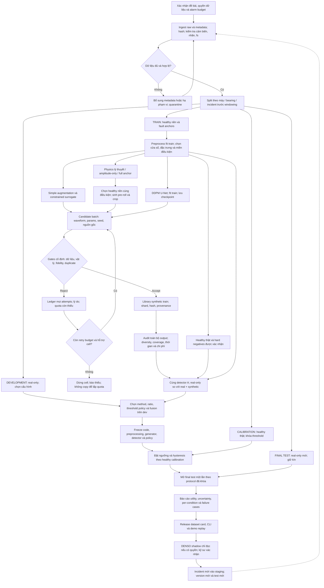

# Kế hoạch nghiên cứu DENSO — Neo và Mở rộng dữ liệu bất thường trong 12 tuần

**Phiên bản:** 1.1 — 07/10/2026 (bổ sung giao thức MVP thực thi).  
**Trọng tâm:** xây dựng bộ sinh nhiều waveform lỗi có kiểm soát, tập dữ liệu tăng cường có truy xuất nguồn gốc và bằng chứng về hiệu quả huấn luyện trên dữ liệu thật độc lập.  
**Trạng thái:** kế hoạch 12 tuần được thực thi thành các mốc rút gọn trong workspace; không phải 12 tuần lịch đã hoàn thành hoặc đã kiểm chứng tại DENSO. Báo cáo chạy thật và trạng thái từng gate được lưu riêng, không chuyển mọi mục kế hoạch thành “đã xong”.  
**Tài liệu này:** `C:\Users\Ad\Downloads\DENSO\docs\plans\KE_HOACH_NGHIEN_CUU_DENSO_A2_12_TUAN.md`.

> **Lưu ý mã đề:** PDF nội bộ `C:\Users\Ad\Downloads\DENSO\inputs\a2\A2.pdf` gọi hướng sinh dữ liệu là A2 — “Neo và Mở rộng”. Tuy nhiên, snapshot website tại `C:\Users\Ad\Downloads\DENSO\research_evidence\official_snapshots\DENSO_website_evidence.txt` gọi bài toán sinh dữ liệu lỗi là **A1**, còn A2 là tích lũy tri thức chuyên gia. Kế hoạch dưới đây bám **nội dung sinh dữ liệu mà người dùng yêu cầu và PDF hiện có**, không chuyển sang RAG/LLM. Tuần 1 phải xác nhận mã đăng ký và đề gốc với mentor/BTC; không coi PDF này là toàn bộ yêu cầu chính thức đã được DENSO xác nhận.

## Mục lục

1. Mục tiêu, phạm vi và đầu ra bắt buộc
2. Những kết luận hiện tại được dùng làm điểm xuất phát
3. Thiết kế nghiên cứu và phương pháp được chọn
4. Dataset, quyền sử dụng và data contract
5. Pipeline hoàn chỉnh và sơ đồ Mermaid
6. Quy trình sinh số lượng lớn, kiểm soát chất lượng và bàn giao
7. Thiết kế đánh giá độc lập và quyết định phương pháp
8. Breakdown công việc trong 12 tuần
9. Tổ chức, nguồn lực và cổng nghiệm thu
10. Tự phản biện, rủi ro và phương án thay thế
11. Checklist nghiệm thu và giới hạn tuyên bố
12. Nguồn và mức độ xác minh
13. Giao thức MVP thực thi và quy tắc vòng lặp ngày 07/10/2026

---

## 1. Mục tiêu, phạm vi và đầu ra bắt buộc

> **Ưu tiên phiên bản thực thi:** mục 13 quy định phạm vi MVP công khai và các cổng không thể hoàn tất khi thiếu independent-bearing/DENSO data. Đầu ra code và hướng dẫn ở `C:\Users\Ad\Downloads\DENSO\generator_benchmark\MVP_README.md`; evidence theo tuần ở `C:\Users\Ad\Downloads\DENSO\generator_benchmark\mvp_release_20261007`. Không dùng kết quả generator-only cũ thay cho báo cáo utility mới.

### 1.1. Bài toán thực tế

Máy khỏe tạo ra nhiều dữ liệu, trong khi dữ liệu lỗi ít, đắt và không thể chủ động gây hỏng trên dây chuyền. Chỉ tăng số cửa sổ từ vài bản ghi lỗi không làm tăng số sự cố hoặc số vòng bi độc lập. Giải pháp cần tạo **biến thể tín hiệu lỗi có căn cứ**, đồng thời chứng minh rằng sử dụng chúng giúp AI phát hiện bất thường thật tốt hơn — chứ không chỉ tạo phổ giống mẫu neo.

**Câu hỏi chính:** với cùng lượng dữ liệu thật dùng để huấn luyện, thêm dữ liệu synthetic có làm tăng recall trên vòng bi/máy/bản ghi thật chưa thấy, tại mức báo động giả do DENSO chấp thuận, so với real-only và augmentation đơn giản hay không?

**Câu hỏi riêng về bộ sinh:** có thể sinh hàng nghìn đến hàng chục nghìn mẫu mỗi cơ chế lỗi trong miền vận hành đã xác định, có tính hợp lệ, đa dạng và truy xuất nguồn gốc, với chi phí/tốc độ chấp nhận được hay không?

### 1.2. Đầu ra và cách nghiệm thu

| Đầu ra | Nội dung phải có | Cách kiểm chứng |
|---|---|---|
| Bộ sinh dữ liệu bất thường | API/CLI, cấu hình cơ chế lỗi, điều kiện, seed, quota, khả năng từ chối điều kiện ngoài miền | Chạy lại trên đầu vào được phép; kiểm tra đầu ra, ledger, thời gian và lỗi có kiểm soát |
| Tập dữ liệu tăng cường | Waveform, nhãn synthetic, manifest, điều kiện, nguồn neo/nền, split, hash, báo cáo chất lượng | Audit tất cả hàng xuất, nguồn gốc và quota; không lẫn với tập real-test |
| Báo cáo trước/sau tăng cường | Real-only, simple augmentation, surrogate, physics và DDPM theo ngân sách định trước | Đánh giá paired trên cùng dữ liệu real-test mới; không chọn winner bằng test |
| Demo phục vụ kỹ sư | Sinh theo cấu hình, xem waveform/phổ bao, lý do accept/reject, coverage và provenance | Kịch bản replay; không cần kết nối PLC hoặc tự động điều khiển máy |
| Hồ sơ tái lập | Data contract, split manifest, config, phiên bản môi trường/code, checkpoint nếu có, seed, logs và test | Một người khác chạy smoke và tái tạo batch/báo cáo với quyền dữ liệu phù hợp |

### 1.3. Phạm vi chốt để khả thi trong 12 tuần

- **Bắt buộc:** vòng bi; healthy và các lỗi đơn `inner`, `outer`, `ball` nếu dataset hỗ trợ; generation-first; đối chứng downstream known-fault; kiểm tra lỗi chưa biết bằng holdout cơ chế; chống rò rỉ; đo chi phí sinh và kiểm soát báo động giả.
- **Có điều kiện:** chuyển sang dữ liệu DENSO, RPM/load mới trong miền có hỗ trợ, mức lỗi có nhãn thật, mẫu âm khó do chuyên gia xác nhận, shadow pilot chỉ đọc.
- **Mở rộng có cổng:** đai chùng trên HVAC. Chỉ bắt đầu sau khi pipeline vòng bi đạt cổng tuần 8 và còn nguồn lực. LM guide chỉ làm nếu có dữ liệu vị trí/hành trình và yêu cầu rõ từ mentor.
- **Không cam kết trong 12 tuần:** mọi loại lỗi chưa biết, sinh đầy đủ miền RPM/load chưa đo, RUL, mô hình suy giảm liên tục, mô phỏng tiếp xúc 3D hoàn chỉnh, GAN/TimeGAN reproduction, điều khiển bảo trì tự động hoặc chứng minh cải thiện OEE.
- **Phân bổ nguồn lực đề xuất:** 55% bộ sinh và kiểm soát dữ liệu, 25% đánh giá độc lập, 10% dữ liệu/quyền sử dụng, 10% demo và bàn giao. Không giảm đánh giá chỉ để tăng quota synthetic.

### 1.4. Mục tiêu số lượng — mục tiêu kế hoạch, không phải kết quả đã đạt

| Giai đoạn | Quota đề xuất | Điều kiện |
|---|---:|---|
| Smoke | 32–128 mẫu/lớp/phương pháp/seed | Kiểm tra shape, finite, nhãn, provenance, seed và đường lỗi |
| So sánh phát triển | 256–1.024 accepted mẫu/lớp/phương pháp/seed | Cùng quota và điều kiện; giữ raw attempts/rejections |
| Scaling | 1.000 → 5.000 → 10.000 accepted mẫu/lớp cho phương pháp đủ điều kiện | Không tăng quy mô nếu gate/coverage không đạt hoặc phát hiện ghi nhớ |
| Bàn giao MVP | 10.000 accepted mẫu/lớp, tối đa 30.000 cho ba lớp vòng bi | Có thể hạ quota và báo thiếu; không sao chép/fallback để lấp đủ số |
| Mở rộng tùy chọn | Tối đa 100.000 mẫu toàn bộ thư viện | Chỉ khi có thêm cell điều kiện/nền/neo và lợi ích hoặc nhu cầu workload rõ |

30.000 waveform dài 2.048 điểm, một kênh, float32 chiếm **245.760.000 byte ≈ 234,4 MiB** cho waveform, chưa gồm metadata, diagnostics, checkpoint và dữ liệu thô. Không diễn giải 30.000 waveform thành 30.000 lần hỏng, 30.000 vòng bi hoặc 30.000 thí nghiệm độc lập.

---

## 2. Những kết luận hiện tại được dùng làm điểm xuất phát

### 2.1. Evidence hiện có và giới hạn

Lượt soạn này đã đọc trực tiếp README, manifest, JSON lựa chọn, run-status và tài liệu review. Các con số dưới đây là **giá trị đang lưu trong artifact**, không phải kết quả tái chạy toàn bộ benchmark trong lúc viết kế hoạch.

| Phương pháp | Mean W1 development đang lưu | Gate hiện tại | Cách sử dụng trong kế hoạch |
|---|---:|---|---|
| Constrained surrogate | 0,7289 | Đạt | Đối chứng mạnh cho augmentation cục bộ; chưa chứng minh mở rộng điều kiện |
| DDPM U-Net, 1.500 bước | 1,1503 | Đạt | Candidate học dữ liệu đáng kiểm tra downstream; không coi là paper reproduction |
| Physics anchored cũ | 3,2846 | Đạt | Đối chứng lịch sử; giữ nguyên phiên bản và provenance |
| Physics calibrated mới | 4,6825 | Không đạt đầy đủ | Cần chẩn đoán model/estimator; không mặc định phiên bản mới tốt hơn |
| GAN prototype | 6,2944 | Không đạt | Baseline lịch sử; không ưu tiên thêm ngân sách để “cứu” trong MVP |

Nguồn: `C:\Users\Ad\Downloads\DENSO\generator_benchmark\results_review_comparison\selection.json`. W1 dùng đặc trưng engineered và có thể ưu ái phương pháp bám neo; không thay accuracy, recall, diversity hoặc physical correctness. Các ngân sách cũ **không compute-matched**. Heldout-load đã xem nhiều lần chỉ còn là exploratory.

### 2.2. Phân biệt neo lỗi và nền khỏe

- Manifest hiện có dùng lỗi CWRU 0,007 inch; load 0 HP làm anchor-train, 1 HP development, 2 HP heldout lịch sử. Danh tính vòng bi vật lý độc lập **chưa được xác nhận**.
- README mô tả tám cửa sổ lỗi/lớp, mỗi cửa sổ 2.048 điểm tại 12 kHz: khoảng 1,365 giây từ một bản ghi lỗi/lớp, không phải tám sự cố độc lập.
- Code physics dùng nền healthy; cần tuần 1 kiểm kê chính xác số cửa sổ nền đang thực sự dùng. Không dựa con số “20 healthy windows” từ trao đổi trước làm dữ kiện đã audit.
- Surrogate hiện tại biến đổi fault anchor; không dùng healthy background. DDPM hiện tại học fault data; không tự biến thành mô hình tiêm lỗi vào healthy.
- `physics_unanchored` cũ vẫn dùng fault-anchor RMS: **không** được dùng làm baseline “không có dữ liệu lỗi”. Kế hoạch phải bổ sung baseline lý thuyết thực sự không fit fault và baseline chỉ neo biên độ.
- Giảm correlation với anchor chưa chứng minh sinh đúng severity, điều kiện mới hay lỗi chưa biết. Không có thực nghiệm downstream độc lập được hoàn thành trong phạm vi soạn tài liệu này.

### 2.3. Khoảng trống cần bổ sung thay vì làm lại toàn bộ

1. Manifest phân cấp machine → bearing → incident/session → recording → window và permission.
2. Split mới chưa dùng để chọn phương pháp; transform/generator fit chỉ trên train.
3. Hợp đồng điều kiện RPM/load/sensor/geometry, bỏ hard-code CWRU khi dùng miền khác.
4. Physics calibration có diagnostics về định danh, đa cộng hưởng, fit/check và background matching.
5. Mẫu âm khó, unknown-fault evaluation, detector baseline thống nhất và threshold calibration độc lập.
6. Bộ lập kế hoạch quota theo cell điều kiện; ledger rejected và thiếu coverage.
7. Báo cáo utility, hiệu quả theo lượng synthetic và theo số nguồn neo độc lập.

---

## 3. Thiết kế nghiên cứu và phương pháp được chọn

### 3.1. Chiến lược: không đặt cược vào một bộ sinh

**Trục nghiên cứu theo PDF:** physics có neo trên vài lỗi thật, tiêm thành phần lỗi vào healthy background cùng miền, mở rộng có giới hạn theo điều kiện.  
**Trục đối chứng để tránh thiên kiến:** real-only, simple augmentation, constrained surrogate và DDPM U-Net.  
**Quyết định release:** chọn trên development theo ba trục quality–diversity–cost, và utility development; khóa quyết định trước final test. Nếu không bộ sinh nào giúp downstream, bàn giao generator với giới hạn và kết quả âm, không tuyên bố cải thiện.

Giả thuyết cần kiểm chứng:

- **H1 — Utility:** real + synthetic tốt hơn real-only và simple augmentation trên real-test độc lập.
- **H2 — Anchoring:** neo tham số vật lý tốt hơn tham số lý thuyết và chỉ neo biên độ, khi background/quota/budget giống nhau.
- **H3 — Coverage:** mở rộng theo cell điều kiện hợp lệ hữu ích hơn sinh thêm nhiều biến thể quanh một neo.
- **H4 — False alarm:** thêm hard negatives được xác nhận giảm báo động giả mà không làm tăng missed detections quá giới hạn chấp thuận.
- **H5 — Unknown:** healthy-only anomaly branch phát hiện được cơ chế bị giữ lại tốt hơn classifier tập đóng; không giả định synthetic known faults giải quyết H5.

### 3.2. Physics có neo: mô hình tối thiểu nhưng đúng vai trò

Với vòng bi có hình học biết được, đặt `fr = RPM/60`, số bi `n`, đường kính bi `d`, đường kính vòng chia `D`, góc tiếp xúc `φ`:

```text
BPFO = (n·fr/2)·(1 − (d/D)·cosφ)
BPFI = (n·fr/2)·(1 + (d/D)·cosφ)
BSF  = (D·fr/(2d))·(1 − ((d/D)·cosφ)²)
FTF  = (fr/2)·(1 − (d/D)·cosφ)
```

Với ball faults có thể xuất hiện BSF, 2×BSF và sidebands FTF; kiểm tra dữ liệu và cơ chế tiếp xúc trước khi chọn signature. Không gán cùng một order cho mọi vòng bi DENSO.

```text
s_fault,c(t) = Σ_k A_k · q_k(t_k) · h_c(t − t_k)
h_c(u)      = 1[u ≥ 0] · Σ_j w_cj · exp(−β_j u) · sin(2π f_cj u + ψ_cj)
x_syn,c(t)  = b_healthy,c(t) + s_fault,c(t)
```

- `c`: kênh cảm biến; `b`: nền khỏe thật; `A`: cường độ kích thích, không tự bằng kích thước khuyết tật.
- `q`: điều biến vùng tải; `β > 0`; cộng hưởng `f_cj` nằm dưới Nyquist và trong dải quan sát hợp lệ.
- Một cộng hưởng là baseline; chỉ thêm cộng hưởng thứ hai khi residual/diagnostics cho thấy cần và đủ dữ liệu để fit. Không tăng tự do tham số để ép khớp mọi anchor.
- RPM không đổi: chu kỳ xung theo order. RPM biến đổi có tachometer: thời điểm xung lấy từ tích phân phase/order, không thay một RPM trung bình cho toàn đoạn.
- Với nhiều kênh, sự kiện lỗi chung nhưng đường truyền/phase khác nhau; không sinh từng kênh độc lập rồi gọi là tín hiệu đa biến đồng bộ.
- Sinh pre-roll ít nhất theo độ dài đáp ứng/settling cần thiết, sau đó crop. Test biên đầu-cuối, filter transient và tình huống xung chồng lấn.
- `x = b + s` là xấp xỉ tuyến tính. Nếu lỗi làm thay đổi đáng kể đáp ứng nền/tải hoặc gây clipping, phải báo model mismatch; không coi phép cộng là chân lý cho mọi máy.

### 3.3. Quy trình neo tham số

1. Chỉ dùng fault anchors train có nhãn và metadata hợp lệ; xác nhận sự kiện thực với người phụ trách dữ liệu.
2. Detrend/bỏ DC, đổi về đơn vị vật lý nếu có calibration; không chuẩn hóa từng cửa sổ làm mất RMS rồi fit biên độ.
3. Ước lượng dải cộng hưởng bằng band-kurtosis scan baseline. Nếu triển khai fast kurtogram, xác minh riêng bằng tín hiệu kiểm thử; không đổi tên grid scan thành thuật toán đó.
4. Tính envelope ở dải chọn; đối chiếu peak/order/harmonics/sidebands với geometry và RPM. Peak mạnh nhất không mặc nhiên là lỗi.
5. Tìm transient có SNR đủ, căn chỉnh, fit decay trên miền hữu hiệu; loại các đoạn xung chồng hoặc ghi mức tin cậy thấp. Không fit log-epsilon ở nền nhiễu để tạo decay giả.
6. Ước lượng amplitude/jitter/modulation, đưa bounds/prior vật lý; fit nhiều khởi tạo, kiểm tra sensitivity và tương quan tham số.
7. Chia **fit/check nội bộ train** theo nguồn độc lập khi đủ. Nếu chỉ có một nguồn, check chỉ là tái khớp nội bộ, không phải generalization.
8. Lấy mẫu **joint parameters** từ các nghiệm khả dĩ trong bounds; bootstrap theo recording/incident nếu đủ nhóm. Khi không đủ, dùng interval sensitivity, không gọi là posterior xác suất đã được hiệu chuẩn.
9. Kiểm tra residual, signature và giá trị chạm bound/fallback. Fit không ổn định → giữ baseline đơn giản hoặc từ chối cơ chế/cell đó.

### 3.4. Surrogate và augmentation đơn giản

- **Simple augmentation:** gain, shift, noise nhẹ, crop hợp lệ với miền train. Là đối chứng để hỏi physics/deep có giá trị hơn biến đổi rẻ hay không. Các biến đổi gain/shift có correlation rất cao là điều dự kiến; báo cáo riêng, không loại bỏ toàn bộ đối chứng vì gate anti-copy của thư viện synthetic.
- **Constrained surrogate:** biến đổi pha có regularization, projection phổ và histogram. Bound pha chỉ áp ở intermediate projection; output cuối cần đo residual thực tế. Giữ nhãn `local_augmentation`, không gán nhãn “new condition” khi chỉ đổi pha.
- Gate exact-duplicate và provenance áp cho mọi nguồn; gate near-copy áp cho thư viện được tuyên bố đa dạng. Hiển thị cả raw/accepted của simple baseline, không lọc bất lợi cho baseline để làm phương pháp chính thắng.

### 3.5. DDPM U-Net

- Tái sử dụng hướng DDPM đã sửa schedule/terminal noise và residual multiscale 1D U-Net; kiểm tra lại forward/reverse, finite, seed và checkpoint ở run mới.
- Bắt đầu fault-only theo lớp; điều kiện RPM/load/sensor chỉ bổ sung khi có đủ train examples và metadata. Không hứa conditional transfer chỉ từ tám windows/lớp.
- Scaling fit trên train; amplitude clipping nếu có phải lấy từ train, lưu fraction bị clip và diagnostics trước/sau, tránh che model failure.
- Theo dõi train/dev loss, memorization, class fidelity, diversity, quota acceptance, GPU time/VRAM; loss thấp không là tiêu chí nghiệm thu duy nhất.
- Không post-filter bằng detector chính đang dùng để đo utility. Nếu thử discriminator/classifier gate, đó là nhánh ablation riêng và báo selection bias.
- Không mô tả code hiện tại là TimeGAN, Thompson multivariate transfer hoặc tái lập Ping/Ma. Hybrid physics→diffusion residual chỉ là mở rộng sau MVP, không là dependency của kế hoạch 12 tuần.

### 3.6. Detector để kiểm tra usefulness, không chiếm trọng tâm generator

- **A — baseline chính:** time statistics + log-PSD/FFT + envelope/order features + Random Forest trong scikit-learn. Cùng extractor, hyperparameter budget và train weights cho tất cả generator.
- **C — healthy-only:** robust covariance/Ledoit–Wolf hoặc Isolation Forest trên healthy train theo condition; chọn cấu hình trên development. Không học synthetic healthy như thể đó là healthy thực đã xác nhận.
- **B — tùy chọn:** encoder/prototype với PyTorch chỉ khi A+C chưa đủ và còn ngân sách; không bắt buộc để chứng minh augmentation.
- Known-fault classification, binary anomaly và unknown detection là ba output khác nhau. Unknown score không bảo đảm biết cơ chế hoặc severity.
- Fusion A+C là ablation, phải hiệu chuẩn ngưỡng của **toàn hệ thống**, không OR hai threshold đã calibrate riêng rồi cho rằng FPR không đổi.

---

## 4. Dataset, quyền sử dụng và data contract

### 4.1. Danh mục dataset và vai trò

| Dataset | Nội dung đã xác minh/hiện có | Vai trò | Giới hạn và việc phải làm |
|---|---|---|---|
| **CWRU** | Dữ liệu MATLAB, DE/FE/BA/RPM; các bộ 12/48 kHz. Manifest hiện có healthy + inner/outer/ball, lỗi 0,007 inch và load 0/1/2 HP | Smoke, tái kiểm tra prototype, so sánh exploratory và regression | Không biết bearing independence chỉ từ load/file; normal fs từng file cần xác nhận; chưa xác lập quyền redistribution/commercial |
| **Paderborn — PU** | 32 trạng thái vòng bi: 6 healthy, 12 artificial damage, 14 real damage từ accelerated lifetime; 4 settings; 20 lần đo × 4 s/setting | Dataset **ưu tiên cho unseen-bearing**; artificial→real damage và condition shifts | Fact sheets, bearing IDs, channel fs phải audit raw. License CC BY-NC 4.0: nghiên cứu phi thương mại; dùng cho DENSO thương mại phải xin phép |
| **HUST bearing v3** | 99 raw signals; 5 loại vòng bi; 3 điều kiện; lỗi inner/outer/ball và các cặp; fs 51.200 Hz; repository CC BY 4.0 | External dataset và giữ lại lỗi kép/cơ chế hợp lệ để kiểm tra open-set | 99 signals không đồng nghĩa 99 bearings; map physical IDs/condition/labels từ raw và paper trước khi split; không ép label taxonomy trùng hoàn toàn CWRU |
| **DENSO healthy** | Chưa xác nhận đã được cấp trong workspace | Nền thật của máy đích, condition model, healthy threshold calibration, đo false alarms | Cần thời lượng dài, nhiều ca và điều kiện, sensor calibration, permissions và time alignment |
| **DENSO fault/incident** | Chưa xác nhận số loại/số sự cố độc lập | Neo trên máy đích và real-test sự cố mới | Vài windows của cùng incident không đủ để chứng minh tổng quát hóa; cần maintenance evidence/label review |
| **HVAC belt looseness v1** | Repository có current 100 kHz, vibration x/y 25,6 kHz, RPM motor/fan 100 kHz; nhãn d0–d4; CC BY 4.0 | Mở rộng đai nếu vòng bi qua gate; severity với nhãn thật | Mô tả ghi “four conditions” nhưng liệt kê d0–d4: phải xác nhận raw label counts, tension mapping, số session độc lập |
| **Rotary machine single/double faults — Marshall/Jensen** | DOI được ghi trong PDF; lượt fetch DOI trực tiếp trả HTTP 403 | Nguồn đai/puli bổ sung nếu cần | Chưa dùng làm dataset bắt buộc; xác minh repository/raw/license/metadata trước khi thêm |
| **LM guide / run-to-failure** | Chưa có dữ liệu phù hợp được xác nhận | Hướng sau 12 tuần | Không đưa vào tiêu chí bàn giao bắt buộc; RUL đòi longitudinal degradation và failure/censoring labels |

**Ưu tiên thực thi:** CWRU để smoke → PU để đánh giá bearing độc lập nếu quyền phù hợp → HUST external check → DENSO target validation khi được cấp. Không cần tải tất cả dataset mới làm được MVP.

### 4.2. Operating conditions PU đã xác minh

| Setting | RPM | Torque (Nm) | Radial force (N) |
|---|---:|---:|---:|
| N15_M07_F10 | 1.500 | 0,7 | 1.000 |
| N09_M07_F10 | 900 | 0,7 | 1.000 |
| N15_M01_F10 | 1.500 | 0,1 | 1.000 |
| N15_M07_F04 | 1.500 | 0,7 | 400 |

Các thông số giữ cố định trong mỗi measurement. Không dùng chúng như dữ liệu RPM biến đổi liên tục. 20 lần đo của cùng bearing không là 20 bearing độc lập. Chỉ 6 healthy bearing states khiến ước lượng false-alarm uncertainty hạn chế; không chia thành hàng nghìn windows để che giới hạn đó.

### 4.3. Yêu cầu dữ liệu DENSO gửi mentor ở tuần 1

1. Danh sách máy/bộ phận ưu tiên, mã đề gốc, sensor channels, vị trí/hướng gắn, đơn vị, fs, range, firmware/calibration.
2. Healthy raw liên tục ở nhiều ca/tốc độ/tải; gồm thay chế độ lành tính và lịch maintenance để loại giai đoạn có lỗi chưa xác nhận.
3. Fault raw trước/trong/sau sự cố nếu tồn tại; incident ID, nhãn lỗi, confidence, căn cứ kỹ thuật, thời điểm onset/repair và khoảng thời gian không chắc chắn.
4. Bearing geometry/model, transmission ratio, RPM/tachometer, load/torque; với đai thêm pulley/belt/tension; với LM guide thêm position/direction/cycle.
5. Quyền dùng cho fit/test, thời hạn lưu, quyền demo/redistribute/checkpoint, người duyệt và cách anonymize machine ID.
6. Alarm budget/ca hoặc ngày, minimum coverage, thời gian phát hiện chấp nhận được, mức severity ưu tiên và cost missed fault.
7. Những máy/incident/đợt đo có thể giữ kín làm test mới; ai có quyền mở test và ngày freeze.

**Không có fault DENSO:** vẫn làm healthy anomaly model và transfer synthetic thử nghiệm, nhưng không kết luận fault-label correctness tại DENSO. **Chỉ có một incident/lỗi:** dùng như case study; chưa có independent incident-test cho lớp đó.

### 4.4. Schema dữ liệu thật

Mỗi raw recording phải có:

```text
dataset_id, dataset_version, license_id, permission_scope, source_url_or_access_id
machine_id, bearing_id, incident_id, session_id, recording_id
raw_path, raw_sha256, channel_names, sensor_type, sensor_position, sensor_orientation
units, fs_hz, start_time, duration_s, timestamp_quality, synchronization_info
rpm_value_or_series_ref, load_value_and_unit, geometry_ref, operating_state
real_label, label_confidence, severity_label, severity_definition, label_evidence_ref
split_role, group_key, split_manifest_version, ingest_version, missing_metadata_flags
```

Unknown metadata phải là null/flag, không đoán từ tên file. Không dùng raw absolute path hoặc incident ID như classifier feature. Machine identifiers phải được pseudonymize trong bản demo được chia sẻ.

### 4.5. Split trước windowing

- Mức ưu tiên grouping: **máy → bearing vật lý → incident/session → recording → window**. Chọn group theo claim; cùng bearing không đi cả train và test của unseen-bearing claim.
- Gợi ý phân bổ khi đủ groups: train khoảng 60%, development 20%, threshold-calibration 10%, final-test 10%; điều chỉnh theo group/class coverage, không ép tỷ lệ làm mất lớp hoặc độc lập.
- Nếu healthy groups ít: dùng grouped cross-validation trong development, dành healthy calibration và test riêng khi đủ; nếu không đủ, hạ claim/confidence và báo thiếu dữ liệu.
- Cả healthy background lẫn fault anchor của synthetic đều là train. Một background train không được tái dùng dưới bản resample/filter khác trong real-test.
- Development dùng chọn phương pháp/parameter/fusion, calibration chỉ dùng đặt threshold sau freeze, final-test không dùng chọn/học/gate.
- Nếu cần chia một recording theo thời gian, gap phải lớn hơn window/filter support và phụ thuộc tín hiệu; đây chỉ là **within-recording temporal study**, không bằng chứng bearing/machine independence.
- Test CWRU lịch sử giữ nguyên như exploratory; nhãn `locked_test` trong manifest cũ không tự phục hồi tính confirmatory.
- Phải audit quan hệ nguồn raw, embedded MATLAB channels, fingerprint và recording overlaps. `99.mat` cần chỉ đúng `X099_DE_time`, không vô tình đọc phần `X098` nhúng trong file.

---

## 5. Pipeline hoàn chỉnh và sơ đồ Mermaid

### 5.1. Sơ đồ end-to-end



**Quy tắc đọc sơ đồ:** test/calibration không có đường vào generator fit hoặc quality gates. Feedback hiện trường tạo version mới; không sửa release rồi báo tiếp trên cùng final-test như chưa từng xem.

### 5.2. Chi tiết từng bước và đầu ra bắt buộc

| Bước | Xử lý và quyết định | Artifact / điều kiện kết thúc |
|---|---|---|
| **P0. Requirement lock** | Mentor xác nhận bài toán, mã đề, cơ chế ưu tiên, quyền dữ liệu và alarm budget; tách yêu cầu bắt buộc và giả thuyết | Requirement matrix + scope decision + danh sách điểm chưa xác nhận |
| **P1. Ingest** | Download/copy chỉ từ nguồn được phép; hash; kiểm tra MATLAB key/channel; không overwrite raw | Raw inventory, license registry, checksum và ingest log |
| **P2. Raw QA** | Đo duration/fs/units; missing samples, flatline, saturation, sensor disconnect; alignment RPM; kiểm tra label evidence | QA per recording, quarantine list; không sửa dữ liệu mà không lưu transformation |
| **P3. Group split** | Định danh group; stratify theo lớp khi khả thi; audit overlaps; giữ test ngoài tuning access | Split manifest versioned; test custodian; group intersection test |
| **P4. Preprocess** | Fit train-only; detrend, anti-alias resample, lọc theo recipe; lưu original amplitude branch; quản lý filter edges | Transform config/state, waveform resampled, segment ranges và QA |
| **P5. Window/condition registry** | Chọn length theo số chu kỳ và bandwidth; condition matching; chỉ train chọn anchors/nền | Window manifest, anchor/background registry và cell support map |
| **P6. Generator fit** | Fit physics/surrogate/DDPM theo đúng scope; fit/check nội bộ; chẩn đoán fallback, uncertainty và memorization | Generator state/checkpoint, fit diagnostics, model hash và support bounds |
| **P7. Candidate planning** | Chốt class × condition × strength × sensor × background quotas; lấy mẫu seed/joint params | Generation plan, attempt IDs, cấu hình batch và chi phí dự kiến |
| **P8. Generate** | Sinh waveform, pre-roll/crop, kênh đồng bộ, params; không nhãn “unknown fault” cho random noise | Candidate waveform + provenance trước gate; finite retry ledger |
| **P9. Gate** | Numeric/sensor/physical/signature/copy checks; threshold train-only đã freeze; lưu mọi rejection | Accepted/rejected flags, reason codes và số attempts thật |
| **P10. Library audit** | Audit mọi hàng: hash/provenance/source split, duplicate, anchor similarity; diversity/pair sampling có ghi denominator | Dataset shards, full-row audit report, coverage heatmap, generator card |
| **P11. Downstream dev** | Cùng detector/dữ liệu thật/weights; sweep ratio nhỏ; utility trên dev real-only; so budget | Development report và lựa chọn release có điều kiện |
| **P12. Freeze + calibration** | Đóng băng extractor, model, method, ratios và alarm policy; chỉ đặt threshold từ healthy calibration | Release config, threshold artifact và signed freeze record |
| **P13. Final test** | Test real-only mới; known/unknown/condition tasks theo protocol riêng; không bỏ silent rejects | Paired metrics, group CIs, missed faults, delays, false alarms, coverage |
| **P14. Release/pilot** | Xuất tập train synthetic có nhãn rõ, usage limits; replay/shadow read-only và rollback | Release manifest, dataset card, CLI, report, demo và handover checklist |

### 5.3. Preprocessing không làm mất thông tin lỗi

1. Raw giữ nguyên; từng transformation có input/output hash và recipe.
2. Các fs khác nhau: lựa chọn native-fs feature extraction hoặc resample sang fs chung trên **miền bandwidth giao nhau**. Bộ 51,2/64 kHz không ép về 12 kHz nếu mất resonance cần nghiên cứu; dùng native branch khi cần.
3. Resample có anti-alias filter và kiểm tra peak/frequency/RMS trước/sau; cutoff không do test quyết định. Upsample không tạo thêm thông tin tần số.
4. Envelope sau band-pass với dải chọn từ train; log-PSD với các bins chuẩn hóa hợp lý; có RPM thì order features. Không tính envelope từ dải tùy ý khác nhau để ưu ái từng generator.
5. Theo dõi gain/units: amplitude physics giữ đơn vị thực; branch model có train-fitted scaling riêng. Không per-window normalize rồi tuyên bố severity amplitude tăng.
6. Fault signature nên có nhiều chu kỳ. 2.048 điểm tại 12 kHz dài 0,1707 s chỉ là preset prototype; chọn độ dài theo RPM thấp nhất và tần số lỗi cần phân giải. Độ phân giải phổ xấp xỉ `1/T_window` phải đủ cho signature cần kiểm tra.
7. Development/test dùng cùng recipe đã freeze. Gaps, filter padding và state không được vượt ranh giới train-test. Window overlap trong cùng partition được phép nếu báo dependence; không dùng overlap để tăng CI sample size.
8. Multi-sensor giữ đồng bộ thời gian. Nếu RPM/load thiếu, chỉ chạy supported fallback và gắn low-confidence; không gán nominal RPM của CWRU sang máy mới.

### 5.4. Chọn nền khỏe và miền condition support

- Mỗi background có nguồn recording/session/bearing, sensor, RPM/load, QA và healthy confidence.
- Ưu tiên same-machine/same-sensor/same-condition. Nếu nền công khai hoặc nền khác máy, gắn `cross_domain_background`; không gọi là DENSO-validated.
- Khi chỉ có background RPM thấp, không kéo giãn toàn waveform để giả background RPM cao nếu chưa xác thực dynamics/noise/resonance. Sinh fault order mới trên nền cũ chỉ là stress simulation, không condition-matched evidence.
- `condition registry` gồm các cell được hỗ trợ, nội suy có căn cứ và ngoài miền. API phải reject hoặc đánh dấu research-only khi condition ngoài support.
- Thêm background nguồn mới được ưu tiên hơn sinh thêm 100.000 phase variants từ cùng nền.

### 5.5. Hard negatives và unknown faults

- Hard negatives có thể gồm healthy thực khi đổi tải/RPM, startup/shutdown được phép, gain drift, xung nhiễu đơn lẻ, tín hiệu can nhiễu. Gán “bình thường” chỉ nếu DENSO xác nhận đó là trạng thái chấp nhận được.
- Nếu sensor disconnect/saturation là sự kiện cần cảnh báo dữ liệu thì dùng nhãn `data_quality_alert`, không trộn thành healthy.
- Hard negatives nhân tạo chỉ dùng cho train hoặc stress test được gắn synthetic; final false-alarm evidence phải trên healthy thực.
- Mỗi unknown-fault fold giữ lại toàn bộ một cơ chế khỏi anchors, generator fit, classifier fit và tuning labels. Không dùng kiến thức signature của lỗi holdout để thiết kế gate cho fold đó.
- Unknown detection trả `bất thường chưa xác định`; phân biệt unknown label, low confidence, unsupported condition và sensor-quality failure. Không nhận dạng lỗi chưa biết bằng cách buộc softmax chọn inner/outer/ball.

---

## 6. Quy trình sinh số lượng lớn, kiểm soát chất lượng và bàn giao

### 6.1. Nhãn synthetic phải thành thật

Schema tối thiểu mỗi accepted/rejected sample:

```text
sample_id, attempt_id, is_synthetic, label_type, intended_fault_mechanism
generator_name, generator_version, generator_state_hash, config_hash, seed
anchor_recording_ids, anchor_window_ids, background_recording_id, background_range
split_role=train, source_group_keys, fs_hz, n_samples, channels, units
condition_requested, condition_realized, condition_support_level
physical_parameters, amplitude_ratio, simulation_strength, measured_severity_label
quality_scores, gate_version, accepted, rejection_reason_codes
waveform_sha256, shard_id, row_index, generation_duration_s, run_id
```

- `intended_fault_mechanism` là cơ chế mà bộ sinh đặt vào, **không** xác nhận bằng tháo máy hoặc thực nghiệm cơ khí.
- `simulation_strength` là cường độ mô phỏng; `measured_severity_label` để null nếu không có mapping từ dữ liệu lỗi thật.
- Với generator không dùng nền hoặc không có physical params, trường tương ứng là null có giải thích; không bịa healthy provenance cho DDPM/surrogate.
- Metadata inference như measured envelope peak lưu riêng với điều kiện được yêu cầu; phát hiện sai label/cell không được sửa nhãn âm thầm cho đủ quota.

### 6.2. Sampling plan

1. Xác định các cell có train support theo class/RPM/load/sensor; chia quota để không lớp/cell/nền nào độc chiếm.
2. Lấy mẫu joint parameter, biên độ và nền trong bounds đã fit; dùng stratified sampling cho coverage. Không Cartesian-product mọi cực trị vốn chưa từng đồng thời hợp lệ.
3. Bắt đầu balanced cell quota cho benchmark; release cũng cung cấp manifest để downstream reweight theo prevalence thực, không giả cân bằng synthetic là prevalence nhà máy.
4. Sample ID/seed quyết định trước; ledger cả accepted/rejected. Nguồn train anchors/background phải kiểm tra lại ở thời điểm export.
5. Sinh theo shard/batch để giới hạn RAM; ghi temp → audit → finalize. Output directory mới; resume chỉ khi input/config/state hashes giống nhau và shard cũ đã verified.
6. Retry budget mặc định có thể bắt đầu `4 × requested quota` như production path cũ; nếu hết budget, fail cell và báo thiếu. Thay budget là run/version mới, không xóa denominator trước đó.
7. Không ghép các windows độc lập thành chuỗi liên tục/RUL. Muốn chuỗi liên tục cần mô hình state dynamics, continuity và nhãn timeline riêng.

### 6.3. Cổng kiểm soát candidate

| Gate | Kiểm tra | Hành động |
|---|---|---|
| G-data | Shape/fs/channel/units, finite, quá ngắn, timestamp, saturation/flatline | Reject hoặc quarantine; không impute waveform lỗi nặng rồi accept |
| G-physics | Positive RPM/damping, frequency dưới Nyquist, geometry hợp lệ, parameter bounds, event ordering | Reject; unsupported condition phải báo riêng |
| G-signature | Envelope/order peaks, harmonic/sideband plausibility, PSD band energy, RMS/crest/kurtosis | Reject khi vi phạm train-derived bounds; lưu metrics trước/sau clipping |
| G-copy | Exact hashes và maximum absolute cyclic correlation với **mọi** anchors phù hợp | Chặn duplicate; ngưỡng >0,99 kế thừa là anti-near-copy engineering rule, không chứng minh novelty vật lý |
| G-label | Cơ chế yêu cầu phù hợp simulation metadata và signature; ambiguous/multi-fault có label riêng | Reject/ambiguous flag; không detector chính tự gán ground truth |
| G-provenance | Source split train, hashes/config/model đúng, quyền export | Fail closed; thiếu provenance không bàn giao |

Bounds được chốt từ train/domain knowledge trước khi mở dev/test đánh giá. Candidate-level gate và lựa chọn phương pháp trên development là hai cấp khác nhau. Có thể thử một gate recipe mới trong development, nhưng phải version và chốt trước final test, không học bounds từ real-test.

### 6.4. Audit library: không chỉ kiểm tra vài hàng đầu

- Mọi output row: finite, đúng shape, waveform hash, accepted flag, provenance, source split và anchor similarity. Kiểm tra cả hàng cuối batch và shard cuối.
- Exact duplicate audit toàn library. Near-duplicate synthetic–synthetic: scalable screening/nearest neighbors, kèm random/disjoint pair audit stratified theo class/condition/source. Ghi rõ phần nào all-pairs, phần nào sampling và số pairs; không gọi sampled audit là kiểm tra mọi cặp.
- Diversity báo theo feature space và waveform similarity; coverage báo theo class × condition × source. Histogram trùng anchor ở surrogate là thuộc tính method, không bằng chứng miền mới.
- Báo số nguồn neo/nền độc lập và tỷ lệ đóng góp; không chỉ `unique hash count`.
- Vẽ real train/dev và synthetic qua PCA/embedding train-fitted để chẩn đoán; hình đẹp không là proof. Không dùng test để fit embedding/tune generator.
- Expert review: target 20–50 mẫu/lớp ở nhiều cell và failure cases nếu có người duyệt; blind method ID, lưu căn cứ/uncertainty. Đây không thay real-test.

### 6.5. Metrics bộ sinh và quy tắc release

**Bắt buộc báo cáo:** requested/attempted/accepted/rejected, rejection reason, acceptance per cell, fidelity raw/accepted, duplicate/near-copy, diversity, support/coverage, parameters chạm bound, clipping fraction, thời gian fit, generation throughput, CPU/GPU/VRAM, storage và seconds/1.000 accepted.

**Điều kiện release engineering đề xuất:** 100% exported rows finite và provenance/hash hợp lệ; zero exact copies trong thư viện “novel variations”; zero candidates vi phạm near-copy rule đã chọn; quota/cell đạt hoặc ghi rõ thiếu; cùng seed tái lập trong môi trường đã khóa; output không overwrite evidence cũ. Target acceptance ≥95%/cell được dùng như mục tiêu phát triển, không hạ gate để đạt 95% và không coi đó là physical correctness.

**Không được bỏ mẫu rejected khỏi báo cáo chất lượng raw**, không báo throughput chỉ theo những batch thành công. Nếu inference sau này có abstain/quality reject, phải báo tỷ lệ coverage và workload chứ không xóa những thời điểm khó khỏi metric.

### 6.6. Cấu trúc triển khai dự kiến

Không thay đổi thư viện đang dùng: Python, NumPy, SciPy, scikit-learn, PyTorch cho deep branch; CLI và static reports trước dashboard framework mới.

| Khu vực | Đường dẫn tuyệt đối dự kiến | Nội dung |
|---|---|---|
| Code đang có | `C:\Users\Ad\Downloads\DENSO\generator_benchmark` | Giữ generator/benchmark hiện tại và snapshots; refactor có tests, không xóa artifacts |
| Pipeline mới | `C:\Users\Ad\Downloads\DENSO\a2_research_pipeline` | ingest, split, preprocess, registry, adapters, planner, gates, evaluation, reports, tests |
| Config | `C:\Users\Ad\Downloads\DENSO\a2_research_pipeline\configs` | Dataset/condition/generator/training/release JSON đã version |
| Run mới | `C:\Users\Ad\Downloads\DENSO\a2_research_runs` | Mỗi run_id riêng: manifests, fit states, checkpoints, attempts, shards, reports |
| Data được phép | `C:\Users\Ad\Downloads\DENSO\a2_authorized_data` | Chỉ tạo khi có quyền; ACL tách raw DENSO/test khỏi demo/public export |
| Release | `C:\Users\Ad\Downloads\DENSO\a2_releases` | Dataset card, generated train set, audit, CLI instructions, limits và report |

Các đường dẫn ở bảng là **đề xuất**, không khẳng định module/thư mục mới đã được triển khai. Run phải lưu dependency versions, device, code hash; checkpoint deep mới có model/optimizer/scheduler/config/state để tái lập/resume. Không giả checkpoint của lượt deep cũ đã tồn tại.

### 6.7. Test suite phải có khi triển khai

1. Unit: order formulas, RPM phase/event times, damping/Nyquist bounds, fs conversion, histogram/spectral diagnostics, DDPM schedule và forward/reverse finite.
2. Leakage: train/dev/cal/test group intersections, raw ranges/filter edges, background contamination, embedded MATLAB key, unknown-fold cơ chế bị holdout.
3. Production: finite retry exhaustion, duplicate/near-copy ở cuối batch, provenance mismatch, seed repeat, overwrite refusal, corrupt shard, resume config mismatch.
4. Scale: 128/1.000/10.000 samples; hash/metadata rows đúng số lượng, RAM/throughput, acceptance per cell không sụp khi tăng quota.
5. Evaluation: threshold không fit test, no point-adjustment, alarm debouncing/delay bằng synthetic timeline kiểm thử, bootstrap lấy group chứ không window.
6. Security/release: DENSO raw/IDs/private paths không lọt demo; license gate; logs không chứa secrets; permission failure trả lỗi rõ ràng.

---

## 7. Thiết kế đánh giá độc lập và quyết định phương pháp

### 7.1. Tách ba cấp bằng chứng

1. **Signal-level:** waveform, phổ bao, correlation, W1, parameter validity và duplicate. Trả lời “bộ sinh có hoạt động và tạo tín hiệu có vẻ hợp lý không?”.
2. **Downstream public-data:** detector học với/không synthetic, đánh giá trên real groups chưa thấy. Trả lời “synthetic có hữu ích trên tác vụ và dataset được xét không?”.
3. **Target DENSO:** real healthy/faults độc lập của máy đích và shadow review. Trả lời “giải pháp có ích ở điều kiện DENSO thực sự không?”.

Không suy cấp 3 từ cấp 1/2. CWRU faults + DENSO healthy chỉ là **target-background transfer experiment**, không xác thực DENSO fault label.

### 7.2. Ma trận đối chứng tối thiểu

| Mã | Dữ liệu/augmentation | Câu hỏi |
|---|---|---|
| M0 | Real train only; healthy + cùng fault anchors | Mốc gốc |
| M1 | M0 + simple augmentation | Lợi ích từ biến đổi rẻ hoặc thêm training exposure |
| M2 | M0 + constrained surrogate | Augmentation cục bộ bám neo có đủ không? |
| M3 | M0 + physics lý thuyết | Giá trị mô phỏng không fit fault parameters; amplitude theo healthy/engineering prior đã định trước |
| M4 | M0 + physics chỉ neo amplitude | Hiệu ứng gain khác hiệu ứng neo dynamics? |
| M5 | M0 + physics full-anchor | Neo frequency/decay/jitter/modulation giúp hơn M3/M4? |
| M6 | M0 + DDPM U-Net | Data-driven generation so với physics/local augmentation |
| M7 — có điều kiện | Phương pháp được chọn + hard negatives / A+C | Tác động đến false alarms và unknown detection |

M3–M6 giữ cùng healthy background exposure nếu phương pháp sử dụng nền; phương pháp không dùng nền báo khác biệt, không giả vờ background-matched. M3 không được fit RMS bằng faults. Khi kiểm tra “healthy-only generation”, dùng một thí nghiệm riêng **không fault train cho cả generator lẫn detector**, không chỉ đổi tên M3 trong khi detector vẫn có fault anchors.

### 7.3. Công bằng về dữ liệu, weights và ngân sách

- Cùng real train groups/anchors, validation groups, detector features, search grid và stopping rule.
- Quota accepted synthetic giống nhau ở so sánh chất lượng; raw attempts và fit/generate costs phải báo. Cell unsupported không được tùy ý xóa khỏi baseline đối chứng.
- Real-only có class weights; real+synthetic giữ real-group weight đã chốt và sweep synthetic mass, tránh hàng chục nghìn synthetic lấn át vài real anchors.
- Random Forest: cùng model size/grid, báo thời gian fit khác nhau do dataset size. Deep detector tùy chọn: cùng gradient updates, real/synthetic sampling ratio, seed; không cho synthetic nhiều epochs hơn để “thắng”.
- Báo hai view: **quota-matched** để so chất lượng đầu ra và **budget-capped** để so hiệu quả trong giới hạn CPU/GPU time. Chốt tuning budget ở tuần 2 sau microbenchmark; không gọi matched quota là matched compute.
- Seed tối thiểu 3 cho development, ưu tiên 5 cho kết quả chốt nếu ngân sách cho phép. Seed là độ ngẫu nhiên thuật toán, không tăng số bearings độc lập.
- Bộ tính score đánh giá chính không trùng hoàn toàn với gate generator; dùng real-test utility, independent signal diagnostics và blind expert checks để hạn chế metric gaming.

### 7.4. Các thí nghiệm theo mục tiêu

| Thí nghiệm | Thiết lập | Endpoint và giới hạn |
|---|---|---|
| E0 — Baseline | M0, M1 trên grouped real splits | Accuracy/macro-F1/class recall, anomaly scores; baseline đủ mạnh trước deep |
| E1 — Anchoring | M3/M4/M5; cùng sampling plan/nền/quotas và detector | Recall/fidelity/utility; kiểm tra neo đầy đủ có hơn amplitude-only |
| E2 — Few-shot | k nguồn lỗi độc lập = 1, 2, 5, 10 khi thật sự có đủ; nếu k windows thì ghi đúng đơn vị | Learning curve; không gọi 8 windows là 8 bearing shots |
| E3 — Synthetic volume | Ratio synthetic mass 0, 1, 5, 10; ưu tiên M2/M5/M6 lọt development gate | Saturation/negative transfer; quota library lớn không buộc detector dùng tất cả |
| E4 — Unseen bearing | PU grouped by bearing; mọi recordings/conditions của bearing test tách khỏi train | Endpoint chính public-data; CI theo bearing; artificial/real-damage strata |
| E5 — Condition shift | Giữ lại setting RPM hoặc torque/force; known-bearing và unseen-bearing+condition là hai setup riêng | Worst-condition recall và false alarms; không lẫn shift với independence |
| E6 — Unknown fault | Leave-one-mechanism-out; loại cơ chế đó khỏi anchors/generator/tuning | Unknown recall tại healthy alarm budget; AUPRC/AUROC; false unknown trên known faults |
| E7 — Severity | Giữ lại nhãn kích thước/độ hỏng thật nếu đủ groups; HVAC d-level có mapping đã audit | Recall theo severity thật; simulation strength không là severity ground truth |
| E8 — Long healthy replay | Recordings healthy mới đủ dài, alarm policy cố định | False alarms/hour/ca và coverage; ngày chỉ khi có exposure đại diện |
| E9 — Target transfer | DENSO healthy + ít anchors DENSO, test incident/machine khác nếu có | Báo riêng zero-shot/few-shot/calibration-only; không trộn target labels vào external-test |

External HUST/cross-dataset không dùng để tuning nếu tuyên bố zero-shot. Nếu cần fit scaler/healthy threshold trên HUST/DENSO, đổi tên setup thành target-calibrated và dành target-test khác. Severity extrapolation, unknown mechanisms và condition extrapolation là ba phép thử khác nhau.

### 7.5. Endpoint chính, threshold và uncertainty

**Endpoint chính đề xuất:** chênh lệch recall trên lỗi thật giữa real-only và phương pháp tăng cường, tại healthy false-alarm target được chọn **trước test**. Có thể dùng FPR cửa sổ 1% cho benchmark kỹ thuật nếu đủ dữ liệu calibration, nhưng alarm budget vận hành phải được mentor xác nhận, không lấy 1% làm tiêu chuẩn nhà máy.

Quy trình threshold:

1. Development chọn generator/detector/fusion và hysteresis/debouncing policy; freeze mọi score transformations.
2. Threshold-calibration healthy thật đặt ngưỡng/quantile cho score toàn hệ thống. Không thay threshold bằng quantile của test.
3. Final-test báo **recall và FPR/alarm rate thực đạt**, không nói recall “tại FPR 1%” nếu test FPR khác 1%. ROC curve full-test được phép báo mô tả, nhưng operating threshold chính là threshold đã khóa.
4. Quality reject/unsupported condition tại inference → abstain + quality event. Báo scored coverage, exposure tổng, alarm workload, missed events và tỷ lệ abstention; không coi thời gian không score là bình thường.

Metrics phụ: macro-F1, accuracy để đáp ứng báo cáo trước/sau, class recall, AUPRC theo prevalence dataset, AUROC, confusion matrix, worst-condition recall, detection delay nếu onset xác thực, false alarms/hour/ca và calibration drift. Không dùng point-adjusted F1.

**Confidence intervals:** paired bootstrap/so sánh theo bearing hoặc incident/machine, không resample windows độc lập; báo số groups thật và kết quả từng group. Có thể bootstrap khoảng 1.000 lượt khi đủ groups; quá ít groups thì báo paired raw differences/range và n nhỏ, không dựa p-value giả chính xác. Báo seed variability riêng khỏi sampling uncertainty. Thí nghiệm phụ/multiple comparisons ghi exploratory hoặc điều chỉnh theo protocol.

**False-alarm exposure:** nếu chỉ có vài phút healthy, báo alarm/hour quan sát cùng exposure thực; không nhân tuyến tính thành tuyên bố “alarms/day” đáng tin. Với zero events, upper bound Poisson xấp xỉ `3/exposure` chỉ có ý nghĩa khi giả định thích hợp; tín hiệu tương quan/điều kiện khác nhau cần phân tích theo block/session và không suy an toàn từ zero alarms ngắn hạn.

### 7.6. Điều kiện kết luận

- Tuần 2 chốt minimum meaningful improvement và non-inferiority margin với DENSO. **Gợi ý để thảo luận**, không phải KPI chính thức: tăng recall ≥5 điểm phần trăm ở cùng alarm budget, không giảm worst-condition recall quá 3 điểm phần trăm.
- Bằng chứng mạnh hơn khi paired CI cho improvement không bao gồm 0, alarm workload đạt giới hạn và không bị một condition/source duy nhất chi phối. Nếu underpowered, kết luận “chưa đủ bằng chứng”, không ép pass/fail chỉ từ CI.
- Chọn phương pháp release trên development; final-test chỉ xác nhận hoặc bác bỏ. Nếu final-test thất bại, lưu release candidate và failure report; lần sửa sau cần test mới.
- Nếu synthetic không hơn real-only/simple: báo kết quả âm, giảm library về phần hợp lệ, ưu tiên healthy anomaly/data acquisition thay vì tăng quota vô hạn.

---

## 8. Breakdown công việc trong 12 tuần

### 8.1. Giả định nguồn lực và cách đọc lịch

Lịch là **12 tuần nghiên cứu**, không phải 12 tuần đã được cuộc thi cấp. Giả định 3–4 người với tổng khoảng 10–15 person-days/tuần, trong đó có người giữ vai trò evaluation độc lập; mentor hỗ trợ xác nhận metadata/nhãn theo lịch. Nếu chỉ một người, phải giảm số dataset/generator và bỏ đai/prototype/shadow để giữ chống rò rỉ và đánh giá.

Vai trò: **L** — lead/data và điều phối; **S** — signal/physics; **M** — ML/deep; **E** — evaluation/QA; **P** — demo/bàn giao có thể kiêm. Ngày N1–N5 là ngày làm việc của tuần; tác vụ song song do vai trò khác nhau phụ trách, không ngụ ý một người hoàn tất tất cả trong một ngày.

### 8.2. Bảng tổng thể

| Tuần | Trọng tâm | Đầu ra chốt | Cổng |
|---|---|---|---|
| 1 | Đề bài, evidence, quyền dữ liệu và inventory | Requirement/data register; baseline status thật; scope | G0: đề và quyền đủ rõ |
| 2 | Group splits, protocol và preprocessing | Split manifest; metrics/budget protocol; tests leakage | G1: khả năng có real-test độc lập |
| 3 | Real-only/simple/surrogate baseline | Generator smoke + detector A/C baseline | Không deep trước baseline chạy được |
| 4 | Physics theoretical và anchoring | M3/M4/M5 adapters, diagnostics và condition bounds | G2: cơ chế/fit tối thiểu hợp lệ |
| 5 | Sampling/gates/hard negatives | Planner, attempt ledger, 1.000 mẫu/lớp smoke-scale | Gate cố định; không filter test |
| 6 | DDPM và comparison development | Checkpoints mới, M0–M6 dev report, costs | G3: shortlist có bằng chứng |
| 7 | Sinh quy mô và dose response | Library 1k/5k/10k; full audit; E2/E3 | Không tăng count nếu support yếu |
| 8 | Unseen-bearing/condition development | Grouped dev outcomes, failure analysis; release candidate | G4: khóa phương pháp/budget |
| 9 | Unknown/severity; target preparation | E6/E7 dev; healthy calibration recipe; DENSO data gate | Freeze protocol final |
| 10 | Freeze, calibration, final-test mới | Locked artifacts; confirmatory report hoặc feasibility gap | G5: hiệu quả thật, không chọn lại trên test |
| 11 | Replay/shadow, demo và release packaging | Read-only demo; cards; pilot evidence nếu có | G6: an toàn và vận hành được |
| 12 | Reproduction, bàn giao và roadmap | Dataset/generator/report/slides/checklist; sign-off | G7: nghiệm thu trung thực |

### Tuần 1 — Xác nhận đề và kiểm toán điểm xuất phát

**Mục tiêu:** không xây tiếp trên giả định sai về A2, số anchors hoặc kết quả cũ.

- **N1 — L/E:** đối chiếu PDF, slide gốc được mentor cấp, website và deliverables; xác nhận A1/A2, machine/mechanism ưu tiên. Lập requirement traceability matrix và danh sách cần mentor trả lời.
- **N2 — E/M:** kiểm kê actual source/config/JSON/arrays/logs/test; chạy test hiện có trong output riêng; kiểm tra production hash/provenance và trạng thái process/checkpoint thực. Không dùng `run_status.json` tự ghi làm chứng cứ độc lập duy nhất.
- **N2–N3 — L/S:** inventory raw CWRU; đếm recordings/windows/anchor/background thực dùng, label, fs, load, geometry, duration và nguồn độc lập. Chỉ ra normal fs giả định và embedded-channel risks.
- **N3 — L:** đăng ký dataset/license; xác nhận PU phi thương mại/commercial permission; gửi DENSO data request và access/retention plan. Chọn PU/HUST subset đủ thay vì tải tất cả tùy hứng.
- **N4 — S/E:** phân loại những gì đã chạy, artifact-only, chưa verified và conceptual; ghi baseline code hash/snapshot; giữ evidence cũ không overwrite.
- **N5 — đội:** chốt scope vòng bi, deliverables generation-first, team capacity, lịch mentor; thông báo dữ liệu còn thiếu và fallback public-only.

**Đầu ra:** requirement matrix, evidence inventory, data/license register, benchmark status, anchor/background count report, risk log.  
**Nghiệm thu G0:** biết đang giải bài toán nào; dataset nào có quyền dùng; không còn nhầm windows thành bearings.  
**Nếu bị chặn:** tiếp tục smoke công khai được phép; không đưa dữ liệu DENSO vào huấn luyện/slide khi chưa có permission.

### Tuần 2 — Khóa giao thức và xây nền dữ liệu chống rò rỉ

**Mục tiêu:** có train/dev/cal/test và metric contract trước khi tuning.

- **N1 — L/E:** ingest subset PU/HUST được phép; đọc fact sheets/label mapping; xác nhận bearing/session IDs, channel fs và raw grouping. Dữ liệu chưa biết IDs gắn limitation.
- **N2 — E:** thiết kế unseen-bearing split chính, condition-shift split phụ và unknown folds; xác định custodian final-test và version; kiểm tra source/group/raw range overlaps.
- **N2–N3 — S/M:** triển khai preprocessing native/common-fs, amplitude-preserving branch, envelope/log-PSD/order features; unit tests aliasing/filter boundary/units.
- **N3 — E/L:** đăng ký endpoint chính, alarm target, threshold roles, seeds, few-shot definition, training weights, quota levels, minimum meaningful gain và stop rule.
- **N4 — M/S:** microbenchmark fit/generate/feature extract để chốt CPU/GPU/time budget; xác định usable VRAM/device thay vì chỉ kiểm tra CUDA available.
- **N5 — E:** leakage tests, schema validation và pipeline smoke ingest→window→features; khóa protocol v1, chặn truy cập test cho tuning roles theo điều kiện thực tế.

**Đầu ra:** dataset cards bản đầu, split manifests, preprocessing states, protocol v1, budget caps và tests.  
**Nghiệm thu G1:** có nguồn test thực sự độc lập phù hợp claim; nếu không đủ, ghi public grouped study/case study chứ không claim unseen-machine.  
**Fallback:** dùng grouped development nhiều folds và tìm dữ liệu mới; không random split windows để tạo vẻ đủ test.

### Tuần 3 — Baseline real-only và augmentation rẻ

**Mục tiêu:** biết mức khó của tác vụ trước physics/deep và có pipeline evaluation chạy được.

- **N1 — M/E:** train detector A trên M0; RF grid nhỏ định trước, class/group weights; log confusion/class recall và runtime trên dev.
- **N2 — M/S:** M1 simple augmentation với range train-supported; tách bản sao có chủ ý khỏi library diversity claim. M2 surrogate adapter với provenance/residual/copy audit đầy đủ.
- **N3 — M:** healthy-only C với Ledoit–Wolf/Isolation Forest; kiểm tra condition stratification và healthy outliers; không học threshold từ final calibration sớm.
- **N3–N4 — E:** kiểm tra metric implementation, paired per-group report, bootstrap logic và no point-adjustment; chạy ba seeds smoke baseline.
- **N4 — S/E:** xây diagnostic panel waveform/PSD/envelope/correlation; đặc trưng ngoài gate để kiểm tra vòng lặp metric gaming.
- **N5 — đội:** review false positives/missed faults và label quality; sửa lỗi pipeline trước tuning generator.

**Đầu ra:** M0/M1/M2 dev report, detector A/C states, smoke batches 32–128/lớp, evaluation tests.  
**Nghiệm thu:** baseline chạy end-to-end trên real-dev và metric đúng; không yêu cầu accuracy đẹp.  
**Fallback:** nếu baseline gần trần, chọn task shift/group khó hơn trên development đã định nghĩa; không thay final-test để kiếm gain.

### Tuần 4 — Physics có neo và đối chứng đúng nghĩa

**Mục tiêu:** phân biệt tác dụng amplitude với tác dụng neo cơ chế; chữa fit chứ không fit test.

- **N1 — S:** geometry/order adapter theo dataset; test BPFO/BPFI/BSF/FTF và ball harmonics; bỏ hard-code CWRU khỏi path khác miền.
- **N2 — S/M:** triển khai M3 theoretical với engineering/healthy amplitude prior; M4 amplitude-only; M5 full-anchor. Giữ legacy physics như historical adapter, không đánh tráo phiên bản.
- **N2–N3 — S:** band-kurtosis, envelope peak, aligned transient/decay fit, jitter/modulation; đa khởi tạo, sensitivity và diagnostics bound/fallback.
- **N3 — E:** fit/check train split và estimator toy tests; nhiễu/xung chồng phải gây low-confidence đúng; không gọi grid scan là fast kurtogram.
- **N4 — S/M:** baseline một resonance; chỉ thử hai resonance khi train residual hỗ trợ; background condition matcher, pre-roll/crop và variable-RPM phase path nếu data đủ.
- **N5 — E/S:** review 128 mẫu/lớp/cấu hình; so signature với train-check; đánh giá model mismatch và đề xuất supported cells.

**Đầu ra:** physics adapters M3/M4/M5, calibration diagnostics, joint parameter intervals và support map.  
**Nghiệm thu G2:** bounds/order/units có căn cứ, generation finite, source matched và fit failure báo rõ.  
**Fallback:** giữ physics research-only khi fidelity/identifiability kém; không ép release vì phương pháp hợp PDF.

### Tuần 5 — Sampling plan, quality gates và hard negatives

**Mục tiêu:** chuyển prototype thành generator có quota và rejection minh bạch.

- **N1 — L/S:** định nghĩa cell class×condition×background/sensor; quotas cân bằng nguồn, supported/interpolated/unsupported flags.
- **N2 — M/S:** triển khai planner/seed/attempt IDs, batch/shard writer và finite retry budget; lưu raw attempts cùng params trước gate.
- **N2–N3 — E:** gate numeric/physics/signature/provenance/copy; test cuối batch, exact/gain/shift copies, hash corruption, quota exhaustion.
- **N3 — S/L:** lấy healthy transitions thật; mentor duyệt hard negative semantics; synthetic nuisance gắn nhãn riêng; data-quality alerts không coi healthy.
- **N4 — E/M:** 1.000 accepted mẫu/lớp cho phương pháp đủ điều kiện; audit toàn hàng, per-cell rejection và cost/1.000 accepted; mở issues nếu count đúng mà support nghèo.
- **N5 — đội:** freeze gate v1 và quality report format; expert waveform review nếu có; xác định cells phải dừng.

**Đầu ra:** planner/gates/ledger/provenance writer, hard-negative register, scale-smoke audit.  
**Nghiệm thu:** không export thiếu provenance, không dùng test fit gate, thiếu quota báo fail/partial rõ ràng.  
**Fallback:** giảm quota/cell support; bổ sung dữ liệu nguồn thay vì nới mọi gates để đủ số.

### Tuần 6 — DDPM và so sánh development toàn bộ

**Mục tiêu:** kiểm tra diffusion công bằng hơn lượt cũ, vẫn trong ngân sách khóa.

- **N1 — M/E:** kiểm tra terminal schedule/U-Net/reverse finite, train scaling/clipping; lưu checkpoint mới, configs và environment.
- **N2–N3 — M:** train DDPM ba seeds theo time cap, không vô hạn tăng steps sau khi xem test; theo dõi learning curve/dev diagnostics và memorization.
- **N3 — S/E:** same-condition candidate quotas 256–1.024/lớp/seed, gate v1; báo raw/accepted/clipping/near-copy và diversity diagnostics.
- **N4 — M/E:** detector A với M0–M6, real-group mass cố định, identical dev set; kiểm tra quota-matched và time-capped views, no generator-specific detector tuning.
- **N5 — đội:** chọn shortlist theo quality–diversity–cost và dev utility; GAN giữ historical trừ khi có lý do và budget rõ, không thêm framework/paper reproduction để kéo lịch.

**Đầu ra:** DDPM states/checkpoints mới, dev comparison report, budget ledger, shortlist.  
**Nghiệm thu G3:** đủ dữ liệu để quyết định phương pháp nào đáng scale, không chỉ W1.  
**Fallback:** DDPM failure là kết quả hợp lệ; tiếp tục surrogate/physics đủ gate, không diễn giải là diffusion literature vô dụng.

### Tuần 7 — Sinh nhiều và kiểm tra “thêm lượng có thêm ích không?”

**Mục tiêu:** đạt workload generation-first nhưng không đồng nhất count với diversity.

- **N1 — M/S:** scale shortlist 1k→5k→10k accepted/lớp; batch memory cap, no-overwrite/resume tests, streaming diagnostics.
- **N2 — E:** audit every row/hash/provenance/anchor similarity; scalable pair screening, stratified pair sampling và coverage map theo nguồn/cell.
- **N2–N3 — M/E:** E3 synthetic mass ratios 0/1/5/10 với fixed weights/budget; xác định plateau hoặc negative transfer; real-only exposure control.
- **N3–N4 — E/S:** E2 theo số **nguồn** neo nếu đủ; nested seed/subset design; nếu chỉ windows thì label rõ window-shot, không bearing-shot.
- **N4 — L/S:** xác định thiếu cell/background/severity; xin thêm nguồn DENSO hoặc public recordings phù hợp, không giải bằng thêm phase variants.
- **N5 — đội:** chốt library candidate count/support/limits; quyết định có cần 100k optional không bằng demand/budget, không bằng mục tiêu slide.

**Đầu ra:** scale library candidate, audit/report throughput/storage, E2/E3 curves và count-versus-source analysis.  
**Nghiệm thu:** đạt quota hợp lệ hoặc báo partial; full-row checks pass; library không được gọi continuous trajectories.  
**Fallback:** nếu lợi ích bão hòa sớm, bàn giao library lớn có usage guidance nhưng detector dùng ratio tối ưu dev; không bắt buộc train trên tất cả.

### Tuần 8 — Kiểm tra generalization trên development độc lập

**Mục tiêu:** release candidate không chỉ tốt trên cùng bearing với anchors.

- **N1–N2 — E/M:** grouped PU development folds cho E4; per-bearing results, artificial/real-damage strata, healthy group uncertainty.
- **N2 — S/E:** E5 heldout-condition dev; tách same-bearing shift khỏi unseen-bearing+shift; kiểm tra false positives khi RPM/load đổi.
- **N3 — M/L:** external HUST dev subset nếu đã khai báo vai trò từ tuần 2; map labels/native-fs; nếu dùng tuning thì không gọi subset ấy external-test.
- **N3–N4 — S/E:** failure analysis theo class/condition/background/generator; kiểm tra conditional signature, residuals, clipping và unsupported calls.
- **N4 — đội:** chọn method/ratio/detector recipe/fusion có điều kiện; khóa release candidate config và stop tuning criteria.
- **N5 — L/P:** đánh giá nguồn lực cho đai. Chỉ triển khai minimal HVAC ingestion/healthy-versus-d-level study nếu core complete và không đụng final-test bảo vệ; LM guide chưa đủ data thì bỏ.

**Đầu ra:** grouped dev generalization report, failure cases, release-candidate selection và scope update.  
**Nghiệm thu G4:** có lý do chọn/không chọn từng generator bằng utility/cost/support; không né failure cells.  
**Fallback:** nếu không có gain, giữ generator experiment và chuyển phần vận hành sang A/C + data acquisition; báo negative augmentation result.

### Tuần 9 — Unknown, severity và chuẩn bị target validation

**Mục tiêu:** đánh giá đúng mong muốn “chưa từng gặp” nhưng không hứa mô phỏng mọi lỗi.

- **N1–N2 — E/M:** E6 development leave-one-mechanism-out, generator refit không thấy cơ chế holdout, healthy C và A+C fusion; unknown scores/false unknown trên known cases.
- **N2 — S/E:** E7 severity dev chỉ với labels thật đủ nguồn; báo measured severity và simulation strength riêng; nếu HVAC optional, audit d0–d4/session/tension mapping trước fitting.
- **N3 — L/S:** DENSO data gate: permissions, metadata, healthy/fault exposure, incident independence và source sensor. Nếu cấp muộn, chọn target prep/case study chứ không ép confirmatory.
- **N3–N4 — M/E:** hoàn thiện alarm debouncing/hysteresis/refractory/coverage policy trên dev; lựa chọn policy duy nhất trước final calibration.
- **N4 — E:** kiểm tra protocol test, model/code/config hashes và metric outputs; dry-run bằng dev/toy, không final-test.
- **N5 — đội/mentor:** freeze task list, supported domains, primary comparator, alarm budget, success margins và final access plan.

**Đầu ra:** unknown/severity dev report hoặc explicit data gap; target-readiness sheet; final protocol và candidate frozen.  
**Nghiệm thu:** unknown holdout không bị gate/anchor/tuning leakage; threshold final chưa học bằng test.  
**Fallback:** thiếu severity/RUL/incident labels thì báo không đánh giá, không thay bằng simulation-only accuracy.

### Tuần 10 — Hiệu chuẩn ngưỡng và final-test thực sự mới

**Mục tiêu:** có một phép thử xác nhận, không tiếp tục chọn winner sau test.

- **N1 — E/M:** freeze code/preprocessing/generator/detector/fusion; model hashes; xác nhận test group list và access audit.
- **N2 — E:** dùng healthy calibration set đặt ngưỡng cho policy đã freeze; lưu threshold/config/exposure/limitations. Calibration strata thiếu data phải abstain hoặc có fallback định trước.
- **N3 — E:** chạy final real-only test một lần cho tasks đã khóa; cùng test cho các đối chứng đăng ký trước; report actual achieved FPR/alarms và recall.
- **N4 — E/L:** paired group CIs, per-class/condition results, missed-event/delay nếu onset có nhãn, coverage và workload; công bố cả negative/ambiguous outcomes.
- **N5 — đội:** review kết luận. Test failure không quay lại tuning rồi test lại dưới cùng tên; lập revision/new-test request riêng.

**Đầu ra:** frozen release bundle, calibration record, final report có metrics/uncertainty/raw denominator và limitations.  
**Nghiệm thu G5:** kết quả có thể kiểm toán; gain chỉ tuyên bố đúng domain/task/exposure.  
**Fallback:** nếu không có fresh independent real-test, bàn giao feasibility report, không gắn nhãn confirmatory hoặc DENSO validated.

### Tuần 11 — Demo, replay/shadow và đóng gói release

**Mục tiêu:** thể hiện khả năng sinh nhiều và sử dụng an toàn, không tạo hỏng thật.

- **N1 — P/M:** demo CLI/static report: chọn cơ chế/condition/count/seed; hiển thị accepted/rejected, quota, source, waveform/PSD/envelope và support warning.
- **N2 — P/E:** healthy/fault replay với timestamp, alarms/debounce/coverage; stress sensor disconnect/saturation/out-of-domain; quay demo backup nếu cần.
- **N2–N4 — L/E:** shadow chỉ đọc ở DENSO khi được phép: không ghi PLC, không dừng máy, không tự tạo work order bắt buộc; kỹ sư review ticket và outcome. Logs này exploratory nếu chưa preregister exposure đủ.
- **N3 — S/L:** dataset/generator card: labels, geometry, condition bounds, source counts, license, caveats; không chia sẻ DENSO raw hoặc derived data/checkpoints khi chưa có permission.
- **N4 — E/M:** smoke trên môi trường người nhận nếu có; checkpoint/hash/schema verification; benchmark release command ở output mới, rollback/version instructions.
- **N5 — đội:** demo rehearsal và expert feedback; UI bugs có thể sửa với regression tests, không âm thầm thay model/threshold đã test.

**Đầu ra:** demo/replay, release candidate package, shadow logs có điều kiện, dataset/generator cards.  
**Nghiệm thu G6:** tool chạy được và không gây tác động dây chuyền; claims demo khớp reports.  
**Fallback:** offline replay thay integration, ghi rõ chưa pilot hiện trường; không lấy replay làm evidence false alarms/ngày tại nhà máy.

### Tuần 12 — Tái lập, nghiệm thu và bàn giao

**Mục tiêu:** bàn giao bộ sinh/tập tăng cường/báo cáo trước-sau hoàn chỉnh, không chỉ slides.

- **N1 — E:** reproduction checklist: verify all release rows/hashes/provenance, group splits, config/state/checkpoint và code versions; chạy unit/integration/scale smoke.
- **N2 — L/E:** final report: primary result, learning/volume curves, signal quality/diversity/cost, failure cases, unknown/condition results và thiếu dữ liệu.
- **N3 — P/S:** slides/demo narrative generation-first; nhấn số nguồn độc lập và supported conditions bên cạnh số waveform, không chỉ “30.000 mẫu”.
- **N3–N4 — L/M:** handover CLI/API contract, licensing/ACL, retention, reproduction và release rollback; mentor/user acceptance theo checklist.
- **N4 — đội:** roadmap sau 12 tuần: thêm independent DENSO incidents/machines, real severity, long healthy exposure; RUL chỉ khi có run-to-failure; đai/LM guide tách dự án phụ.
- **N5 — mentor/đội:** sign-off đạt/chưa đạt từng deliverable; archive immutable artifacts và data deletion/retention theo quyền; log unresolved risks.

**Đầu ra:** generator release, library được phép bàn giao, report before/after, reproduction pack, slides/demo và roadmap.  
**Nghiệm thu G7:** mọi con số dẫn được tới artifact; limitation công khai; không đổi kết quả âm thành tuyên bố thành công.  
**Fallback:** bàn giao phần hoàn thành với scope/hypothesis status rõ, giữ quyền dùng/test của DENSO cho giai đoạn sau.

### 8.3. Quan hệ với mốc cuộc thi

PDF/snapshot hiện có nêu 12/10/2026, 16/11/2026 và 02/12/2026; cần BTC xác nhận lại. Nếu bắt đầu ngày 06/10/2026, 12 tuần kéo dài đến khoảng cuối tháng 12, **sau** mốc chung kết 02/12. Do đó:

- Hồ sơ ý tưởng dùng phạm vi, evidence hiện có được ghi đúng mức và một smoke/demo an toàn; không hứa toàn bộ 12 tuần đã xong trước 12/10.
- Vòng trình bày dùng outputs đã có đến thời điểm đó, tách pending tasks khỏi results.
- Chung kết có thể dùng MVP được freeze sớm nếu đạt gate; tuần 9–12 là phần nghiên cứu/pilot tiếp tục, không giả như deadline cuộc thi cho thêm thời gian.
- Nếu bắt buộc hoàn thành trước chung kết: giảm scope còn CWRU smoke + PU grouped known-fault + một shortlist generator + offline demo; bỏ đai, prototype và integration sâu, không bỏ chống rò rỉ/fresh test.

---

## 9. Tổ chức, nguồn lực và cổng nghiệm thu

### 9.1. Trách nhiệm và nguyên tắc review

| Vai trò | Trách nhiệm chính | Người review |
|---|---|---|
| Lead/data | Requirements, permissions, inventory, scope, mentor, release | Evaluation + mentor |
| Signal/physics | Geometry/orders, calibration, background matching, physical diagnostics | ML + evaluation; expert nếu có |
| ML/deep | Adapters, DDPM, detector baseline, checkpoints, performance | Signal + evaluation |
| Evaluation/QA | Split/test custody, fairness, metrics, leakage tests, CI, claims | Lead/mentor; không tự đổi protocol theo winner |
| Product/bàn giao | CLI/static reports, replay, cards, demo và usage limits | Evaluation kiểm tra mọi con số/nhãn |

Người làm generator không tự duyệt tất cả claims của chính generator. Đội nhỏ vẫn phải có reviewer kiểm tra code/manifest/metrics; “tự phản biện” trong tài liệu này không được mô tả là review chuyên gia độc lập.

### 9.2. Nguồn lực tối thiểu

- CPU đủ ingest/FFT/RF và RAM được kiểm tra bằng microbenchmark; streaming batch thay tải toàn bộ dataset vào RAM.
- GPU chỉ cần cho DDPM/deep comparator; xác minh device/VRAM và time cap thực tuần 2, không suy năng lực từ CUDA availability.
- Disk tách raw, attempts/checkpoints và release; estimate theo số kênh/length/dtype cộng overhead. Dataset AC/HVAC có thể lớn; chỉ tải subset phù hợp và được phép.
- NumPy/SciPy/scikit-learn/PyTorch là stack đã hiện diện trong workspace; không bắt buộc XGBoost, RAG, LangChain, dashboard framework hay repo legacy mới.
- Logging local immutable run folders, SHA-256, JSON configs và manifest là đủ MVP. Có thể thêm version control sau khi đội thống nhất, không giả workspace đã là Git repository.

### 9.3. Cổng go/no-go có quyền dừng mở rộng

| Cổng | Phải đạt | Nếu không đạt |
|---|---|---|
| G0 — tuần 1 | Đề/permission/scope rõ | Public-only smoke; hỏi mentor, không private deployment |
| G1 — tuần 2 | Split/source independence và endpoint rõ | Hạ claim, thêm dữ liệu; không fake split bằng windows |
| G2 — tuần 4 | Physics bounds/units/diagnostics hợp lệ | Physics research-only; giữ surrogate/DDPM đối chứng |
| G3 — tuần 6 | Shortlist đủ quality/diversity/cost/dev utility | Không scale candidate thất bại |
| G4 — tuần 8 | Release candidate và support limits được khóa | Không mở đai/LM guide; báo negative result nếu có |
| G5 — tuần 10 | Final protocol/test mới và kết quả kiểm toán được | Feasibility-only hoặc revision với test mới |
| G6 — tuần 11 | Demo/pilot an toàn và quyền bàn giao | Offline replay; không kết nối dây chuyền |
| G7 — tuần 12 | Artifacts/report/checklist khớp | Partial delivery có giới hạn, không tuyên bố hoàn thành sai |

---

## 10. Tự phản biện, rủi ro và phương án thay thế

Đây là bản **tổng hợp câu hỏi phản biện và quyết định kỹ thuật**, không phải tuyên bố có một cuộc họp giữa nhiều chuyên gia hay đánh giá độc lập đã diễn ra. Mục tiêu là phát hiện chỗ pipeline dễ thiếu trước khi implementation.

| Câu hỏi phản biện | Nguy cơ nếu bỏ qua | Quyết định trong pipeline |
|---|---|---|
| Tại sao cần physics nếu surrogate W1 thấp nhất? | Nhầm fidelity cục bộ với condition coverage | Surrogate baseline; physics hypothesis cần utility/coverage thật, không ưu tiên bằng niềm tin |
| Tại sao giữ DDPM khi dữ liệu fault ít? | Deep ghi nhớ, số lượng lớn nhưng support hẹp | Time cap, checkpoint, copy/diversity audit, unseen-group utility; được phép dừng |
| Tại sao physics mới tệ hơn cũ? | Fit phức tạp tưởng luôn tốt; model misspecification | Amplitude-only ablation, multi-start/sensitivity, one/two-resonance có cổng, không fit test |
| Thêm synthetic có thắng chỉ vì train lâu hơn? | Compute/training exposure confound | Same detector/search/weights, deep update control, quota-matched và budget-capped views |
| Gate có “chọn hộ” detector không? | Metric gaming và selection bias | Gate train-only, không primary detector post-filter; independent diagnostics và real-test |
| Healthy nền có thực sự khỏe? | Lỗi ẩn gây sai nhãn/cross-domain contamination | Healthy confidence, maintenance review, QA/quarantine, source/condition registry |
| Nền và fault cùng RMS liệu đủ? | Đường truyền/cảm biến/tải khác gây domain gap | Match sensor/condition/units; mô hình transfer có diagnostics; không áp geometry CWRU sang DENSO |
| k shots là gì? | Tám windows bị gọi tám faults độc lập | Định nghĩa k theo nguồn; window-shot ghi riêng và không có group-level claim |
| 10.000 unique hashes có nghĩa 10.000 chế độ mới? | False diversity/false confidence | Source counts, feature coverage, pair audit, supported cells; count là workload |
| Cửa sổ độc lập có thể nối làm trajectory? | Continuity giả/RUL labels bịa | Không nối; RUL/trajectories cần data/model riêng |
| Với lỗi chưa biết có phải sinh lỗi chưa biết? | Random noise gọi unknown fault; closed-set softmax tự tin sai | Holdout cơ chế thật, healthy-only anomaly, abstain/unknown output |
| Threshold OR có giữ false-alarm rate? | FPR tổng vượt budget | Calibrate toàn hệ thống sau fusion; actual test alarm rate báo riêng |
| Chỉ test healthy vài phút có suy alarms/ngày? | Cam kết vận hành từ exposure yếu | Báo duration/alarm/hour/CI/condition và cần healthy dài thật |
| Dataset ngoài là generalization hay tuning? | External test bị dùng rồi vẫn gọi independent | Dataset roles versioned; target-calibrated tách zero-shot; test mới sau tuning |
| Có thể dùng PU cho nhà máy thương mại không? | License NC bị bỏ qua | Research sandbox phù hợp quyền; xin phép hoặc thay dataset/model release |
| Bản synthetic có thể lộ dữ liệu DENSO? | Memorization, IDs/path và permission leakage | ACL, near-copy audit, anonymization; derived artifacts/checkpoints cũng cần permission |
| 12 tuần có khớp lịch cuộc thi? | Hứa giai đoạn sau deadline đã hoàn thành | Tách research roadmap và competition MVP; scope reduction minh bạch |
| Kết quả âm có phá dự án không? | Thay test/đổi metric để tạo số đẹp | Negative result hợp lệ; release có giới hạn, ưu tiên thu thêm dữ liệu thật |

### 10.1. Risk register vận hành

| Rủi ro | Dấu hiệu sớm | Giảm thiểu / người chịu trách nhiệm |
|---|---|---|
| DENSO cấp dữ liệu muộn/ít | Tuần 2 chưa có contract/raw | L dùng public study; tuần 9 target gate; không claim field validation |
| Không đủ independent groups | IDs thiếu, mỗi class một bearing | E hạ claim; acquisition plan, group CIs có n thật |
| Physics calibration không định danh | Bound/fallback nhiều, fit thay mạnh theo seed | S giảm parameters, interval sensitivity, reject cell |
| DDPM memorization/label failure | Near-copy hoặc wrong signature | M dừng time cap, provenance/copy checks; không xuất blind batch |
| Synthetic dominance | Dev real performance giảm theo ratio | M/E mass weights, dose-response, early stop trên dev |
| Gate acceptance sụp khi scale | Attempts tăng nhanh, vài cell fail | S/E báo partial quota, không nới gate sau test |
| Alarm load cao | Healthy shifts kích hoạt A/C liên tục | E condition model, dev policy, fresh calibration; abstain khi unsupported |
| Truy xuất nguồn gốc sai | Hash/row mismatch, split contamination | E fail closed, atomic shards, full audit |
| Chi phí GPU/disk quá cao | Microbenchmark vượt cap | M streaming/subset/budget cap, bỏ optional branches |
| Integration ảnh hưởng production | Có yêu cầu ghi PLC/work order tự động | L chỉ read-only shadow; safety sign-off riêng |

### 10.2. Tình huống rẽ nhánh cần chuẩn bị

- **Không có dữ liệu DENSO:** hoàn thành public benchmark + tool release có limits; deliverable tiếp theo là data request/pilot protocol, không field efficacy.
- **Có healthy DENSO, không faults:** target-background experiment và anomaly calibration; cần independent incidents để xác nhận fault usefulness.
- **Có vài fault windows một incident:** case study + generation audit; không grouped fault confirmation.
- **Surrogate thắng utility:** release local augmentation trong support region; không tuyên bố đã làm physical condition expansion.
- **Physics thắng chỉ ở một cell:** release restricted cell, báo failure cells; không winner toàn bộ máy/điều kiện.
- **DDPM đa dạng nhưng utility không tăng:** giữ research artifact, không nhấn diversity như thay usefulness.
- **Không generator nào hơn simple:** kết luận augmentation phức tạp chưa có lợi; bàn giao evidence và chọn baseline rẻ cho tác vụ hiện tại.

---

## 11. Checklist nghiệm thu và giới hạn tuyên bố

### 11.1. Checklist bàn giao

Các ô dưới đây là việc cần hoàn thành khi thực thi, không phải xác nhận đã làm trong lượt soạn kế hoạch.

#### Yêu cầu và dữ liệu

- [ ] Mentor xác nhận mã đề và deliverables gốc; scope generation-first.
- [ ] Data/license/permission registry đầy đủ cho raw, derived data, checkpoint và demo.
- [ ] Counts theo máy/bearing/incident/recording/window và healthy exposure được báo thật.
- [ ] Units/fs/channels/RPM/geometry/labels/missing metadata có contract.
- [ ] Group split và raw source overlaps audited; final-test mới chưa dùng chọn phương pháp.

#### Generator và số lượng

- [ ] Physics theoretical/amplitude-only/full-anchor được phân biệt đúng; surrogate/DDPM không nhận giả provenance.
- [ ] Supported condition registry và API reject/abstain ngoài miền hoạt động.
- [ ] Candidate/accepted/rejected ledger và finite retry budget đầy đủ.
- [ ] Full-row finite/hash/provenance/source/copy audit; pair audit ghi rõ sampling scope.
- [ ] Quota 1k/5k/10k có coverage/cost, hoặc thiếu quota được ghi rõ, không fallback bằng bản sao.
- [ ] Synthetic labels, simulation strength và measured severity tách biệt.
- [ ] No-overwrite, seed repeat, checkpoint/resume và corruption/failure tests pass trên release.

#### Đánh giá và vận hành

- [ ] Real-only/simple/surrogate/physics/DDPM so sánh cùng dữ liệu thật và budget protocol.
- [ ] Known/unknown/condition/severity tasks tách riêng; uncertainty theo groups.
- [ ] Generator/score/fusion freeze trước healthy calibration; test không fit threshold.
- [ ] Report actual recall/FPR/alarm exposure, missed faults, delay khi có onset, coverage/abstention.
- [ ] Không point-adjust F1 hoặc loại silent failures khỏi denominator.
- [ ] Before/after report gồm accuracy/macro-F1 và endpoint vận hành; negative results được giữ.
- [ ] Demo/read-only shadow có safety/permission; offline replay được ghi đúng là replay.
- [ ] Cards, configs, states, hashes, environment, instructions và handover report hoàn chỉnh.

### 11.2. Các câu có thể và không thể nói

**Có thể nói nếu artifact chứng minh:** “Bộ sinh tạo N waveform synthetic trong các điều kiện đã liệt kê, từ A nguồn lỗi và B nguồn nền, với acceptance/cost/diversity được audit”; “Trong setup grouped public-data cụ thể, real+synthetic thay đổi recall/macro-F1 so với real-only như báo cáo”; “DENSO pilot read-only đã/ chưa có, exposure là bao nhiêu”.

**Không được nói chỉ từ benchmark hiện tại:** “Đã giải quyết thiếu dữ liệu lỗi cho mọi máy DENSO”; “30.000 mẫu tương đương 30.000 sự cố”; “W1 thấp chứng minh AI dự báo tốt”; “Sinh được lỗi chưa biết”; “RMS tăng là severity thực tăng”; “Tín hiệu CWRU cộng nền DENSO là lỗi DENSO đã xác minh”; “Đã dự báo RUL”; “Đã cải thiện OEE/giảm downtime theo số phần trăm” khi không có longitudinal field evidence.

### 11.3. Kết luận phương pháp

Kế hoạch chọn **physics có neo và nền khỏe thật làm giả thuyết trung tâm**, không mặc định đó là winner. Surrogate giữ vai trò baseline local augmentation; DDPM giữ vai trò data-driven candidate; simple augmentation và real-only là đối chứng bắt buộc. Thư viện synthetic chỉ được coi là thành công về **số lượng** khi quota/audit đạt, thành công về **đa dạng** khi coverage có bằng chứng, và thành công về **hữu ích** khi real-test độc lập xác nhận. Ba kết luận đó phải báo riêng.

---

## 12. Nguồn và mức độ xác minh

### 12.1. Nguồn nội bộ đã đọc khi soạn

| Nguồn | Dùng cho | Giới hạn |
|---|---|---|
| `C:\Users\Ad\Downloads\DENSO\inputs\a2\A2.pdf` và `C:\Users\Ad\Downloads\DENSO\inputs\a2\A2_extracted.txt` | Neo/Mở rộng, healthy injection, E0–E5, đai/LM guide và lịch | Hồ sơ hiện có, không xác nhận là slide đề gốc; nhiều literature entries PDF chỉ snippets |
| `C:\Users\Ad\Downloads\DENSO\research_evidence\official_snapshots\DENSO_website_evidence.txt` | Mâu thuẫn mã A1/A2 và website deliverables | Snapshot, mentor/BTC cần xác nhận hiện hành |
| `C:\Users\Ad\Downloads\DENSO\generator_benchmark\README.md` | Phạm vi code, commands, fs/windows/gates, unsupported claims | Docs phải audit lại bằng code/test khi triển khai |
| `C:\Users\Ad\Downloads\DENSO\generator_benchmark\data_manifest.json` | Record IDs, labels/load/fs assumptions, hashes và permission flags | Load recordings không chứng minh independent bearings |
| `C:\Users\Ad\Downloads\DENSO\generator_benchmark\results_review_comparison\selection.json` | W1/gates/cost artifact hiện có | Artifact đã đọc, không rerun benchmark; post-hoc exploratory, không compute-matched |
| `C:\Users\Ad\Downloads\DENSO\generator_benchmark\results_review_deep_1500\run_status.json` | Trạng thái được ghi của lượt deep | Status file không tự chứng minh process/checkpoint/array validity |
| `C:\Users\Ad\Downloads\DENSO\docs\reviews\REVIEW_IMPLEMENTATION_A2.md` | Đã sửa gì, gaps và heldout limitations | Review record, không downstream field evidence |
| `C:\Users\Ad\Downloads\DENSO\docs\reviews\BIEN_BAN_RASOAT_METHOD_DENSO.md` và `C:\Users\Ad\Downloads\DENSO\research_evidence\sources_manifest.json` | Fairness/leakage/permissions và sources trước đây | Tự rà soát, không independent expert validation |

### 12.2. Dataset sources truy cập lại trong lượt soạn

1. **CWRU official download description:** https://engineering.case.edu/bearingdatacenter/download-data-file — đã đọc; kênh DE/FE/BA, MATLAB và các nhóm fs. Không thấy license commercial/redistribution được xác lập trong nội dung này.
2. **PU official dataset:** https://mb.uni-paderborn.de/en/kat/research/bearing-datacenter/data-sets-and-download — đã đọc; 6 healthy/12 artificial/14 accelerated-real damage, 20×4 s, 4 settings.
3. **PU operating conditions:** https://mb.uni-paderborn.de/en/kat/research/bearing-datacenter/operating-conditions — đã đọc; RPM/torque/radial force đúng bảng mục 4.2.
4. **PU license evidence:** snapshot `C:\Users\Ad\Downloads\DENSO\research_evidence\pu_index.html` — đã đọc đoạn CC BY-NC 4.0 và yêu cầu liên hệ cho commercial use. Raw fact sheets và từng channel fs vẫn cần audit trước training.
5. **HUST v3:** https://data.mendeley.com/datasets/cbv7jyx4p9/3 — đã đọc; 99 signals, 5 bearing types, 3 conditions, 51.200 Hz, CC BY 4.0. Chưa xác nhận độc lập vật lý/raw IDs của toàn bộ file.
6. **HVAC v1:** https://data.mendeley.com/datasets/5tt3zb2pns/1 — đã đọc; sampling rates, d0–d4 và CC BY 4.0. Đã ghi mâu thuẫn “four conditions”/năm labels; cần audit raw.
7. **AC/HVAC dataset paper:** https://pmc.ncbi.nlm.nih.gov/articles/PMC12361783/ — fetch công cụ đọc được; bản proxy https://r.jina.ai/https://pmc.ncbi.nlm.nih.gov/articles/PMC12361783/ cho nội dung và repository links. Request Python trực tiếp không trả cùng body hữu ích, nên không dùng kết quả Python rỗng để xác minh metadata.
8. **Rotary machine dataset:** https://doi.org/10.1016/j.dib.2023.109358 — fetch trực tiếp HTTP 403; không coi raw/license đã xác minh trong lượt này.

### 12.3. Phương pháp tham khảo — không thay thế reproduction

- Randall & Antoni, *Rolling element bearing diagnostics: A tutorial*, DOI https://doi.org/10.1016/j.ymssp.2010.07.017 — cơ sở order/envelope diagnostics; cần đọc/review sâu khi triển khai estimator.
- Antoni, *Fast computation of the kurtogram*, DOI https://doi.org/10.1016/j.ymssp.2006.01.009 — tham khảo fast kurtogram; grid scan hiện có không được gọi reproduction.
- Ho et al., *Denoising Diffusion Probabilistic Models*: https://arxiv.org/abs/2006.11239 — forward/reverse diffusion; U-Net waveform hiện tại là adaptation riêng.
- Thompson et al., *Multivariate Data Augmentation for Predictive Maintenance using Diffusion*: https://arxiv.org/abs/2411.05848 — hướng so sánh và limitations theo review trước; không dùng số liệu paper làm kết quả của đội.
- Các công trình physics-based few-shot/TimeGAN/Ping/Ma liệt kê trong PDF là prior art cần đọc toàn văn/license/repo riêng nếu tuyên bố novelty hoặc reproduction. Kế hoạch không phụ thuộc vào việc đã tái lập chúng.

**Tóm tắt bàn giao mong muốn sau 12 tuần:** một bộ sinh chạy được và có miền hỗ trợ rõ, một thư viện synthetic quy mô lớn có audit/provenance, một báo cáo real-only so với real+synthetic trên dữ liệu thật mới, và demo an toàn. Nếu dữ liệu chưa đủ để chứng minh ích lợi tại DENSO, deliverable phải nêu đúng khoảng trống và phép thử tiếp theo — không bù thiếu bằng tăng số waveform.

---

## 13. Giao thức MVP thực thi và quy tắc vòng lặp ngày 07/10/2026

### 13.1. Tự review trước triển khai

Điểm thiếu của trạng thái cũ không phải số waveform: đã có nhiều waveform nhưng **chưa đánh giá downstream trước/sau**, chưa có ledger đầy đủ rejected, chưa có release/replay end-to-end và kiểm thử trực tiếp DDPM trên GPU còn phụ thuộc biến môi trường shell. Chạy lại 17 tests phát hiện lỗi CuBLAS deterministic; đã đưa cấu hình vào module trước CUDA và chạy lại pass.

Không biến “phức tạp nhất” thành tiêu chí chọn giải pháp. Cả RF, IF, ba physics comparator và DDPM được hiện thực/chạy để phản chứng; thêm model chỉ có ý nghĩa khi thí nghiệm mới trả lời được câu hỏi. Baseline chạm trần development thì không được làm yếu baseline hoặc thay final để tạo gain.

### 13.2. Phạm vi release public-only

- CWRU: train 0HP, development 1HP, healthy calibration 2HP; tải mới 3HP IDs 100/108/133/121 chỉ mở sau freeze. Nguồn/href/hash được đối chiếu trước khi đọc tín hiệu. Các fault 2HP cũ không được đổi tên thành fresh test.
- Chưa có independent-bearing: không gọi setup này là thay thế đầy đủ G4/G5 nghiên cứu. PU license CC BY-NC 4.0 được đọc lại; mục đích/quyền thương mại chưa chốt. Không tải PU vào release này. Đây là quyết định scope, **không phải kết luận dataset không tải được**.
- Raw CWRU public download cũng không tự xác lập commercial/redistribution. Output lưu local cho nghiên cứu; không public raw/derived/checkpoints khi thiếu quyền.
- 8 windows từ một recording/fault, 20 healthy train. Không gọi là 8 independent shots. Healthy native fs 48k còn là working assumption, được ghi trong report.
- Physics legacy vẫn research-only; không hoàn tất theoretical healthy-only, identifiability posterior hoặc miền RPM/load/severity mới. DDPM train mới 1500 steps/seed và checkpoint; không tái lập paper.
- Generator release là local surrogate, **không chuyển mục tiêu toàn dự án sang chỉ detector**. Detector có thể real-only nếu synthetic chưa giúp; product vẫn cung cấp generator, dataset và báo cáo trước/sau trung thực.

### 13.3. Hai vòng development, không lặp test đến khi đẹp

1. Vòng 1: real-only, simple, surrogate, physics_unanchored/amplitude-anchored, physics_anchored, physics_calibrated và DDPM; mỗi phương pháp 3 seeds. Quota base 128/lỗi, tổng trọng số synthetic trong fault class=.5. Mỗi class tổng mass=1, cùng real access.
2. Vòng 2 đã đăng ký trước: simple/surrogate với quota 32 hoặc 256, mass .25 hoặc .5. Vary count tách khỏi vary weighting; không dùng test để chọn dose.
3. Extractor 25 features gồm statistics/log-PSD/**mọi** fault orders cho mọi waveform, không truyền ground-truth label để trích đặc trưng detector. RF 200 trees, cùng hyperparameters; IF healthy-only báo riêng, không fusion.
4. Chọn theo macro fault recall trên dev rồi macro-F1; FPR dev≤5% ở từng seed; real-only khi hòa. Threshold selection trên dev khác final threshold fit trên healthy calibration sau freeze.
5. Gate utility mô tả: +2 điểm % so real-only **và** simple, FPR≤5% ở mọi seed. Không claim statistical significance/CI từ 59 correlated windows.
6. Sau freeze, final chỉ chạy một lần. Không retune rồi tái gọi đó là confirmatory test. Nếu giả thuyết không đạt, báo kết quả âm và cần tập mới. **Điều kiện dừng kỹ thuật** là package hoạt động/kiểm thử/audit/replay đạt, không ép giả thuyết khoa học phải dương.

### 13.4. Fairness, rejection và những giới hạn implementation

- Benchmark detector sử dụng raw finite synthetic, không áp anti-copy làm yếu simple. Library release áp gate riêng; không tuyên bố downstream raw batch chính là downstream của accepted library. Cần ablation mới nếu muốn claim đó.
- Mọi production attempts có hash/metadata/accept/reject reason; rejected raw arrays không lưu. Finite retry 4×; quota thiếu giữ FAILED và ledger, không copy fallback. Shards temp→final và no-overwrite; **chưa hỗ trợ resume**, không tick phần resume của checklist cũ.
- Invalid sensor rows giữ trong denominator; fault recall không cải thiện giả do loại rows. Báo coverage, sensor alerts và healthy any-alert rate. Known mechanism hypothesis khác unknown detection; unknown thực tế chưa được validate.
- Library generation theo batch; full audit hiện nạp arrays vào RAM. Release 1000/lớp phù hợp, không claim billion-row streaming.
- Code/model/source/config hashes + snapshots, local trusted checkpoint verification. Integrity manifest chống lỗi vô ý, không thay chữ ký số/security review.
- Các mốc tuần 8/9 về independent-bearing/unknown/severity/DENSO permission là GAP. Tuần 11 chỉ offline demo, không factory shadow/pilot. Tuần 12 không giả mentor sign-off.

### 13.5. Đầu ra và bằng chứng

- Hướng dẫn/code: `C:\Users\Ad\Downloads\DENSO\generator_benchmark\MVP_README.md`.
- Protocol/freeze/review từng mốc: `C:\Users\Ad\Downloads\DENSO\generator_benchmark\mvp_release_20261007`.
- Báo cáo chỉ được tạo sau chạy final/audit/tests: `C:\Users\Ad\Downloads\DENSO\generator_benchmark\mvp_release_20261007\REPORT.md` và `C:\Users\Ad\Downloads\DENSO\generator_benchmark\mvp_release_20261007\report.html`.
- Không coi đường dẫn dự kiến trong mục này là bằng chứng đã có file; trạng thái thực phải kiểm tra trực tiếp artifacts và log exit code. Báo cáo cuối phải phân biệt PASS_SOFTWARE với UTILITY_NOT_ESTABLISHED.

### 13.6. Đóng mốc thực thi: kết quả thực tế ngày 07/10/2026

Đã đối chiếu filesystem, completion logs, final metrics, audit và manifest: release hoàn tất, không còn worker development/final đang chạy. **Đây là hoàn tất các work packages trong phạm vi MVP, không phải 12 tuần lịch, không sign-off mentor.**

| Mốc kế hoạch | Kết quả thực thi | Gate còn thiếu |
|---|---|---|
| 1–2 | Dữ liệu public, hash/role/split contract, protocol trước final | Xác nhận mã A1/A2, quyền DENSO, healthy native fs và independent bearing |
| 3–4 | Real-only, simple, surrogate và ba physics comparators chạy cùng ngân sách neo | Physics theoretical healthy-only, identifiability và posterior đầy đủ |
| 5–7 | Ledger/fail-closed, DDPM 1.500 bước ×3 seeds, grid dose/weight, 1.000 mẫu/lỗi | Miền mới/severity; count không tăng incidents độc lập; không production resume |
| 8–9 | Development hoàn tất và freeze real-only trước final | Independent-bearing, unknown-fault, severity và target DENSO: GAP |
| 10 | Healthy 2 HP calibration riêng, final 3 HP đánh giá đủ 8 phương pháp ×3 seeds | **UTILITY_NOT_ESTABLISHED; gate FPR không đạt** |
| 11–12 | Report offline, 3.000 mẫu audited; 18 generator +14 MVP tests, 8 CLI cases; stress 3 seeds ×3 labels ×2 repeats; reload DDPM seed11 tái tạo 128 inner windows bitwise | Không factory pilot, không external expert/mentor acceptance |

| Phương pháp | Accuracy 4 lớp (mean) | Recall alarm (mean) | FPR (mean) | FPR seed xấu nhất |
|---|---:|---:|---:|---:|
| Real-only — chọn trước test | 99,72% | 100% | 4,52% | **6,78%** |
| Simple | 99,02% | 100% | 7,34% | 11,86% |
| Constrained surrogate | 99,86% | 100% | 20,90% | 25,42% |
| DDPM | 100% | 100% | 6,78% | 10,17% |

Nguồn: `C:\Users\Ad\Downloads\DENSO\generator_benchmark\mvp_release_20261007\final\summary.json`. Accuracy là argmax 4 lớp; recall/FPR là alarm dùng threshold riêng. Không suy accuracy 100% thành không báo giả. Có 59 healthy windows cùng recording; real-only báo giả 4/59, 3/59, 1/59 theo seeds 11/29/47, không phải ba healthy exposures độc lập. Δrecall của candidate đã chọn so real/simple = 0,00 điểm %, không đạt target +2 điểm %.

**Recovery/compute:** GPU RTX A1000 4GB sampling chậm, rồi CUDA training seed47 cũng bị dừng trước checkpoint/freeze. Checkpoints seeds11/29 đã train CUDA được giữ; seed47 train đủ 1.500 bước trên CPU. Sampling cả ba seeds chạy CPU; không ghép batches GPU bị gián đoạn vào batches CPU cuối. Worker prefit seed47 dừng trước khi xuất checkpoint, không được tính là training hoàn tất. Các amendment và archives trong release giữ lịch sử. Không hứa all-CPU retraining bitwise bằng mixed-device release; timing comparator không tính đủ GPU attempts bị hủy nên **không compute-matched**.

**Bổ sung nghiệm thu bàn giao đã chạy:** DDPM reload cả ba checkpoints tái tạo đúng 128 inner windows/seed trên CPU; 24 metric rows tính lại khớp; headless UI đổi labels/provenance hoạt động; layout iframe390/1440 không tràn trang (bảng hẹp cuộn riêng). 4/4 tests validator mới đạt, tách khỏi 32 tests gốc. Release nguyên vẹn 484 files, không rerun final. Biên bản và lệnh chạy: `C:\Users\Ad\Downloads\DENSO\docs\handover\BAN_GIAO_MVP_DENSO.md`; evidence: `C:\Users\Ad\Downloads\DENSO\generator_benchmark\handoff_validation_20261007\results.json`.

**Điều kiện mở vòng nghiên cứu mới:** chốt mục tiêu/rights/metadata với mentor; đăng ký protocol mới có bearings/components độc lập, healthy exposure dài và test mới chưa xem. Giữ bằng nhau ngân sách neo thật khi so physics có/không neo; tách known faults, unknown faults và operating-context shift. Tuning trên development mới, calibration healthy độc lập sau freeze, mở final mới một lần. Không cải thiện con số của final 3 HP bằng threshold hậu nghiệm hoặc đổi winner theo bảng đã xem.


