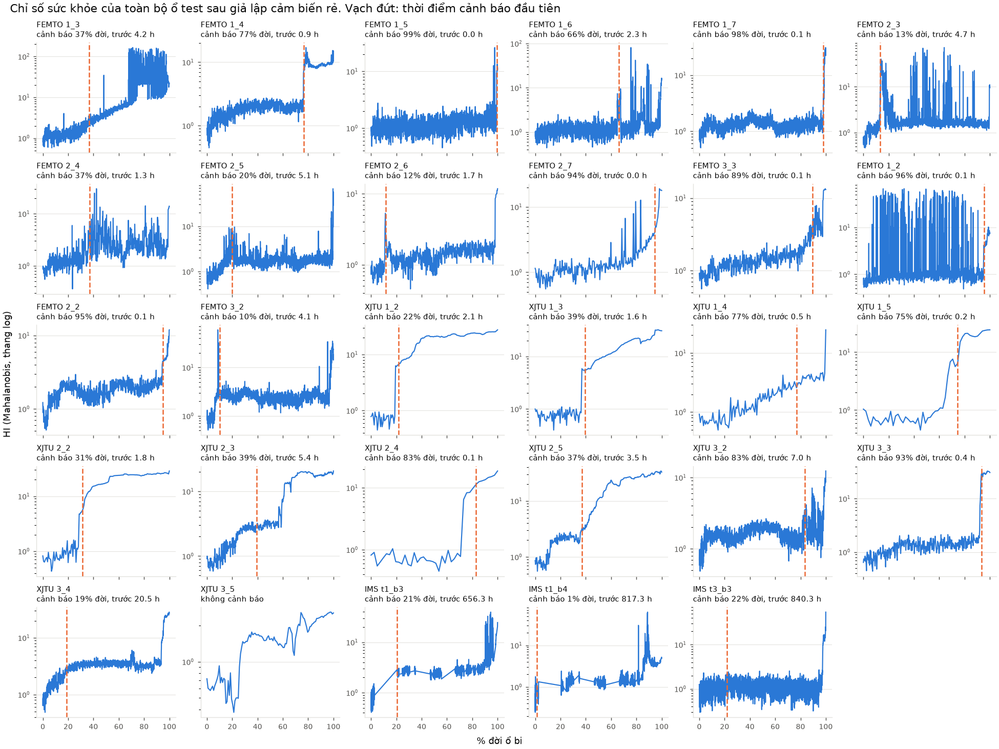

# Kết quả sơ bộ TN1, TN2, TN3 — 31/10/2026

**Chạy trên CPU, chỉ với dữ liệu công khai, chưa có dữ liệu DENSO.** Minh chưa rà soát các số liệu này.

Kết quả tiếp theo, gồm TN2b đạt cổng G1b: [báo cáo 01/11](KET_QUA_TN2B_TN3B_REALTIME_20261101.md).

## Kết luận

| Thí nghiệm | Kết quả | Có thể nói gì ở buổi thứ Ba |
|---|---|---|
| TN1, cảm biến rẻ trên CWRU | Accuracy 99,72% → 87,99% ở 3 HP, chỉ còn 49,58% ở 1 HP | Lỗi bi mất nhiều nhất. Kết quả không ổn định khi đổi tải |
| TN2, cấy lỗi trên Paderborn | **Nhánh chính A trượt cổng G1:** 0,463 so với C 0,716 | Hiệu chỉnh trên 2 ổ làm kết quả xấu đi. Bản chưa hiệu chỉnh đạt 0,824 nhưng **chưa phải kết quả xác nhận** |
| TN3, xu hướng trên FEMTO, XJTU-SY, IMS | HI cảnh báo được, nhưng dự báo thời gian còn lại **chưa dùng được** (α-λ 3–13%) | Chỉ trình bày cảnh báo, không trình bày RUL |

## TN1 — Cảm biến rẻ có đủ không?

**Thiết lập.** Dùng lại đúng detector real-only của MVP: 8 cửa sổ/lỗi + 20 bình thường ở 0 HP, ngưỡng từ 2 HP, seed 11/29/47. Mỗi tầng chỉ thêm một biến.

**Kiểm tra nền.** S0 tái lập đúng số MVP đã khóa trên Linux: accuracy 99,72%, FPR 4,52%, seed xấu nhất 6,78%. SHA-256 của mọi tệp CWRU khớp `records.json`.

| Tầng | Acc 3 HP | Acc 1 HP | Bình thường | Vòng trong | Vòng ngoài | Bi | Recall báo động | FPR | AUC |
|---|---:|---:|---:|---:|---:|---:|---:|---:|---:|
| S0 gốc 12 kHz | 99,72% | 100% | 98,9% | 100% | 100% | 100% | 100% | 4,5% | 1,000 |
| S1 hạ 4 kHz | 93,64% | 75,71% | 98,3% | 90,4% | 100% | 85,9% | 100% | 30,5% | 1,000 |
| S2 + lọc 1 kHz | 88,56% | 50,42% | 93,2% | 100% | 100% | 61,0% | 76,5% | 1,7% | 0,922 |
| S3 + nhiễu 25 µg/√Hz | 87,99% | 49,58% | 91,5% | 100% | 100% | 60,5% | 76,5% | 1,1% | 0,917 |
| **S4 đủ chuỗi ±8 g, 20 bit** | **87,99%** | **49,58%** | **91,5%** | **100%** | **100%** | **60,5%** | **76,5%** | **1,1%** | **0,916** |
| S5 ±4 g | 87,99% | 49,58% | 91,5% | 100% | 100% | 60,5% | 76,5% | 1,1% | 0,917 |
| S6 ±2 g | 89,27% | 56,78% | 97,7% | 100% | 100% | 59,3% | 76,5% | 1,1% | 0,939 |
| S7 nhiễu 100 µg/√Hz | 89,97% | 54,94% | 97,2% | 100% | 99,4% | 63,3% | 76,8% | 0,6% | 0,933 |
| S8 12 bit | 87,29% | 48,31% | 88,7% | 100% | 97,7% | 62,7% | 78,0% | 1,7% | 0,911 |
| S9 lọc 500 Hz | 84,18% | 92,23% | 98,3% | 100% | 57,6% | 80,8% | 74,4% | 1,7% | 0,933 |

Các cột theo lớp là của 3 HP.

**Diễn giải.**
- Mất mát chủ yếu đến từ **hạ băng thông** (S1, S2). Nhiễu, lượng tử hóa và cắt đỉnh thêm rất ít, kể cả khi làm xấu đi (S5–S8). Tức là nên hỏi DENSO về băng thông thật trước các thông số khác.
- Đọc riêng 3 HP sẽ quá lạc quan. Ở 1 HP, S4 chỉ còn: bình thường 26,6%, vòng trong 100%, vòng ngoài 61,0%, bi 10,7%. Sau khi làm rẻ, mô hình học từ một tải **không chuyển được sang tải khác**.
- Thứ tự S9 đảo ngược giữa hai tải (1 HP 92% nhưng 3 HP 84%, và FPR ở 1 HP là 96%), nên **không** kết luận được lọc 500 Hz tốt hơn.

**Giới hạn.** 3 HP đã công bố từ MVP nên đây là so sánh mô tả, không phải kiểm chứng mới. Mỗi lớp chỉ có một bản ghi, chỉ huấn luyện 8 cửa sổ/lỗi. Đơn vị g và tần số 48 kHz của bản ghi bình thường là giả định.

## TN2 — Cấy lỗi có thay được việc chờ máy hỏng không?

**Thiết lập.** Chia theo ổ bi, ghi trong [giao thức](../../anchorspec/PROTOCOL_TN2.md) trước khi đọc ổ test. Test gồm 9 ổ hỏng thật và 2 ổ bình thường. Mở test một lần, sau khi freeze và ghi hash. Tất cả qua giả lập cảm biến rẻ. Thông số 6203 lấy từ Lessmeier et al. 2016.

| Nhánh | **Chỉ số chính** | Theo seed | Vòng trong | Vòng ngoài | Ổ đúng/9 theo seed | Đúng loại khi đã biết bất thường | Bình thường | AUC |
|---|---:|---|---:|---:|---|---:|---:|---:|
| **A, cấy đã hiệu chỉnh (nhánh chính)** | **0,463** | 0,455 / 0,470 / 0,463 | 0,207 | 0,719 | 4 / 3 / 4 | 0,462 | 0,560 | 0,980 |
| A0, cấy chưa hiệu chỉnh | 0,824 | 0,880 / 0,787 / 0,806 | 0,932 | 0,717 | 9 / 8 / 7 | 0,828 | 0,552 | 0,978 |
| B, hỏng nhân tạo | 0,575 | 0,546 / 0,594 / 0,586 | 0,353 | 0,798 | 4 / 5 / 5 | 0,574 | 0,535 | 0,981 |
| C, CWRU nguyên khối | 0,716 | 0,741 / 0,705 / 0,702 | 0,777 | 0,655 | 7 / 6 / 6 | 0,756 | 0,965 | 0,990 |
| C2, lỗi CWRU + nền máy | 0,513 | 0,527 / 0,475 / 0,538 | 0,522 | 0,505 | 4 / 4 / 4 | 0,759 | 1,000 | 0,996 |

| So sánh (CI 95% bootstrap theo ổ bi) | Hiệu | CI 95% |
|---|---:|---|
| **A − C (cổng G1)** | **−0,253** | **−0,367 … −0,132** |
| A − C2 | −0,051 | −0,266 … +0,177 |
| A − B | −0,113 | −0,298 … +0,043 |
| A − A0 | −0,361 | −0,470 … −0,212 |
| A0 − C | +0,108 | +0,037 … +0,183 |
| A0 − C2 | +0,311 | +0,152 … +0,458 |

**Quan sát.**
- **Cổng G1 không đạt** với nhánh đã khai báo là chính. Chỉ tiêu 80% cũng không đạt.
- Dev dự báo sai hẳn: trên dev A 0,892 > A0 0,433, nhưng trên test A 0,463 < A0 0,824. Số dev của A là trong mẫu vì KA22/KI21 dùng để hiệu chỉnh.
- A coi phần lớn ổ vòng trong là vòng ngoài. Ví dụ seed 11, KI04 có 78/80 cửa sổ bị gán vòng ngoài.
- Mọi nhánh yếu ở KA15 và KA30, hai ổ biến dạng dẻo (0,01–0,75 tùy nhánh). Nhóm mỏi rỗ thường dễ hơn, nhưng các ổ vòng trong vẫn sai nhiều ở A và B.
- K005 bình thường bị gọi là lỗi ở A, A0, B (đúng 7–27%), trong khi K006 đúng 85–100%.

**Diễn giải (giả thuyết, chưa kiểm chứng).** Hiệu chỉnh riêng từng lớp trên một ổ đã biến biên độ thành dấu hiệu phân lớp giả: trung vị biên độ tương đối ở seed 11 là 0,30 (trong) so với 0,69 (ngoài), còn A0 là 0,73 và 0,91. Những ổ vòng trong nặng hơn KI21 vì vậy bị gán vòng ngoài. **Thí nghiệm tiếp:** hiệu chỉnh dùng chung biên độ cho mọi lớp, hoặc dùng nhiều ổ dev.

**Về A0.** Đây là tín hiệu đáng theo đuổi và A0 thắng C với CI dương, nhưng **không được báo là cách AnchorSpec đã thắng**: A0 không phải nhánh khai báo chính, và dev từng xếp nó thấp. Chọn A0 sau khi xem test là chọn lại trên test. Cần giao thức mới và ổ bi chưa dùng. Ở điều kiện này không còn ổ Paderborn nào chưa dùng ngoài KB23/KB24/KB27 hỏng cả hai vòng.

**E6, phụ.** B với tín hiệu gốc 64 kHz đạt 0,707 (7/9 ổ), B cảm biến rẻ đạt 0,575. Vòng trong tăng từ 0,353 lên 0,922, nhưng vòng ngoài giảm từ 0,798 xuống 0,492 và AUC giảm từ 0,981 xuống 0,653. Kết quả lẫn lộn, cùng bộ đặc trưng chỉ đổi thang tần số, chưa đủ làm căn cứ khuyến nghị phần cứng.

**Giới hạn.**
- Mọi ổ Paderborn cùng một giàn thử; chỉ một trục, nên chưa kiểm được góc nhìn giữa các trục.
- Chỉ 2 ổ bình thường test, 2 ổ lỗi dev. CI theo ổ dựa trên 4 và 5 ổ mỗi lớp, nên phải đọc thận trọng.
- Đơn vị kênh rung Paderborn không được ghi. Giả định m/s²; dev khi coi là g cho cùng thứ tự các nhánh.
- **Bộ ước lượng tốc độ từ phổ không đạt:** sai số trung vị 2–5%, lớn nhất ~10% trên K001–K003. TN2 dùng tốc độ danh định, nên bước này của kế hoạch v1.4 **chưa được kiểm chứng**.
- Công thức vòng cách, dị vật, hết dầu đã viết và có kiểm thử đơn vị, nhưng chưa được đối chiếu với lỗi thật nào.

## TN3 — Dự báo xu hướng

**Thiết lập.** HI là khoảng cách Mahalanobis tới 30 bản ghi đầu của chính ổ đó, tham chiếu cố định. Cảnh báo khi vượt ngưỡng 5 bản liên tiếp. Hệ số ngưỡng và HI hỏng chọn trên ổ dev theo từng bộ dữ liệu; ổ test báo một lần với bộ tham số đó.



| Bộ dữ liệu, cảm biến | Ổ test | k | Cảnh báo ở % đời (trung vị) | Lead trung vị | RMS baseline cảnh báo ở | α-λ (α=0,2) | PHM ở 50% | Ổ có HI vượt ngưỡng dưới 50% thời gian sau cảnh báo |
|---|---:|---:|---:|---:|---:|---:|---:|---:|
| FEMTO, rẻ | 14 | 15 | 71% | 1,12 h | 94% | 2,9% | 0,035 | 6 |
| FEMTO, gốc | 14 | 15 | 23% | 3,60 h | 98% | 6,3% | 0,121 | 1 |
| XJTU-SY, rẻ | 12 (1 không cảnh báo) | 15 | 39% | 1,83 h | 67% | 13,0% | 0,133 | 1 |
| XJTU-SY, gốc | 12 | 15 | 42% | 1,71 h | 54% | 8,9% | 0,110 | 0 |
| IMS, rẻ | 3 | 3 | 21% | 817 h | 21% | 5,8% | 0,000 | 1 |
| IMS, gốc | 3 | 3 | 6% | 822 h | 4% | 4,8% | 0,000 | 1 |

**Quan sát.**
- HI cảnh báo sớm hơn RMS ở FEMTO và XJTU-SY. Trên FEMTO, cảm biến rẻ làm cảnh báo muộn đi rõ rệt (71% so với 23% đời). Trên XJTU-SY chênh lệch nhỏ.
- **RUL chưa dùng được:** α-λ 3–13%, PHM đa số gần 0. Khớp log-tuyến tính không theo được đường HI thật, vốn thường nhảy bậc rồi đi ngang (xem hình).
- **Lead time ở đây là cận trên lạc quan, đừng trích riêng.** Không có nhãn thời điểm khởi phát nên không tách được cảnh báo đúng và cảnh báo sai. Hình cho thấy nhiều cảnh báo sớm đi vào đoạn HI còn phẳng. IMS `t3_b3` cảnh báo ở 22% đời dù đường HI gần như phẳng tới cuối, nên 840 h **không** phải thời gian cảnh báo trước thật. HI tăng ngay từ đầu ở nhiều ổ cho thấy 30 bản ghi nền có thể quá ngắn, chưa qua giai đoạn chạy rà.

**Giới hạn.**
- Quy tắc chọn k (`≥ 50% đời trên mọi ổ dev`) không thỏa ở FEMTO và XJTU-SY, nên rơi về k lớn nhất là 15. Lưới k chưa đủ, hoặc quy tắc chưa phù hợp.
- IMS: chỉ 1 ổ dev, 3 ổ test; khoảng thời gian có đoạn dừng thí nghiệm. **Bộ thứ 3 không khớp readme:** thư mục tên `4th_test`, 6.324 tệp kéo dài tới 18/04/2004, còn readme ghi 4.448 tệp tới 04/04/2004.
- Đơn vị IMS không được ghi; FEMTO và XJTU-SY coi là g.
- HI so với nền ngay đầu đời ổ, trong khi thực tế DENSO có thể bắt đầu theo dõi ở giữa đời.

## Việc nên làm tiếp

1. Viết giao thức TN2b: hiệu chỉnh chung biên độ giữa các lớp, kiểm chứng trên điều kiện vận hành **và** ổ chưa dùng; Minh duyệt trước khi chạy.
2. Sửa bộ ước lượng tốc độ, hoặc xác nhận DENSO cung cấp được tốc độ.
3. TN3: dùng nền dài hơn, bỏ giai đoạn chạy rà, thử mô hình từng đoạn hoặc Wiener thay log-tuyến tính.
4. Xác nhận với DENSO mã cảm biến và băng thông thật, vì TN1 cho thấy đây là biến ảnh hưởng lớn nhất.

## Tái lập

```bash
conda activate anchorspec    # Python 3.12, anchorspec/requirements.txt
cd anchorspec
python test_anchorspec.py
python tn1_cwru_cheap.py
python tn2_paderborn.py prepare   # dev, freeze, test: test từ chối chạy lại nếu đã có test.json
python tn3_trend.py
```

Dữ liệu 37 GB sau giải nén nằm ở `data/`, không vào git; danh sách SHA-256 của 70 tệp tải về ở `anchorspec/results/data_inventory.json`. Bản quyền: Paderborn CC BY-NC 4.0; quyền thương mại và phân phối lại CWRU chưa rõ. Không đưa dữ liệu thô lên repo công khai.
